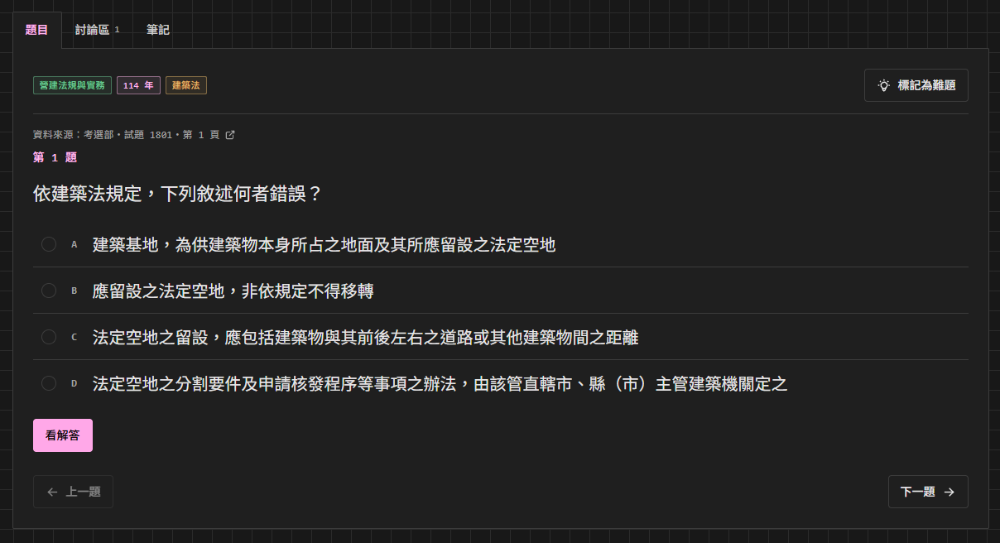
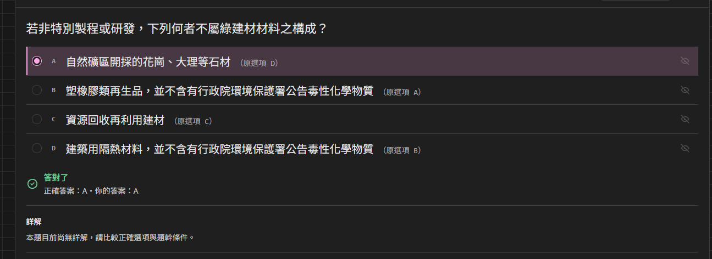
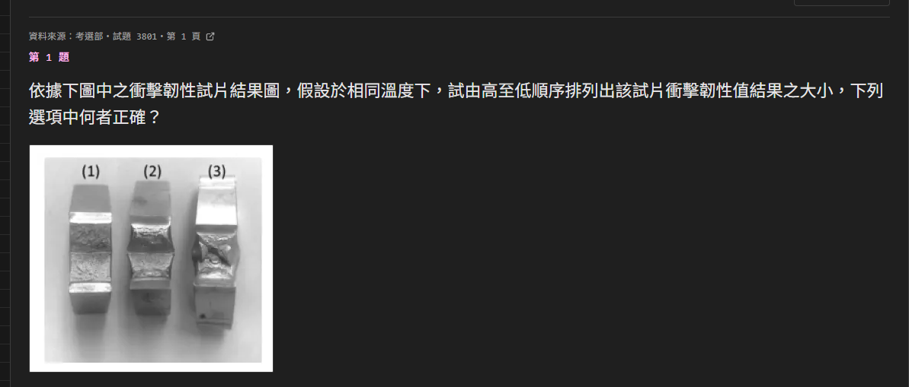
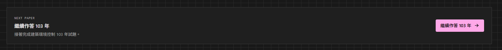
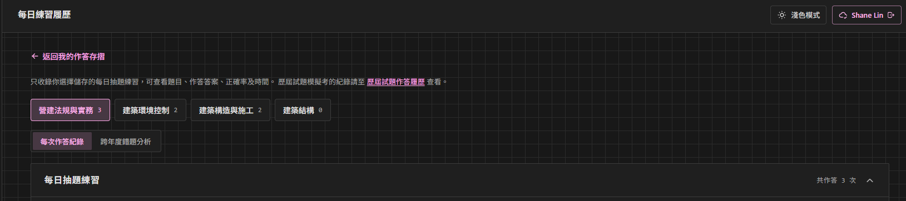
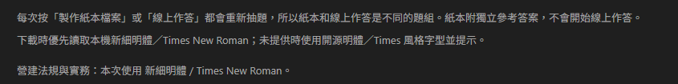

# Todo

已完成的需求請見[歷史紀錄](歷史紀錄/todo-歷史紀錄.md)。
尚待確認的需求請見[待討論](待討論/todo-待討論.md)。

## 1.102 - 2026-11-03

狀態：已實作待審核

 在考古題討論版、每日抽題練習看完答案、歷屆試題模擬考交卷後、難題標記、常錯題目，新增可以複製題目內容(含選項)為文字的選項，方便使用者複製，有圖片的題目可以忽略圖片
 所有題目的圖片都改為無法另存
 繼續作答直接開始該年度，不是連結到選科目選年度的頁面
 每日練習履歷不用有收起展開，直接列出即可
 每日抽題練習的這些字隱藏

實作說明：複製題幹及畫面上的選項順序，不含圖片或原選項提示；每日練習須先看答案。題目圖片與放大圖阻擋右鍵、拖曳及手機長按選單，但無法阻止截圖或其他方式取得圖片。續作保留既有草稿；每日履歷分組直接展開。紙本字型改用替代字型時仍會提示。

## 1.105 - 2026-11-03

狀態：未實作

原始需求：過幾天去 search console 檢查 index 情況

以下由網站管理者在 Search Console 手動檢查，不需要改程式。11 月 3 日已提交 sitemap（共 3,749 頁），也對 6 個網址按過 Request indexing。新網站收錄得慢，11 月 6 日以後再看。

- [ ] 到左邊的 Indexing > Pages，看 Indexed 和 Not indexed 各有幾頁。
- [ ] 在同一頁的 Why pages aren't indexed 看沒收錄的原因：
  - Discovered - currently not indexed、Crawled - currently not indexed：Google 還沒排到，先等。過兩三週大部分還停在這裡，再截圖給 ai agent 看。
  - Blocked by robots.txt：難題標記、常錯題目、設定這類個人頁面本來就不讓 Google 收錄，正常。
  - Alternate page with proper canonical tag、Page with redirect：同一頁的另一個網址，例如後面帶參數的連結，正常。
  - 其他原因截圖給 ai agent 看。
- [ ] 到最上面的 URL Inspection 查 11 月 3 日送過的 6 個網址，看是不是變成 URL is on Google：
  - `https://exam-tw.vercel.app/`
  - `https://exam-tw.vercel.app/exams`
  - `https://exam-tw.vercel.app/exams/law/114`
  - `https://exam-tw.vercel.app/exams/env/114`
  - `https://exam-tw.vercel.app/exams/construction/114`
  - `https://exam-tw.vercel.app/exams/structure/114`
- [ ] 到 Performance 看 Total clicks 和 Total impressions 有沒有開始出現，以及別人搜尋哪些字找到本站。
