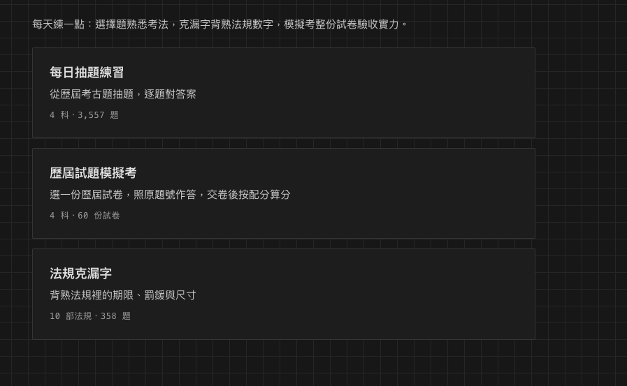
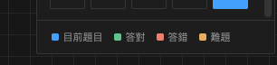
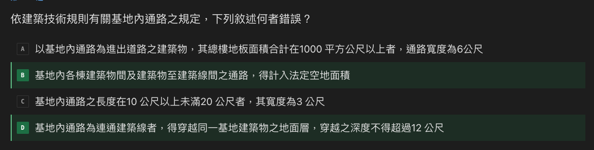
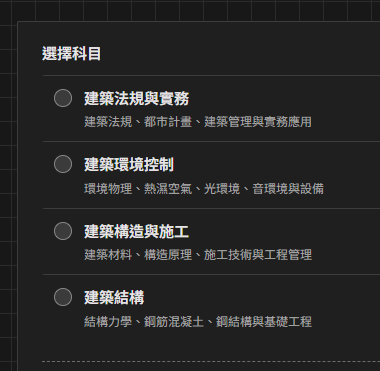
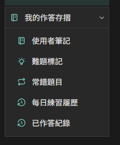
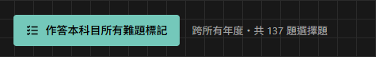

# Todo

已完成的需求請見[歷史紀錄](歷史紀錄/todo-歷史紀錄.md)。
尚待確認的需求請見[待討論](待討論/todo-待討論.md)。

## 1.82 - 2026-10-25

狀態：已實作待審核

### 2026-10-26 補充

 每日抽題練習不要保留選擇的科目，每次進去都重新選科。

- 每日練習裡面的排版比照首頁的方式橫向排列三個，個別區塊可以大一點。
- 首頁加入考試倒數時間，115 年建築師考試日期是 11 月 14～16 日，放在最上面可以大一點。
- 首頁也加入「每日抽題練習」的捷徑。

補充實作狀態：已實作待審核。

- [x] 每次由首頁捷徑、每日練習入口或 `/practice/quiz` 進入都先顯示未選科的設定，需選科才能線上作答或製作紙本；不沿用上次科目。
- [x] 未完成進度保留，需主動按「繼續未完成練習」才恢復；開始新題組會先確認取代。作答中的重新整理、題號連結與歷史紀錄重做仍可直接作答，不刪除既有成績／筆記。
- [x] 每日練習總覽解除 720px 限寬，桌機三張大卡橫排並放大；平板／手機依可用寬度改直排，維持原有三項順序。
- [x] 首頁最上方加入大型考試倒數，日期依[考選部公告](https://wwwc.moex.gov.tw/main/exam/wFrmExamDetail.aspx?c=115180)設定為 2026/11/14～11/16。使用臺灣日期計算，每分鐘及回到分頁時更新；考試期間與結束後顯示對應狀態，不出現負天數或靜態建置日凍結的倒數。
- [x] 首頁新增「每日抽題練習」整區可點的捷徑，保留原四科模擬考入口。
- 驗證：582 項單元測試通過、1 項略過；40 項電腦／手機瀏覽器測試通過（含跨時區與日期邊界）；型別檢查、lint、正式建置通過。Storybook 同步更新首頁日期控制、總覽、設定與未完成進度範例，實際檢查淺色／深色共 8 個畫面在桌機、平板與 320px 手機的顯示及操作。

說明：這段補充原先放在歷史紀錄末尾，已保留文字與圖片並歸回本需求下待審核，未將本次實作自動歸檔。

修改標題名稱
歷屆試題改成 “考古題討論版“
統計分析改成 ”歷屆試題資料集成“

選擇題練習改成”每日抽題練習“
歷屆試題模擬考移到第二個
法規克漏字移到最下面

 此項目展開不要往右展開，往下展開（在同一個筐內）
 每日練習的交卷刪除
 每日練習下方這個標記說明都刪除
 常錯題目跟難題標記都新增”作答本科目所有難題標記“功能，讓使用者可以對該科的難題或錯題再次作答（類似每日練習的樣式不是個別題目練習）

### 實作說明

- 側欄、頁首、瀏覽器標題、入口連結與 Storybook 名稱同步更新；每日練習依序為「每日抽題練習」「歷屆試題模擬考」「法規克漏字」。
- 「我的作答存摺」在側欄同一個外框內向下展開；保留桌機滑入、點擊、鍵盤與手機抽屜操作。
- 每日抽題練習移除右側交卷按鈕，以最後一題的「完成練習」結束；未作答仍會先確認，且不計入正確率。模擬考保留交卷流程。
- 每日練習的作答與模擬考結果不再顯示題號下方的標記說明；題號的狀態色與無障礙標籤保留。
- 難題標記／常錯題目各有本科目整組重練入口，跨所有年度、去重且不限 50 題；僅納入可作答的選擇題，不混入其他科目或申論題。
- 整組重練沿用滿版作答、選項打亂、逐題對答案、筆記、續作與結果功能。取代既有進度前會確認；不會自動刪除難題標記或過去錯題紀錄。
- 超過 200 題的重練結果分筆保存，沿用現有 Firestore 每筆 200 題限制，不需放寬規則。
- 依使用者指示，直接在 `main` 修改並建立本需求的獨立 commit，不另開分支。
- 驗證：型別檢查、lint、正式建置通過；546 項單元測試通過、1 項略過。瀏覽器案例共 96 項通過、12 項略過（全站路由巡覽逾時後，單獨重跑通過）；另完成 12 項 Storybook 實際畫面與操作檢查。

## 1.83 - 2026-10-27

狀態：已實作待審核

 難題標記不會正常顯示詳解。

 難題標記與常錯題目的作答入口新增進階選項（點進去之後設定），因為一次做太多題目了，讓使用者可以設定題數。

### 實作說明

- 難題標記、常錯題目與每日練習共用詳解顯示方式，同時呈現題庫內建詳解、共享詳解、補充、勘誤及附圖；不把提問當成詳解。
- 修正原先只讀內建詳解、漏掉共享投稿的原因。讀取中、讀取失敗與真正沒有詳解會分別提示，不再把未載入的共享內容誤報為「目前尚無詳解」。
- 清單展開後才開始讀取該題共享內容與建立筆記編輯器；收合後保留未儲存的筆記草稿。
- 點擊本科目重練入口先開啟進階設定，預設最多 50 題，可選常用題數、自訂 1 至本科目總題數的整數，或明確選擇全部；也可設定是否打亂選項。
- 題目跨所有年度、限定本科目並去重，只納入可作答的選擇題。未選全部時隨機抽取且不重複；選全部仍保留原題序及超過 50 題的能力。取消設定不修改進度，開始前仍先確認是否取代未完成練習，原有難題標記與作答紀錄都保留。
- 依本次指示一併納入 6 張整理圖片：法規的「防火時效構造」「隔音構造」「無障礙設計規範」，以及環控的「光環境」「音環境」「熱環境」。原有 8 張圖片與資料未更動，原圖、縮圖及索引完整。
- 驗證：603 項單元測試通過；24 項電腦／手機瀏覽器測試通過、2 項依平台略過；型別檢查、lint、正式建置通過。已檢查 Storybook 在淺色／深色、桌機／平板／320px 手機共 12 組畫面與設定操作；6 張新圖片在桌機與手機共 12 次實際載入及放大檢查通過，全部 28 個圖檔均可解碼且尺寸與索引一致。

## 1.84 - 2026-10-27

狀態：已實作待審核

在「我的作答存摺」新增「每日練習履歷」，紀錄每日抽題練習內容並支援刪除。每日抽題練習結束時讓使用者選擇是否記錄，有選擇儲存才加入履歷。

範圍確認：本次僅針對「每日抽題練習」，不調整難題／常錯題重練、歷屆試題模擬考或法規克漏字的原有紀錄流程。

### 實作說明

- 新增「我的作答存摺 → 每日練習履歷」入口與獨立頁面，可依科目查看選擇儲存的練習，顯示作答日期、完整題組、答案、正確率、未作答數與作答時間；保留詳解、筆記、錯題分析與再做一次功能。
- 每日抽題練習結束後先顯示結果及「儲存此次作答／不記錄此次作答」。未選擇儲存不新增履歷或作答統計，也不因離開、重新整理而自動儲存；已獨立儲存的筆記與難題標記不受影響。
- 選擇不記錄後，在本次結果仍顯示時可以改為儲存。儲存後顯示履歷入口，重複點擊或返回結果不會新增重複紀錄；未作答題目保留在題組內，但不計入正確率。打亂的答案會轉回原試卷選項，確保日後檢討正確。
- 每筆履歷提供刪除確認，可取消。刪除只移除該次紀錄，其他練習、模擬考、筆記與難題標記均保留；沿用現有雲端同步與刪除標記，不需另外修改 Firestore 規則。
- 新履歷只收錄本次功能上線後明確選擇儲存的每日抽題練習；舊版自動紀錄的來源無法完整區分，因此不自動搬移，全部留在「已作答紀錄」。新儲存的同一筆資料也維持可在既有紀錄頁檢視，並非重複存兩份。
- 驗證：616 項單元測試通過，型別檢查、lint、正式建置通過。電腦／手機共 55 項瀏覽器案例通過，1 項依平台略過；包含儲存、拒絕儲存、未決定即離開、重整、刪除與舊流程相容性。Storybook 實際檢查結果選擇、已有履歷與空白履歷在淺色／深色、桌機／320px 手機共 12 組顯示及操作。

## 1.85 - 2026-10-27

狀態：已實作待審核

 每種練習的小字說明更新：

- 每日抽題練習：從歷屆考古題抽題，並隨機打亂選項，適合讀書已有一定實力的考生。
- 歷屆試題模擬考：自選 100～114 年任一份考古題，模擬考試時的實際作答，適合全部考生。
- 法規克漏字：適合法規已經背誦到滾瓜爛熟，想挑戰自我的考生。

 選擇科目時，科目名稱下面的小字說明全部刪除。

 「使用者筆記」改成「我的筆記」；「已作答紀錄」改成「歷屆試題作答履歷」。

 「作答本科目所有難題標記」改成「練習本科目難題標記」，常錯題目比照改成「練習本科目常錯題目」。

### 實作說明

- 三種練習的說明依需求更新，並將「被送到」「做答」修正為「背誦到」「作答」。卡片與練習頁共用同一份說明。
- 每日抽題選科列只保留科目名稱，選中後也不再補上題庫數量小字；讀取中與載入失敗時同樣不顯示。保留進階選項、題數設定及其他區域的必要狀態資訊，科目列維持可觸控高度並垂直置中。
- 導覽、頁首、瀏覽器標題、筆記編輯區、相關連結、無障礙名稱與 Storybook 同步使用新名稱。網址仍為 `/notes`、`/history`，既有書籤、筆記、履歷與雲端資料不變。
- 難題與常錯題入口改用新文字，仍先開啟題數設定；選取、取消、跨年度抽題及保護未完成進度的流程不變。
- 額外筆記回歸測試發現手機模擬器的桌面全選快捷鍵沒有選到文字，已修正測試的手機選取方式並確認實際選取範圍；未改動網站編輯器功能。
- 驗證：619 項單元測試通過，型別檢查、lint、正式建置通過。電腦／手機共 33 項瀏覽器案例通過、1 項依平台略過（手機選取案例修正測試操作後重跑通過）。Storybook 完成總覽、選科、筆記、履歷及兩個本科目練習入口在淺色／深色、桌機／320px 手機共 24 組畫面與操作檢查，沒有水平溢出。

## 1.86 - 2026-10-30

狀態：已實作待審核

- [x] 考古題討論版的每一題分成三個分頁：「題目」「討論區」「筆記」。換題時會停在目前的分頁，也可以把某一題的討論區或筆記連結分享給別人。
- [x] 目前所在的分頁像資料夾的標籤：用和面板一樣的深色框線圍起來、底部打開，和下方的面板連成一張紙；其他分頁放在方格紙上。手機上三個分頁平分整列。
- [x] 「題目」分頁可以先作答，再按「看解答」：會顯示答對或答錯、正確答案和題目詳解，也可以「重新作答」。沒選答案也能直接看解答；申論題只顯示詳解。這裡的作答只是練習，不會記入我的作答存摺。
- [x] 「討論區」分頁放大家分享的內容和投稿表單，分頁名稱後面會顯示投稿數。
- [x] 「筆記」分頁可以直接在這一題寫筆記，能加圖片、編輯、刪除或分享到討論區；內容和「我的筆記」頁是同一份。
- [x] 「類似考題」改名為「同考點考古題」：寫出考點名稱和共出現幾次，列出其他年度考過同一考點的題目，最新的在前面，超過 8 題可以展開全部。考古題討論版和我的筆記頁都看得到；目前只有法規科目有這一塊。
- [x] 用手機、平板或較窄的視窗看時，第幾題、上一題／下一題和「題號」按鈕會固定在上方，按「題號」從下方滑出所有題號；科目與年度選擇收成一列，點一下才展開。

## 1.88 - 2026-10-30

狀態：已實作待審核

原始需求：考古題討論版設計評審（2026-10-29）發現「一律給分」題目的四個選項全部標成綠色正確答案，卻沒有任何文字說明，首次造訪的考生會以為資料錯了。

- [x] 一律給分的題目在選項上方顯示「本題一律給分，四個選項都算正確。」；考古題討論版、歷屆試題作答履歷的逐題檢討、每日練習的作答檢討與閱讀設定預覽都一樣。

使用方式：打開任何一律給分的題目（例如法規 101 年第 17 題），選項上方會看到說明。

### 實作說明

- 說明只在一律給分的題目出現；選項列的綠色標示與「正確答案」小字維持不變。
- 驗證：622 項單元測試通過、1 項略過；型別檢查與 lint 通過；介面細節瀏覽器案例 4 項通過（每日練習滿版與紙感細節，淺色／深色各一）。

### ai agent 實作時的決定

- 選項列維持四列都標成正確，只補一行說明，沒有改成單一綠線：作答履歷裡使用者選過的那一列仍要和正確答案同色，改成單線會讓那一列看起來像答錯。

## 1.89 - 2026-10-30

狀態：已實作待審核

原始需求：考古題討論版設計評審（2026-10-29）P1：「檢舉」與「刪除回覆」按一下就生效、無法撤回；貼文下方的動作按鈕在手機上太小又擠在一起；貼文「編輯」模式的工具列與編輯區排成左右兩欄。

- [x] 按「檢舉」會先跳出確認視窗，說明檢舉後無法取消，確認後才送出並顯示「已送出檢舉」；雲端模式未登入時檢舉按鈕先停用。
- [x] 「刪除回覆」也先確認再刪除；留言管理頁的刪除回覆比照。
- [x] 貼文下方的讚、加入我的筆記、檢舉、編輯、刪除按鈕改成和全站相同的大小與間距，手機上更容易點；「刪除」改成紅字的文字按鈕，不再是整個討論區最醒目的紅框。
- [x] 修正編輯投稿時工具列與編輯區並排的問題，改回上下排列。

使用方式：在考古題討論版任一則投稿按「檢舉」或「刪除回覆」，會先看到確認視窗。

### 實作說明

- 確認視窗沿用全站的樣式；檢舉用琥珀色提示，刪除維持紅色。
- 驗證：624 項單元測試通過、1 項略過（含本次新增的兩項：檢舉前先確認、編輯動作列在編輯區下方）；型別檢查與 lint 通過；考古題討論版、解說格式、筆記編輯器的瀏覽器案例共 7 項通過。

### ai agent 實作時的決定

- 檢舉的確認視窗用琥珀色而不是紅色：檢舉不是刪除，紅色會讓人以為內容會消失。
- 「刪除」投稿改成紅字的文字按鈕，保留危險動作的辨識度；沒有做成「更多」選單，避免多一層操作。
- 沒有加「取消檢舉」：雲端規則不允許撤銷，確認視窗已經說明檢舉後無法取消。
- 評審列出的次要觀察（按過讚的紅色、原生下拉選單等）本次未處理，不在 P1 範圍。

## 1.90 - 2026-10-30

狀態：已實作待審核

原始需求：考古題討論版設計評審（2026-10-29）的檢測器把空狀態的「圖示方塊疊在標題上」列為命中，而且沒有投稿時那塊空狀態太高、把投稿表單往下推；使用者決定改成兩行文字、拿掉圖示方塊。

- [x] 全站的「還沒有內容」「正在載入」「載入失敗」「找不到題目」等畫面改成標題加一行說明的兩行文字，不再有圖示方塊，高度也縮小；原有的按鈕（重新載入、開始練習等）保留。

使用方式：考古題討論版沒有投稿時、作答履歷沒有紀錄時、題庫載入中或失敗時都會看到新的樣子。

### 實作說明

- 影響考古題討論版、我的筆記、難題標記、常錯題目、作答履歷、考題分析、法規資料庫共 24 處畫面。
- 驗證：622 項單元測試通過、1 項略過；型別檢查與 lint 通過；考古題討論版題庫載入失敗的瀏覽器案例 1 項通過；Storybook 檢查淺色／深色、桌機／手機共 24 張畫面。

### ai agent 實作時的決定

- 文字維持置中；標題用較深的淡墨、說明用淡墨：直接放在方格紙上的空狀態仍要看得清楚。
- 難題標記、常錯題目、作答履歷清單區原本的最小高度保留，避免資料載入前後畫面跳動；只有空狀態本身變矮。
- DESIGN.md 的空狀態描述另外一個 commit 更新。

## 1.91 - 2026-10-30

狀態：已實作待審核

原始需求：

新增一個頁面 我的作答存摺點下去的頁面
頁面上放自己的活動熱力圖參考 github leetcode
使用 github style heatmap，每個月份中間不需要間距
熱力圖每個小方塊hover時候顯示 幾月幾號幾題，例如 10/10, 50題
熱力圖下方放子頁面的連結
nav bar移除子頁面連結

github

leetcode

補充需求：我的作答存摺這幾個子頁面加上返回我的作答存摺的按鈕

- [x] 新增「我的作答存摺」頁面，點側欄的「我的作答存摺」直接打開這一頁。
- [x] 頁面上方是過去一年的作答活動熱力圖：一格一天、依每天作答題數分五個深淺、月份連續排列不留間距、上方標月份、左側標星期；標題顯示「近一年寫了 N 題」，旁邊顯示「活動 N 天・最長連續 N 天」。
- [x] 滑鼠移到格子上，立刻顯示那一天的日期與題數，例如「10/10, 50題」。
- [x] 手機上可以左右捲動看整年，預設停在最近的日期。
- [x] 熱力圖下方一列一個子頁面：我的筆記、難題標記、常錯題目、每日練習履歷、歷屆試題作答履歷，各有一行說明，整列都能點。
- [x] 側欄拿掉子頁面連結，「我的作答存摺」不再展開選單；進到子頁面時，側欄仍標示「我的作答存摺」。
- [x] 補充調整：我的筆記、難題標記、常錯題目、每日練習履歷、歷屆試題作答履歷的頁面上方都有「返回我的作答存摺」，點一下回到我的作答存摺。

使用方式：點側欄的「我的作答存摺」看過去一年的作答活動，滑鼠移到格子上可以看那一天寫了幾題，再從下方點進要看的頁面，看完點頁面上方的「返回我的作答存摺」回來。只要有儲存過作答（模擬考交卷、每日抽題選擇儲存、難題或常錯整組重練）就會顯示在熱力圖上；沒有紀錄時是空白的格子。

### 實作說明

- 子頁面的網址不變，既有書籤與頁面之間的連結都照常。
- 熱力圖計入作答存摺裡的所有紀錄，依台灣日期歸入當天。
- 驗證：675 項單元測試通過、1 項略過；型別檢查、lint、正式建置通過。電腦／手機瀏覽器案例共 150 項通過、12 項略過。Storybook 檢查新頁（有／沒有作答紀錄）、首頁與側欄在淺色／深色、1280／960／390 寬度共 24 張畫面，另看滑過、鍵盤焦點、320px 手機與手機選單；日期提示在最左、最右與有作答的格子都正確且留在面板內。五個子頁面的 23 種狀態在 1280／390 寬度都有一個「返回我的作答存摺」，另看淺色／深色共 20 張畫面。

### ai agent 實作時的決定

- 新頁的網址用 `/personal`；子頁面沒有搬到這個網址底下，舊連結才不會失效。
- 以「作答題數」而不是「作答次數」計算深淺：一份 80 題的模擬考和一組 5 題的每日抽題份量不同。
- 深淺用墨線藍的五個層次而不是 GitHub 的綠色：綠色在這個網站代表答對。
- 範圍是到今天為止的 53 週、每週從星期日開始、月份標籤在上方，和 GitHub 一樣；月份之間不留間距是需求指定。
- 只計算有儲存到作答存摺的紀錄；法規克漏字與單題檢查答案沒有留下日期，不計入。
- 日期不補零（3/5）；沒有作答的日子也會顯示，例如「3/5, 0題」。
- 格子不能點，熱力圖只是概覽；手機沒有滑過的動作，所以看不到日期提示。
- 子頁面做成同一個框裡的清單，不用每日練習那種大卡片：五個頁面排成三欄會留下空格，而且清單的分隔線不能直接畫在方格紙上。
- 每列只放頁面名稱和一行說明，沒有題數、筆記數或進度，也沒有圖示：延續總覽頁保持單純的做法。列尾保留小箭頭，因為一列文字沒有箭頭看起來不像能點。
- 「返回我的作答存摺」的樣子和「返回每日練習」相同，是頁面上方的文字連結，不是有外框的按鈕：兩個總覽底下的頁面用同一種方式回去。不論從哪裡進到子頁面，都是回到我的作答存摺。
