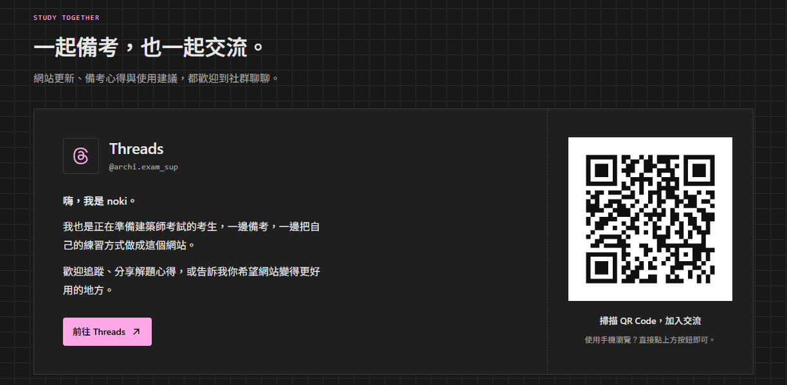
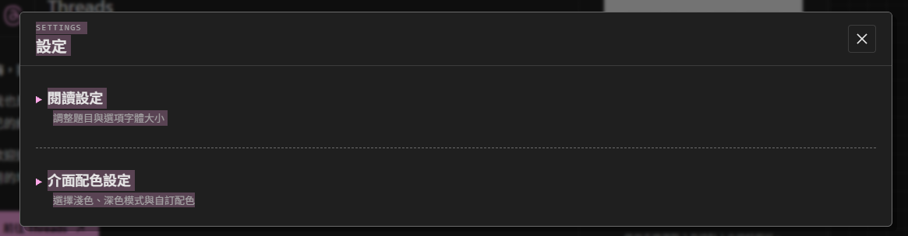
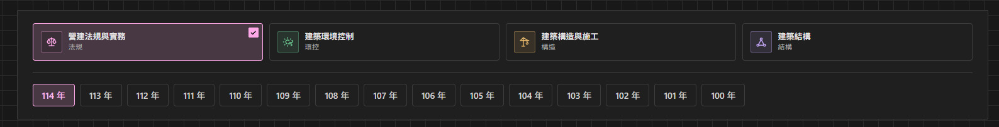
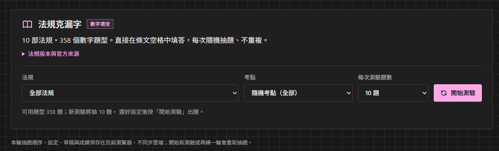
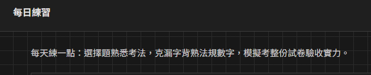
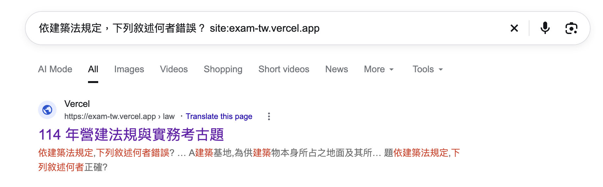
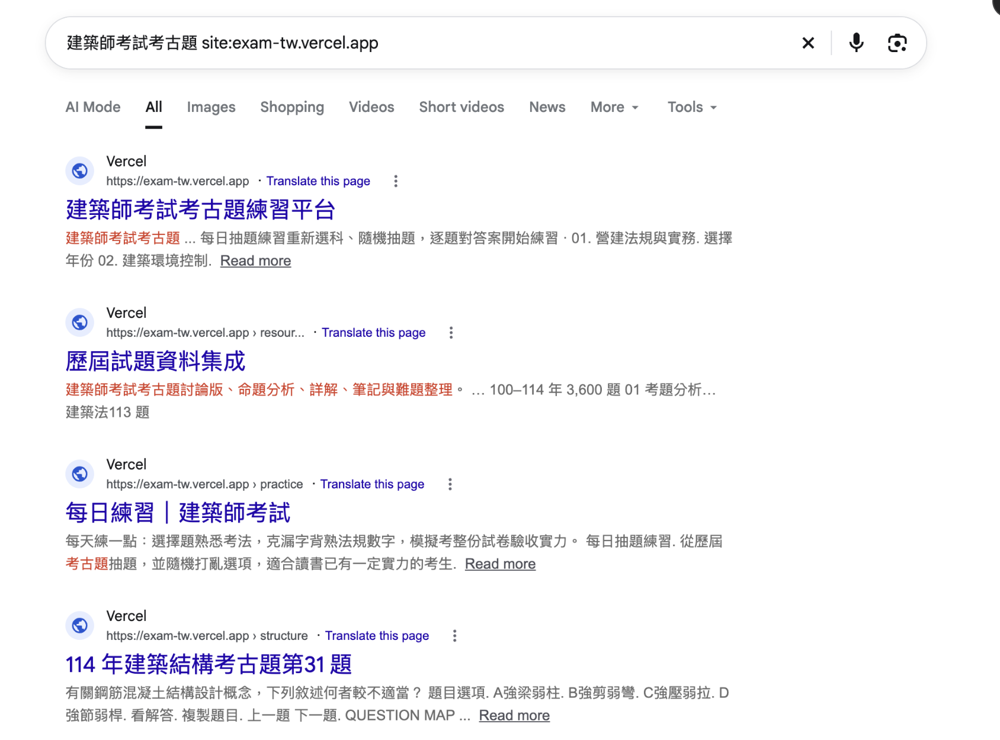

# Todo

已完成的需求請見[歷史紀錄](歷史紀錄/todo-歷史紀錄.md)。
尚待確認的需求請見[待討論](待討論/todo-待討論.md)。

## 1.102 - 2026-11-03

狀態：已實作待審核

 在考古題討論版、每日抽題練習看完答案、歷屆試題模擬考交卷後、難題標記、常錯題目，新增可以複製題目內容(含選項)為文字的選項，方便使用者複製，有圖片的題目可以忽略圖片
 所有題目的圖片都改為無法另存
 繼續作答直接開始該年度，不是連結到選科目選年度的頁面
 每日練習履歷不用有收起展開，直接列出即可
 每日抽題練習的這些字隱藏

實作說明：複製題幹及畫面上的選項順序，不含圖片或原選項提示；每日練習須先看答案。題目圖片與放大圖阻擋右鍵、拖曳及手機長按選單，但無法阻止截圖或其他方式取得圖片。續作保留既有草稿；每日履歷分組直接展開。紙本字型改用替代字型時仍會提示。

## 1.105 - 2026-11-03

狀態：未實作

原始需求：過幾天去 search console 檢查 index 情況

以下由網站管理者在 Search Console 手動檢查，不需要改程式。11 月 3 日已提交 sitemap（共 3,749 頁），也對 6 個網址按過 Request indexing。新網站收錄得慢，11 月 6 日以後再看。

- [ ] 到左邊的 Indexing > Pages，看 Indexed 和 Not indexed 各有幾頁。
- [ ] 在同一頁的 Why pages aren't indexed 看沒收錄的原因：
  - Discovered - currently not indexed、Crawled - currently not indexed：Google 還沒排到，先等。過兩三週大部分還停在這裡，再截圖給 ai agent 看。
  - Blocked by robots.txt：難題標記、常錯題目、設定這類個人頁面本來就不讓 Google 收錄，正常。
  - Alternate page with proper canonical tag、Page with redirect：同一頁的另一個網址，例如後面帶參數的連結，正常。
  - 其他原因截圖給 ai agent 看。
- [ ] 到最上面的 URL Inspection 查 11 月 3 日送過的 6 個網址，看是不是變成 URL is on Google：
  - `https://exam-tw.vercel.app/`
  - `https://exam-tw.vercel.app/exams`
  - `https://exam-tw.vercel.app/exams/law/114`
  - `https://exam-tw.vercel.app/exams/env/114`
  - `https://exam-tw.vercel.app/exams/construction/114`
  - `https://exam-tw.vercel.app/exams/structure/114`
- [ ] 到 Performance 看 Total clicks 和 Total impressions 有沒有開始出現，以及別人搜尋哪些字找到本站。

## 1.106 - 2026-11-04

狀態：已實作待審核

 這個區塊讓字無法選取(不可反白)
 這個區塊讓字無法選取(不可反白)，連帶設定內都一樣
 討論版、考古題選擇、每日練習、法規克漏字選擇葉面讓字無法選取(不可反白)

實作說明：指定的社群區塊、設定視窗與設定頁、科目年度選擇及練習設定區不反白；另處理側欄、頁面標題與首頁／功能入口卡片。題目、條文、詳解、筆記與輸入欄位維持原有選取及編輯功能。

#1.107
 

## 1.108 - 2026-11-04

狀態：已實作待審核

原始需求：你之前加入鍵盤答題 但是操作很不直觀 改成上下用來選擇選項 左右切換下一題上一題

- [x] 歷屆試題模擬考作答時，用上下方向鍵選答案：按下鍵移到下一個選項，按上鍵移到上一個選項。
- [x] 用左右方向鍵換題：左鍵上一題，右鍵下一題。
- [x] 數字鍵 1～4 和 N、P 不再有作用。
- [x] 電腦版作答時間旁的按鍵提示改成「↑↓ 選答案・←→ 換題」。

使用方式：在模擬考作答時按上下鍵選答案，再按右鍵到下一題。

### ai agent 實作時的決定

- 還沒作答時，按下鍵從 A 開始，按上鍵從最後一個選項開始。
- 到第一個或最後一個選項就停住，不會從 D 繞回 A：多按一下不會把答案改到另一端。
- 刪去的選項會直接跳過。
- 按住方向鍵不放只移動一格；在試卷裡按方向鍵不會捲動頁面。
- 在最後一題按右鍵不會交卷，交卷一定要按按鈕。
- 數字鍵和 N、P 拿掉，不和方向鍵並存：同一件事只留一種按法，提示也比較短。
- 按著 Alt、Ctrl、⌘ 或 Shift 的方向鍵留給瀏覽器，例如 Alt＋左鍵是回上一頁。
- 只改歷屆試題模擬考：每日抽題練習、考古題討論版、常錯題目、難題標記本來就沒有鍵盤換題。

## 1.109 - 2026-11-04

狀態：已實作待審核

原始需求：曾經某一次產品設計加入了答題時的待檢查按鈕 經過用戶回饋這個按鈕不需要了 幫我完全移除這個按鈕恢復原狀

- [x] 歷屆試題模擬考作答時，題目上方的「待檢查」按鈕拿掉，只留難題標記和題號。
- [x] 題號導覽和手機的題號抽屜不再有待檢查的左上角折角，下方圖例只剩已作答和難題。

### ai agent 實作時的決定

- 待檢查是 1.94 和答案卡一起加入的，這次只拿掉待檢查；答案卡顯示所選字母、難題折角、「下一個未作答」、交卷前列出空白題號都保留。
- 作答到一半、之前標過待檢查的試卷，標記直接消失，已選的答案和刪去的選項都還在。
- 只標了待檢查、一題都還沒作答的試卷，不再算作答中，跟只打開看過的試卷一樣。
- 最窄的手機（寬 320）題目上方不顯示「第幾題／共幾題」，這是當初和待檢查一起調整的。拿掉按鈕後量過，第 10 題以後放回去還是會把科目標籤擠到第二行，所以維持不顯示。

## 1.110 - 2026-11-04

狀態：已實作待審核

這會搜尋到 114 年題庫 root path 而不是搜到第一題
怎麼避免題庫包 root path 含題目內文字
我希望直接搜尋到某一題
重新設計這類型頁面:
- https://exam-tw.vercel.app/exams/law
- https://exam-tw.vercel.app/exams/law/114

- [x] 「考古題討論版」頁（四科清單）、科目頁、試卷頁都不顯示任何一題的題目、選項或類似考題。用題目文字搜尋時，Google 找到的是那一題，不是試卷頁。
- [x] 這三種頁面最上方是跟題目頁同一塊科目、年度按鈕，沒有「返回」。按科目打開那一科最新一年的第 1 題，按年度打開那一年的第 1 題（有申論題的從申論第 1 題開始）；原本開著討論區或筆記，換過去還是同一個分頁。四科清單還沒選科目時，年度不能按。手機版在四科清單和科目頁先展開這塊按鈕。
- [x] 四科清單列出每科的說明、年份、份數和題數；科目頁列出這一科每一年的試卷和題數，新的在上面。這兩頁的清單不能點。
- [x] 試卷頁開頭一句話說明有幾題、考得最多的三個考點，下面逐題列出題號和考點，申論題在前，點一題打開那一題，按「上一頁」回到清單原來的位置。電腦版的選擇題分兩欄。
- [x] 科目頁和試卷頁的標題是這一頁的名稱，例如「114 年營建法規與實務考古題」。每一頁在搜尋結果裡有自己的介紹：年份、份數、題數，試卷頁再加上考點。
- [x] 側欄的「考古題討論版」回到上次在考古題討論版看的那一頁，連同當時的分頁；第一次使用打開 114 年營建法規與實務第 1 題。用網址、搜尋結果或其他連結進來，就停在那一頁。位置只記在這個瀏覽器，每個分頁各記各的，隱私權政策已寫上。
- [x] SEO研究報告.md 照現況更新，加上「總覽頁改版」一節。

### ai agent 實作時的決定

- 總覽頁的科目、年度按鈕直接打開第 1 題，跟「總覽頁不放捷徑」的規則不同，是照 11/7 的要求做的。所以四科清單和科目頁的清單不能點，免得同一個科目或年度有兩個按下去結果不同的地方；試卷頁的逐題清單仍然可以點。
- 科目、年度按鈕和側欄的「考古題討論版」，在網頁原始碼裡連到科目頁、試卷頁和四科清單，直接點才打開第 1 題或上次的位置；用新分頁打開會看到總覽頁。這樣 Google 從每一題都找得到總覽頁，各份試卷的第 1 題也不會搶走「某年某科考古題」的搜尋。
- 上次看的位置不同步到雲端：它只是看到哪裡，同步的話，在手機看到哪也會把電腦帶過去。
- 網址和分頁標題都不變，因為已經在 Google 和網站地圖裡。
- 沒做、想要可以再加：研究報告建議的「四科 × 十五年」總表、總覽頁右側的題號導覽、首頁介紹四科並連過去、法規題目頁的「類似考題」不列別題題幹。
- 法規 104 年第 47 題的考點「???」、103 年第 73 題的「廢止」照原樣出現在試卷頁清單，題庫資料沒動，要不要改由你決定。
- 建議 11/9 前上線，否則等考試週過後（11/17 起）。上線後對四科清單和四個科目頁要求 Google 重新建立索引。

## 1.111 - 2026-11-04

狀態：已實作待審核

網站名現在還是Vercel
可以改嗎
我還需要網站圖示

補充需求：
我的網站名稱要改成 '建築師大集結'
目標是能讓人 google search '建築師大集結' 要能搜尋到這個網站

- [x] 補充調整：網站名稱改成「建築師大集結」。Google 搜尋結果的網站名稱、首頁的分頁標題「建築師大集結｜建築師考試考古題練習平台」、側欄左上角（下面一行小字「建築師考試考古題練習平台」）、分享連結時的網站名稱、加入主畫面的名稱，以及設定裡配色預覽的側欄，都用這個名稱。備用名稱是 exam-tw.vercel.app。Google 搜尋結果何時換名稱由 Google 決定，上線後幾天到幾週，不保證。
- [x] 瀏覽器分頁、書籤和 Google 搜尋結果顯示網站圖示，圖案是側欄那棟大樓，跟加入主畫面的圖示一樣是藍底白色。
- [ ] 補充調整：上線後，網站管理者在 Search Console 的「網址審查」輸入首頁網址，先按「測試線上網址」確認看得到「建築師大集結」，再按「要求建立索引」（按一次就好）。
- [ ] 一到三週後用 Google 搜尋「建築師大集結」和「site:exam-tw.vercel.app」，檢查找不找得到首頁，以及網站名稱和圖示換了沒有。
- [ ] 想讓 Google 登入畫面也顯示「建築師大集結」才需要：網站管理者在 Google Cloud 的品牌設定把應用程式名稱改成「建築師大集結」，並通過品牌驗證。沒通過以前，登入畫面只顯示網址。

### ai agent 實作時的決定

- 首頁標題把「建築師大集結」放在最前面，後面保留原本的「建築師考試考古題練習平台」：搜尋「建築師大集結」時標題對得上，「考古題」三個字也沒有丟。
- 其他頁的分頁標題後綴還是「｜建築師考試」：大家搜尋時打的是「建築師考試」，這些標題也已經在 Google 裡。
- 首頁頂部列還是寫「首頁」，跟其他頁一樣顯示頁名；網站名稱已經在側欄、分頁標題和給 Google 的資料裡。
- 「建築師大集結」目前沒有別人在用：Bing 和 DuckDuckGo 都查不到這個詞（Google 不做自動查詢），建築師大集結.com 和 .tw 也沒人註冊。
- 已經加到 iPhone 主畫面的圖示會繼續叫「建築師考試」，iPhone 不會自動改名，新加的才是「建築師大集結」。六個字在 iPhone 主畫面放得下，不會被截斷。
- 備用名稱只用網址。如果兩三週後 Google 還是顯示「Vercel」，可能是 vercel.app 底下的網站不容易換名稱，那時再決定要不要把網站名稱改成網址，或等有自己的網域。搜尋「建築師大集結」找不找得到首頁不受這個影響，靠的是首頁標題。
- 瀏覽器分頁用的小圖示是同一棟大樓重畫的版本，線條加粗、邊緣清楚，縮小了也不會糊掉。最小的尺寸只放得下三個窗戶，原本是四個。
