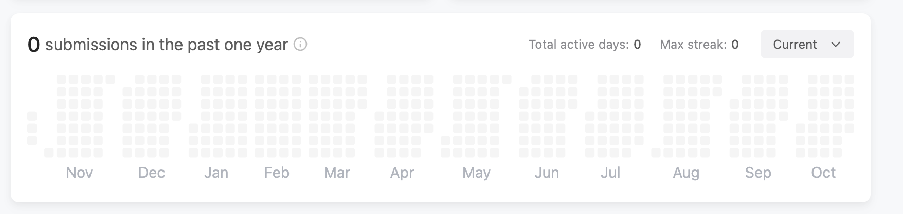
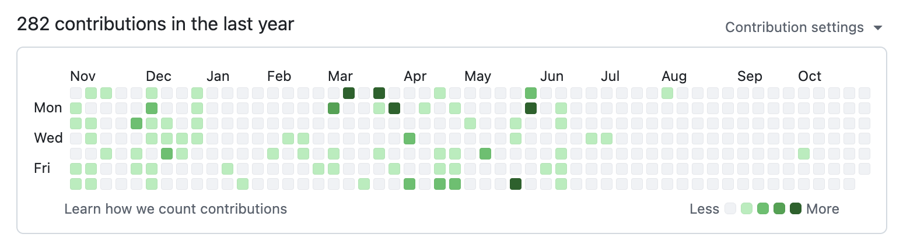
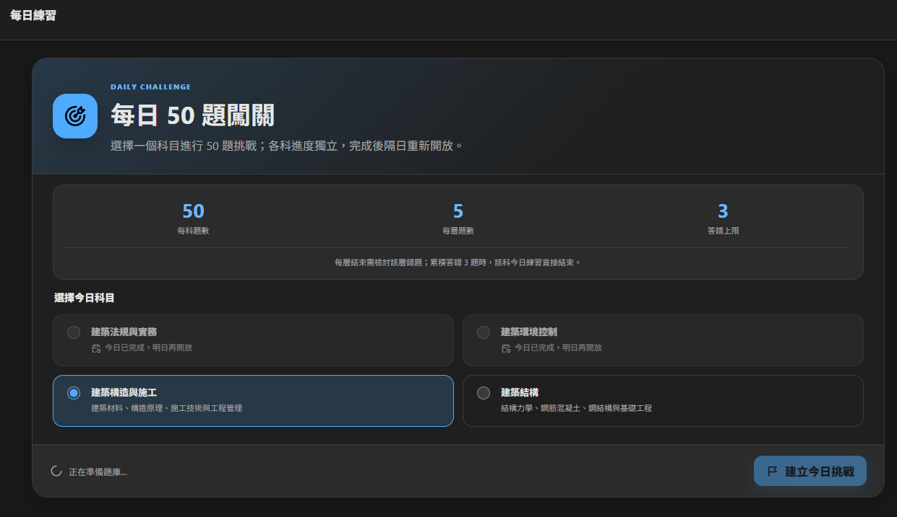
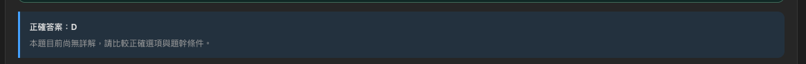
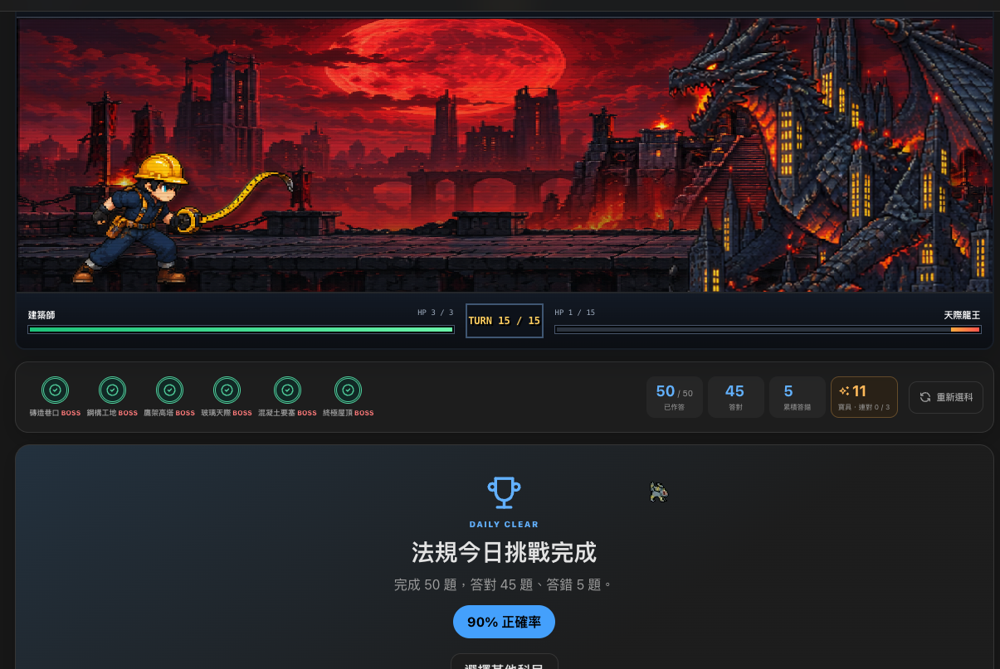
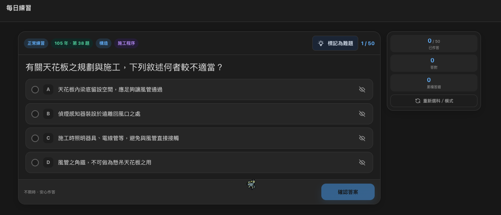
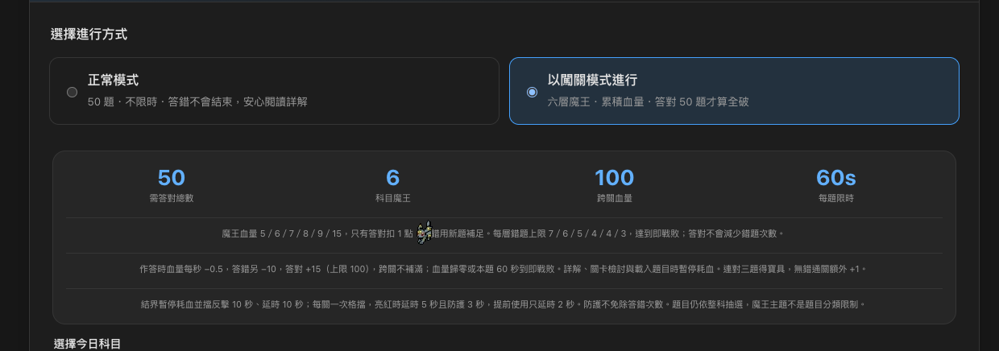
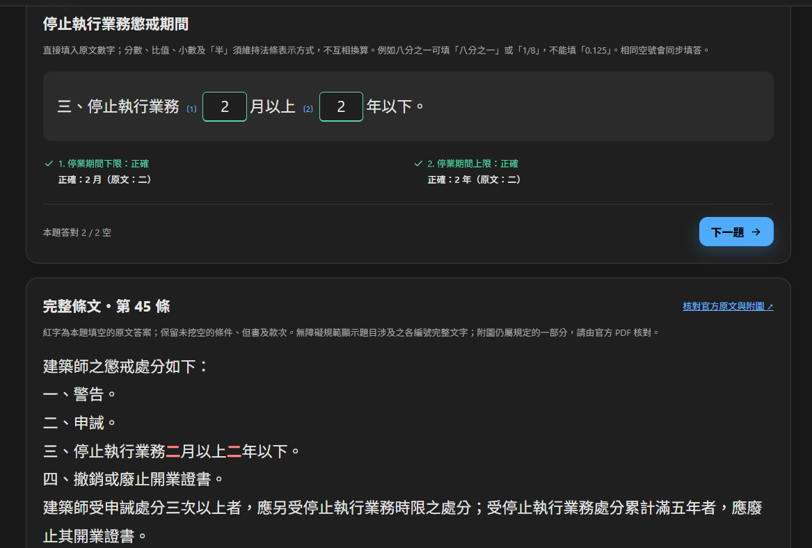
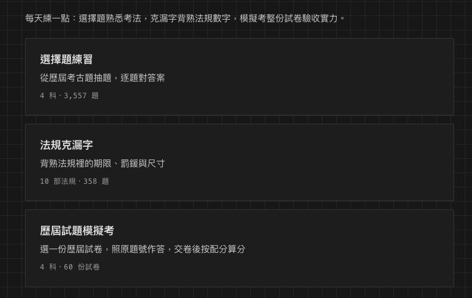
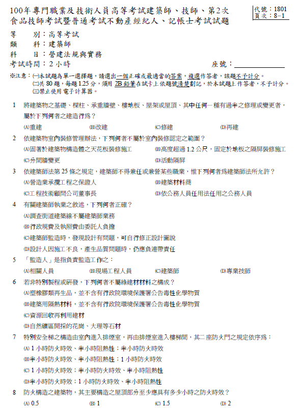

# Todo

已完成的需求請見[歷史紀錄](歷史紀錄/todo-歷史紀錄.md)。
尚待確認的需求請見[待討論](待討論/todo-待討論.md)。

## 1.56 - 2026-10-08

狀態：已實作待審核

- [x]  每次只選擇一個科目，各科分別建立獨立的 50 題每日練習，不使用複選合併出題。
- [x]  移除答對後重複顯示的提示列，保留整張題目卡的答對狀態。
- [x] 錯題檢討時可直接新增、編輯及儲存使用者筆記。
- [x] 累積答錯達三題時，立即結束該科當日練習並鎖定至隔日。
- [x] 每日練習不顯示題目年份，且每場題目的選項順序隨機打亂並隨進度保存。
- [x] 題目與完成狀態於台北時間每日零點換日刷新，不以開始後 24 小時計算。

#1.56
 每日練習裡的詳解好像不會正常顯示
 選項框跟外寬黏再一起，適度脫開

## 1.57 - 2026-10-08

狀態：已實作待審核

- [x]  每日練習主頁顯示今日已完成的科目、答對題數與實際作答題數。
- [x] 取消每層答錯三題即結束；每五題仍須完成該層錯題檢討，再繼續下一層。
- [x]  檢討頁恢復顯示題目年份與分類；作答頁只隱藏年份並保留題目分類。
- [x]  每日練習的檢討與完成頁同步載入「詳解與討論」投稿，不再只讀取題庫內嵌詳解。
- [x] 加入血量連擊、關卡脈動、答對獎勵及答錯回饋動畫，並支援減少動態效果設定，提升闖關遊戲感。
- [x] 每次每日挑戰有十點共用血量；答錯扣一點，連續答對三題回復一點，最多回到十點，血量歸零才結束。
- [x] 測試階段取消每科每日一次限制，保留今日上次成果但允許立即重複挑戰。

## 1.58 - 2026-10-09

狀態：已實作待審核

- [x] 每題加入六十秒倒數，逾時視為答錯並扣除一點血量。
- [x] 滿血時連續答對三題改為獲得寶具；每題最多使用一個寶具。
- [x] 寶具包含自動刪除一個錯誤選項、增加十秒、凍結倒數八秒，以及本題答錯免扣血的護盾。
- [x] 每五題固定進入關卡結算，依錯題數給予 S／A／B 評級；無傷通關額外獎勵一個寶具，第五與第十層標示為 BOSS 關。
- [x] 將血量改為置頂的十顆愛心血條，加入像素遊戲風格的計時器、寶具列、關卡名稱與結算獎勵介面。

## 1.59 - 2026-10-10

狀態：已實作待審核

實作說明：已加入六層建築戰場、原創建築師與六隻魔王像素素材、攻擊／受擊／連擊及十秒結界動畫。六層題數為 5／6／7／8／9／15，耐久為 3／3／4／4／3／3；每層恢復耐久，連對三題回復一格，滿血改得寶具。每題作答後顯示詳解，時間歸零立即戰敗並保存。答對造成魔王傷害，錯題於關卡檢討後補上傷害；防護罩在有效時間內擋傷並延長倒數十秒。素材使用內建 imagegen 產生，存於 `public/daily-game/`；參考 Eastward 的城市光影與 Sea of Stars 的戰鬥回饋。

原始需求：每日挑戰大更新

後續補齊：#1.62 已加入週期蓄力／投射物攻擊、連續倒數血條、時機格擋及狂暴階段；容錯耐久與本題倒數壓力分開標示，保留六十秒歸零立即戰敗。
1.讓每題作答完都會顯示詳解不管對錯
2.我想加入一些遊戲風格的動畫，用平面2D的捲軸式遊戲呈現，目前分成十層，每一層剛好一打一隻怪，整體機制跟隨這個做變更如下：
(1)每層都是設定成答對五題可以擊敗該層怪物，差別在於前面的怪物打完家教輕微，怪物會攻擊玩家的機制是玩家作答失敗，越後面的層數怪物打玩家越痛（意即越後面層數越不能錯）
(2)基於前項遊戲規則，更改本來十層變成只有六層，每層題目數量改成：5/6/7/8/9/15 最後一層是大魔王龍王，最難打
(3)每層錯題數量導致遊戲結束的門檻如下：3/3/4/4/3/3
(4)連續答對有連擊動畫，寶具設定不變
(5)設定成每層怪物都會一直攻擊玩家，直到時間結束會直接被打死遊戲結束，錯題則會加快血量消耗
(6)遊戲動畫風格利用可愛的像素風格，玩家是建築師形象，手拿捲尺當作武器
(7)各層魔王可以以建築元素去呈現，共六個魔王，越後面層數的看起來威脅性要越大，這部分由你幫我設計
(8)整個遊戲的風格都由你幫我設計，原則以平面捲軸是像素風格，背景就用各種建築物
(9)寶具目前的延秒跟凍結時間就改成發起防護罩，可以抵擋該層魔王攻擊，持續10秒，刪除選項不變

## 1.60 - 2026-10-10

狀態：已實作待審核

- [x]  縮小戰鬥區並固定於頁首下方，捲動到選項與確認答案時仍可看見遊戲畫面；手機版再縮減高度。
- [x]  建築師改為襯衫、背心、眼鏡與圖紙造型，保留捲尺武器。
- [x]  魔王血量歸零時加入擊落、縮小與消失動畫；全關完成顯示勝利、獎盃及星光畫面，龍王血量確實歸零。
- [x] 六隻魔王改為短身、大眼的原創可愛像素造型，保留各自建築材料特色與龍王的威脅感。
- [x] 六張背景拆成獨立 WebP，以等比例裁切呈現，避免寬幅拉伸；角色也採用獨立透明 WebP。

## 1.61 - 2026-10-10

狀態：已實作待審核

- [x]  魔王面向左側建築師；朝向與攻擊、受傷、擊破動畫分離，動畫不會翻轉角色方向。
- [x]  桌面版將關卡、統計與重新選科整合至右側欄，主要區域保留給題目；手機版改為題目下方的緊湊資訊區。
- [x] 魔王與玩家受擊加入閃光、後退、撞擊星光與傷害數字；結界擋下攻擊時顯示防禦，不誤播扣血受傷效果。
- [x]  玩家戰敗時閃光、傾倒並淡出，顯示 DEFEAT 與失敗原因；玩家血量歸零，關卡標示失敗，結果圖示不再使用勝利獎盃。
- [x] 六個背景重新設計為圓潤、暖色與童話建築的可愛像素場景，搭配現有角色及魔王；保留原始圖集並輸出獨立 WebP。
- [x] 修正關卡最後一題戰敗後重新載入時，誤用下一關滿血而恢復練習的問題；支援減少動態效果偏好並保留戰敗狀態。

## 1.62 - 2026-10-11

狀態：已實作待審核

- [x] 確認六張新版可愛背景已套用；修正過度寬幅裁切，桌面改為左側大戰場、右側作答，較完整呈現背景、角色與魔王。
- [x] 作答與確認／下一題按鈕同屏顯示；長題、附圖及詳解只在題目區內捲動，確認鍵不跟著消失。手機依螢幕高度平衡戰場與題目，修正標籤擠成直排，完整保留題目內容與圖片放大功能。
- [x] 魔王週期蓄力、招式預告、投射物攻擊與玩家受擊；後段魔王蓄力更快，魔王低血量進入狂暴，以較快攻擊與紅色提示增加緊張感。
- [x] 本題血條與實際倒數連動，時間持續消耗血條；答錯另扣一格耐久，作答後停止本題攻防，下一題重新蓄力。原本各關 3／3／4／4／3／3 格容錯、連對三題回血／寶具及六十秒歸零戰敗規則保留。
- [x] 每關一次「架設防禦」：蓄力亮紅時完美格擋，延長五秒並擋傷三秒；提前使用延長兩秒但不擋錯題傷害。使用次數與防護期限保存，重新整理不可重用，跨關恢復機會。
- [x] 答對新增捲尺伸展打擊、命中閃光與魔王後退；答錯新增魔王投射物與玩家受傷，防護時投射物彈開；第三次連續答對以多重捲尺與必殺星光呈現既有回血／寶具獎勵，不減少必要作答題數。
- [x] 保留減少動態效果設定；驗證倒數扣血、格擋時機／期限、保存還原、連擊、手機及長題附圖排版。

設計參考：[Super Mario RPG](https://www.nintendo.com/us/store/products/super-mario-rpg-switch/) 的時機防禦與連擊回饋、[Sea of Stars](https://www.nintendo.com/us/store/products/sea-of-stars-switch/) 的連招與戰鬥節奏。此處轉化為作答中斷敵人攻勢、限次格擋、容錯耐久與倒數血條，不要求玩家另外操作角色移動或犧牲題目閱讀。

## 1.63 - 2026-10-11

狀態：已實作待審核

原始需求：
1.我覺得遊戲機制錯了，應該是每層的王有固定血量（以目前每層題數），玩家要把王打死就要打完那些血量（即答對該層題數），然後每層錯題限制達成時如果王還沒死就判定失敗，演出被王打死的動畫
2.手機介面題目要滾動會變很難用，盡量讓題目一目瞭然不用滾動，排版需要重新設計
3.我想要新增“以闖關模式進行”或正常模式進行兩種選項，後者就讓使用者回到一開始的練習排版版本，只有選擇遊戲模式才會進到現在的模式（考量不同年齡層的使用者）
4.目前的怪物都是以建築物的材料為主，我想把這些王定義為“建築構造與施工”的王，
有關法規的要重新設計六隻：
第一層：用建築法作為形象
第二層：用公寓大夏管理條例作為形象
第三層：用國普計劃法區域計畫法國家公園法等作為形象
第四層：用營造業法、採購法作為形象
第五層：用都市計畫法、都市更新條例作為形象
第六層：用建築技術規則作為形象
有關環控的也要重新設計六隻：
第一層：風
第二層：光
第三層：水
第四層：音
第五層：設備（如空調等等）
第六層：綠建築

5.然後怪物被攻擊時要有受到攻擊的模樣動畫，同理答錯時使用者也是
6.時間扣點應該不會每層都重置血量，是累積式的，答對就會回復一些血量，另外答對題目回覆錯題的機制配合第一點取消
7.根據我上面的規則，幫我設想周到，並找到可能衝突的地方，並幫我擬定相對應的規則

補充需求：錯題上限改為 **7／6／5／4／4／3**。

實作與規則決議：

- [x] 開始前可選「正常模式」或「以闖關模式進行」，預設正常模式。正常模式抽選本科 50 題、不限時、無血量／錯題上限，逐題顯示詳解，最後整理錯題；每日一次限制仍維持測試停用。
- [x] 闖關魔王血量固定 5／6／7／8／9／15，只有正確作答造成 1 點傷害，答錯與檢討都不扣魔王血量。魔王歸零後才進入關卡檢討；檢討不再是補傷害途徑。
- [x] 每層答錯次數上限 7／6／5／4／4／3；到達上限且魔王存活即戰敗，演出反擊、建築師傾倒與 DEFEAT，並保存失敗關卡。答對只補玩家 HP，不抵銷錯題次數；跨關重設的是該關錯題計數，不是玩家 HP。
- [x] 玩家總 HP 100，作答時每秒扣 0.5、答錯額外扣 10、答對回復 15（不超過 100），跨關保留血量。HP 歸零即戰敗；每題仍保留 60 秒上限，到時也立即戰敗。詳解／關卡檢討／題庫載入時暫停，重新載入不補滿 HP 或倒數；離開時未作答的有效倒數照常結算。
- [x] 連對三題改為寶具 +1，不回復錯題機會；無錯擊破魔王再得寶具 +1。保留每題一寶具、刪除錯誤選項、防護結界 10 秒及每關一次時機格擋；防護暫停耗血、擋反擊，但不免除答錯計數。結界延時 10 秒，完美格擋延時 5 秒且防護 3 秒，提前使用只延時 2 秒。
- [x] 預抽同科 74 題不重複題目作為補題儲備：通關需答對 50 題，加上各關最多 6／5／4／3／3／2 次可存活錯誤，共最多 73 題；第 74 題留作終止錯誤。畫面分別顯示已作答與答對進度，不再把 50 次作答誤判為通關。題庫不足 74 題時提示改用正常模式；意外耗盡題庫不會假通關。
- [x] 手機縮小戰場、精簡標籤與選項控制，題目／選項完整展開，取消限高與巢狀捲動；圖片保持比例並可放大。短題盡量同屏，長題／長選項採整頁自然捲動，避免縮字或截斷內容。桌面保留左右同屏與固定確認區。
- [x] 建築材料魔王沿用為構造與施工系列；新增法規與環控各六隻原創魔王，依所選科目切換名稱、招式、透明像素角色。結構科暫沿用建築系列；魔王形象是科目主題，不限制每層只出該分類題目，避免題庫分布不足。
- [x] 法規：建照印章獸／公寓管家獸／國土山林靈／契約工務獸／都市更新獅／技規法典龍，對應原始需求的六組法律主題；環控：旋風精靈／日光稜晶獸／水滴管管獸／回聲音波獸／空調機械獸／綠建築森龍。
- [x] 保留捲尺命中、魔王閃光後退、錯答投射物、玩家受傷、防護彈開、連擊及減少動態效果。新版保存格式保留 HP／模式／題目儲備／防禦次數，舊版不相容的作答次數闖關進度轉為正常模式保留答案，不自動刪除或虛構新制勝利。
- [x] 驗證固定魔王 HP、六關錯題上限、跨關血量、73 題通關、載入暫停、超時與歸零優先判定、防護仍計錯題、存檔還原、正常模式、手機長題與受擊／戰敗動畫。

素材：使用內建 imagegen 分別產生 12 隻角色，原圖存於 [`public/daily-game/source-1.63/`](../public/daily-game/source-1.63/)，正式素材為 `law-boss-1-v3.webp`～`law-boss-6-v3.webp`、`env-boss-1-v3.webp`～`env-boss-6-v3.webp`；完整提示詞與輸出說明見 [`asset-prompts-1.63.txt`](../public/daily-game/asset-prompts-1.63.txt)。

## 1.64 - 2026-10-11

狀態：已實作待審核

- [x]  題目／選項可分別調整為 14～24px，統一由「設定 → 閱讀設定」操作，移除每日練習額外的字體設定區塊；沿用既有設定保存及登入後跨裝置同步，正常／闖關模式、關卡檢討、完成頁與手機皆套用。
- [x] 移除每日練習寫死的選項與手機題目字級；大字完整換行、不截斷，手機保留整頁自然捲動，桌面闖關確認鍵仍留在題目區外。
- [x]  刪除選科頁的規則數值及長篇說明區塊，保留模式選項內的簡短提示，不改變闖關規則。
- [x]  刪除「DAILY CHALLENGE／建築師的六層試煉」標題、圖示與副標，直接顯示模式與科目選擇。
- [x] 驗證正常／闖關模式字級分開調整、重新載入保存、不重設答案／倒數、檢討及完成頁套用、手機大字無橫向溢出，以及既有闖關流程。
- [x] 補充修正：正常／闖關模式的桌面及手機版一律取消題目卡內部捲軸與限高，題幹、大圖、選項及詳解完整展開；手機附圖取消固定 240px 高度上限、按可用寬度保留比例。超出螢幕時只捲動整個頁面，不縮字或截斷題目。

## 1.65 - 2026-10-11

狀態：已實作待審核

原始需求：

1.每個王都做得太複雜了，可以再簡化，只要表現出特徵就好了，而且目前風格過度免洗（很像中國廉價手遊），重新想一下
2.法規環控的每層名稱不要這樣取，畢竟不一定該層就是該類題目
3.換層要有過場動畫
4.就算答對該題下面也讓使用者可以打詳解或紀錄

補充回饋（2026-10-12）：過場只在左側動畫框播放；魔王細節取原版與過度簡化版之間的平衡，改用日式風格，全部畫風一致。

實作與設計決議：

- [x] 十八隻魔王統一重製為柔和日式像素 JRPG 角色：以建築師、既有背景及同一隻日式印章獸為共同風格參考，統一琥珀眼睛、深色階梯描邊、暖色左上光源與像素陰影。保留表情、短肢體、少量材質接縫及立體感，細節量介於繁複舊版與 32×32 圖示版之間；移除誇張怒眉、繁複裝甲及裝飾。構造保留磚塊／鋼梁／鷹架／玻璃／混凝土／屋頂龍，法規保留印章／公寓鑰匙／山林／契約／街屋獅／法典龍，環控保留風／光／水／音／空調／葉翼龍。結構科沿用構造系列；舊版素材保留，不覆蓋或刪除。
- [x] 法規與環控層名統一為「入口／迴廊／階梯／露臺／高臺／塔頂」，不再以法律名稱或風光水音等分類命名；魔王形象只代表科目風格，不限制該層出題分類，題目抽選及既有規則不變。
- [x] 第一至第五層檢討完成後，在左側原戰鬥框播放 1.8 秒換層過場：沿用同一框架尺寸、血量條及角色比例，建築師前進、下一層背景與魔王登場；右側檢討保留，繼續按鈕暫停，手機則在上方同一戰鬥框播放，不另外佔用題目區。可略過；期間不扣血、不啟動下題倒數，不重設 HP／作答／寶具；過場中重新整理安全回到已保存的檢討，再次繼續即可。減少動態效果時改為 0.3 秒靜態提示，最後一層直接進入勝利結果，不出現第七層。
- [x] 正常／闖關模式在每題送出答案後，不分答對答錯，詳解下方都提供使用者筆記、格式工具、貼圖、儲存與「分享至詳解與討論」。沿用既有文字同步及本機圖片保存；未送出答案前不顯示編輯器，換題不沿用上一題未儲存內容，閱讀及記錄期間維持暫停。
- [x] 驗證十八隻透明 WebP 的共同 384×384 畫布、透明留白、原稿保留及科目切換；目視檢查共同畫風與實際戰鬥框。驗證中性層名、既有關卡與戰鬥、過場左側定位／框架不跳動／暫停／自動完成／略過／重新整理／減少動態效果、答對後儲存及分享、換題隔離、重新載入保存，以及電腦／手機完整展開與無橫向溢出。

正式素材：[`public/daily-game/`](../public/daily-game/) 的 `{construction,law,env}-boss-{1..6}-v5.webp`。使用內建 imagegen 分別重製 18 隻日式角色，原稿存於 [`source-1.65-jp/`](../public/daily-game/source-1.65-jp/)，完整提示詞及處理方式見 [`asset-prompts-1.65-jp.txt`](../public/daily-game/asset-prompts-1.65-jp.txt)；正式檔只做透明裁邊、等比例 nearest-neighbor 縮放與 WebP 轉存，不套濾鏡。

## 1.66 - 2026-10-12

狀態：已實作待審核

原始需求：
新增一項測驗內容:法規克漏字
希望這邊可以把常考的法規改成填空題給使用者填空，主要以數字題目為主
初步先閱讀"建築技術規則"施工編的內容，做成填空題進行測試，你要先閱讀完這份法規，並且依據目前考古題的資料幫我找出常考題型製作，每次填空都是一題，每題可以是複數空格。使用者填完答案後提交可以直接比對答案及完整條文
依照上述要求先行施做看看

補充要求：填入數字維持法條表示方式，不接受小數、分數、百分比或單位之間的等值換算。

- [x] 研究《建築技術規則建築設計施工編》官方 389 條文字及現行生效狀態，對照 100～114 年本站技術規則相關考古題；研究紀錄與可重現證據保存在 `ref/law-cloze/`。
- [x] 新增獨立「法規克漏字」頁面與導覽入口，以常見數字題型製作 34 題、83 空；每次一題，可有多個空格並可依考點練習。
- [x] 提交後逐空比對答案與原文數字、展開完整條文，提供官方法源及相關考古題連結；第 167 條之 6 官方 PDF 的兩類無障礙停車附表已核對補齊。
- [x] 判分保留原文數值表示方式；八分之一／1/8 不接受 0.125，比例不約分換算，比值／小數／半分別核對。全形、中文與阿拉伯字號可對照，單位固定不換算。
- [x] 保存本輪順序、草稿與已提交成績於目前瀏覽器；切換題目隔離答案、題庫版本不符則建立新練習，不改動既有選擇題或雲端資料。
- [x] 驗證官方原文一致性、多空格判分、未填不得提交、法條表示法、重新載入保存，以及桌面／手機版面。

## 1.67 - 2026-10-12

狀態：已實作待審核

原始需求：

1.目前做法還不錯，但我希望可以直接田在文字敘述裡面
另外下面法條的答案部分請以紅字呈現
2.讓使用者選擇每次測驗題數(5/10/15/20/25/30)，也可以選擇法規及考點(或考點隨機出))
3.以依樣的方式研究最新版"建築物無障礙設施設計規範"並加入，因為這科目也是常考

補充回饋：填空不應誤挖標題／款次，例如「三、」須保留，應挖後面的「三公尺」。

- [x] 改成在條文敘述中直接輸入，重複空號同步；提交後逐空比對，完整原文以紅字標出本題答案數值。
- [x] 提供5／10／15／20／25／30題、法規及考點設定，也可隨機考點；每輪不重複，小題庫明示實際題數並以上限出題。設定按「開始新測驗」才套用，完成後顯示題數／空格成績。
- [x] 研究國土署最新版《建築物無障礙設施設計規範》105頁全文及12頁勘誤，核對表格、樓梯錯圖與既有考題；新增39題175空，兩部法規合計73題258空，附官方原文／圖表連結。
- [x] 修正款次誤挖、數字局部匹配、非數量「之一」、單位不符的誤挖及同題重複門檻答案洩漏；法條表示方式及不等值換算原則保持不變。
- [x] 保存本輪設定、順序、草稿、提交結果及完成狀態；驗證所有原文與答案位置、題數篩選、小題庫、重載、逐空判分及電腦／手機整輪流程。未改動既有作答紀錄或雲端規則。

補充回饋（2026-10-12）：建築技術規則題目太少，重新整理並增加題型。

- [x] 再核對現行設計施工編與歷屆資料，新增128題434空，建築技術規則由34題擴充為162題517空，涵蓋17個考點；保留39題無障礙規範，總計201題692空。
- [x] 補齊用語、基地與容積、一般設計、停車設備、防火避難、特定建築、防空、施工安全、地下／高層／山坡地／工廠、開放空間、老人住宅與綠建築。保留用途、例外、但書及原文表示法，不納入未施行第301條、刪除或移編條文。
- [x] 支援原文小數比值及小數分子分數，不接受等值轉換；保護條號款次而允許填真正樓層門檻，並核對括號內單位。
- [x] 原73題內容不變；舊測驗順序、草稿、成績及完成狀態保持不變，按「開始新測驗」才使用擴充題庫。核對全題庫原文與答案位置並驗證桌面／手機整輪及舊輪次還原。

## 1.68 - 2026-10-14

狀態：已實作待審核

原始需求：

1.法規克漏字加入"建築法"、"建築師法"、"都市計畫法"、"國土計畫法"，填空著重在相關"期限"、"罰緩"等數字，依樣先參考歷屆考古題常出現的題目及法條進行
2.法規克漏字新增直接看答案功能
3.目前的詳解不會有空格換行等排版，修正成可以依據使用者筆記的排版呈現

- [x] 核對四部法規現行官方全文與100～114年法規考古題線索；新增建築法23題52空、建築師法15題25空、都市計畫法21題35空、國土計畫法14題33空，合計新增73題145空；六部法規總計274題837空。
- [x] 以執照／開工／公告／展覽／復議等期限、罰鍰／罰金／懲戒、相關法定比例與門檻為重點；保留單位、比較用語、起算點與但書。國土計畫法採114.01.20版本，第45條地方計畫公告後十年內公告功能分區圖；舊考題不改答案。延伸題型明示非直接命題證據。
- [x] 新增「直接看答案」，不需填完；條文內紅字呈現原文答案並展開完整條文。本題標記閱讀練習、不列入答對率，可換題、整輪閱讀及重載還原；草稿保留、不虛構提交答案或100%成績。
- [x] 原201題逐題內容不變；相容兩版1.67題庫的既有順序、草稿、成績及小題庫輪次，不自動加入新法規或重設進度。
- [x] 詳解與討論、回覆、每日練習及作答檢討沿用筆記安全格式渲染，保留換行、空白行、連續空格和縮排；難題／錯題內建詳解也支援格式。投稿、編輯、從筆記分享及加入筆記不再截掉原始首尾排版，空白內容仍會攔截。
- [x] 驗證全題庫法源、答案位置／判分／單位、數字表示法、款次保護、舊進度相容、直接閱讀不計分、重載及桌面／手機版面。研究與可重現來源存於 `ref/law-cloze/`，不修改Firebase權限規則或歷屆作答紀錄。

## 1.69 - 2026-10-14

狀態：已實作待審核

原始需求：

 每題都要列出所有條文內容，否則使用者無法只憑一條項目得知考點
繼續加入"公寓大廈管理條例"、"非都市土地使用管制規則"、"政府採購法"、"營造業法"

- [x] 作答區改以完整條文組成填空，從第一項到所有款項、後續段落、前提及但書一開始就展開；只挖原有考點數字，不再孤立顯示單一款，亦不必交卷後才看法條脈絡。無障礙規範顯示本題所涉編號的完整文字，附表與官方法源保留核對途徑。
- [x] 核對四部現行官方全文352條及100～114年相關考古題；新增公寓大廈19題41空、非都市土地24題67空、政府採購21題46空、營造業20題55空，合計新增84題209空；十部法規總計358題1046空。
- [x] 保留規約例外、雙重人數／權利門檻、土地核定計畫及地方調降、付款實際工作日、異議與申訴起算點、營造業資格及罰則義務人。非都市土地採115.05.27版本；不把授權子法金額規模或錯誤選項當母法數字，延伸題型明示非直接命題證據。
- [x] 原274題及三種舊版輪次可繼續還原，包含答錯結果、草稿與直接看答案狀態。補齊億／萬元中文整數的精確判分及數字邊界，不變更分數、小數、比值、半及固定單位原則。
- [x] 驗證全題庫完整原文、空格還原、標紅位置、款次保護、判分與舊版相容，並檢查桌面／手機全文作答、換題、重載、選法規及無橫向溢出；研究來源與可重現腳本存於 `ref/law-cloze/` 及 `scripts/`。

## 1.70 - 2026-10-15

狀態：已實作待審核

原始需求：

1.每日練習生成的題目新增"列印功能"，使用者也可以選擇把每日派發的題目列印出來手寫，題目排版及字型請比照國家考試的題目格式，上方標題改為"專門職業及技術人員高等考試建築師每日練習試題"，請看下方參考圖，下載下來的格式是PDF

2.每日練習新增當日考題預覽，讓使用者做完後可以完整檢視今日題目

補充需求：另附一份參考答案頁供使用者對答案，一樣參考建築師考試格式。

- [x] 每日練習建立後即可「列印／下載 PDF」；A4 黑白楷體風格、指定標題、科目日期、座號／姓名、注意事項、題前作答括號及頁碼。嵌入開源字型，保留題圖比例、原文段落與單位，自動分頁；不依賴使用者電腦字型或付費 PDF 服務。
- [x] PDF 末頁另附國考式參考答案表，以本次每日題號編排，精確對應已打亂的選項；支援多個可接受答案與一律給分，不在題目頁標出答案，不包含筆記、投稿或詳解。
- [x] 新增可展開／收合的「當日考題預覽」，正常模式顯示完整 50 題（小題庫依實際派發數量），闖關模式含全部備用題並標示題數；完成後或重載仍可查看。題目與選項順序和本次練習一致，不重新抽題、不提交答案、不改變成績；闖關計時照常進行。
- [x] 題目尚未載齊時禁止部分下載／預覽；字型或題圖下載失敗可重試，既有作答、難題、筆記與進度保留。PDF 程式與約 2 MB 字型僅在下載時載入，字型來源、授權、裁切腳本及視覺核對腳本一併保留。
- [x] 驗證 386 項單元測試、60 項每日練習／PDF 桌面與手機測試、TypeScript、ESLint 及正式建置；四科各 50 題下載的 PDF 共 200 筆答案逐筆比對，核對題圖數量、中文字型、分頁及頁面邊界並實際渲染檢視。

使用方式：進入「每日練習」→選科及模式→「建立今日挑戰」→上方「列印／下載 PDF」。完成練習後點「當日考題預覽」可完整檢視本次派發題目；PDF 的最後一頁為獨立參考答案。

## 1.71 - 2026-10-16

狀態：已實作待審核

原始需求：

應該是正常模式下面多一個"製作每日練習紙本檔案"跟"線上作答"給使用者選擇，而不用直接點進去
紙本列印格式修正：
1.原題出處放到該題右下角，以(年,題)顯示就好，例如(110-30)代表110年第30題
2.中文字體改成新細明體，遇到數字就用time new romans，請完全比照國家考試題目卷的形式(直接照抄)
3.所以頁次會在右上角
4.有一律給分的題目不要抓取為每日練習題

補充確認：使用者同意缺少新細明體或 Times New Roman 時，改用開源明體及 Times 風格字型，並明確提示。

- [x] 正常模式下直接提供「製作每日練習紙本檔案」及「線上作答」兩個入口；紙本直接下載，不進入作答畫面、不啟動計時、不提交答案或成績。紙本快照獨立保存，重試、重載及之後線上作答沿用同一題序與選項順序。
- [x] 依參考國考試卷調整標題、等別、類科、科目、日期與座號、注意事項、題號縮排及選項配置；短選項四欄／兩欄橫排，長選項保留懸掛縮排。原題出處移至每題末右下角，採 `(110-30)`；頁次移至右上角，以「總頁數-本頁」呈現，答案維持獨立頁。
- [x] 中文優先使用新細明體，數字及英文字母使用 Times New Roman；僅在下載點擊時請求讀取這兩個本機字型，確認文件嵌入權限，不上傳或將系統字型散布到網站。無法取得時採開源 Noto Serif TC 明體及 Tinos（Times 風格），下載介面明示實際字型，依後續要求不在 PDF 內印出字型資訊；保留完整授權及可重現字型轉換腳本。
- [x] 新建正常模式、闖關模式及紙本統一排除一律給分、全部選項皆接受與非選擇題；可用題數同步重算。舊版作答順序、已答內容、成績與錯題狀態保持不變，不為套用新篩選而覆蓋既有進度。
- [x] 驗證 396 項單元測試、62 項桌面／手機每日練習與 PDF 測試、TypeScript、ESLint 及正式建置；逐筆核對四科 200 筆答案、題圖數量、出處與頁次位置、數字字型及嵌入字型可渲染性，並實際檢視試卷分頁、本機指定字型／開源備援輸出與兩入口畫面。

- [x] 補充調整：將「製作每日練習紙本檔案」與「線上作答」移至設定區最底部，在模式、科目及說明之後顯示；手機改為直向排列。
- [x] 補充調整：輸出的試卷與參考答案頁不再印出「字型：…」資訊；保留原字型、題目、答案、頁碼與下載介面的備援字型提示。
- [x] 補充調整：線上作答與中途檢討移除「當日試題」工具列，不提供完整考題預覽或 PDF 按鈕；在正常練習完成、闖關成功或失敗後，於成績與錯題整理下方提供當日考題預覽。紙本製作僅保留在開始前的設定區。
- [x] 補充調整：正常模式每天每科固定一份題組，紙本與線上共用題目及選項順序；線上先開始也會保存題組，切換科目、重複挑戰、重新整理後均沿用。依臺灣日期隔日更新，闖關模式每次重新抽題，不受此限制。相容舊紙本快照及既有線上進度，不重置已存答案。
- [x] 固定題組調整驗證：422 項單元測試、76 項桌面／手機每日練習流程、TypeScript 與 ESLint 均通過；涵蓋四科獨立保存、紙本／線上共用、完成後重玩、重載、臺灣日期換日、舊資料相容及闖關重新抽題。

使用方式：先選今日科目，再點設定區最底部的「製作每日練習紙本檔案」或「線上作答」。若瀏覽器詢問本機字型權限，可允許使用已安裝字型；拒絕或不支援仍可用明示的開源備援完成下載。

## 1.72 - 2026-10-20

狀態：已實作待審核

原始需求：

新增一個"速記圖庫"，我會把一些整理圖片放上去，裡面分類成法規、構造、環控，看可不可以做成圖片可以由我(管理者)上傳

補充確認：採用本機管理，上傳後隨網站部署公開，不另設雲端圖片儲存服務。

- [x] 新增 `/memory-gallery` 及側欄「速記圖庫」入口，支援法規、構造、環控分類、標題／說明搜尋、縮圖與放大檢視；一般使用者只能瀏覽。
- [x] 新增 `/admin/memory-gallery` 本機管理頁，輸入 `AUTHOR_EDIT_KEY` 後可上傳圖片、修改標題／說明／分類及確認下架。每次修改均由伺服器重新驗證金鑰，不以單純的前端解鎖作為權限依據。
- [x] 管理 API 僅限本機 development 環境，正式網站與 Vercel 拒絕檔案修改；金鑰不存入 localStorage、圖庫索引或公開環境變數，`.env.example` 僅提供空白設定欄位。
- [x] 接受靜態 PNG／JPEG／WebP，每張最多 8 MB、2,400 萬像素；檢查真實檔案簽章及解碼結果、校正方向、轉 WebP、建立縮圖，長邊上限 12,000 像素。以隨機 UUID 命名，不接受使用者指定儲存路徑。
- [x] 圖片存於 `public/memory-gallery/assets/`，索引存於 `data/memory-gallery.json`；串行及原子寫入避免上傳互相覆蓋，損壞的索引不會被清空。下架只加上 `archivedAt` 並從清單移除，完整圖片檔案仍保留，可透過 Git 或移除該索引的 `archivedAt` 還原；已知圖片網址不會因此撤銷。
- [x] 驗證 448 項單元測試、10 項桌面／手機圖庫流程、TypeScript、ESLint 與正式建置；另以真實本機 API 完成上傳，確認公開頁面、完整圖片及縮圖均可讀取。測試圖片已移至測試輸出，正式圖庫不放入示範內容。

使用方式：

1. 在專案 `.env.local` 設定 `AUTHOR_EDIT_KEY=你的長隨機金鑰`；已有設定可沿用，請勿加上 `NEXT_PUBLIC_` 或提交實際金鑰。修改後重新啟動 `npm.cmd run dev`。
2. 本機開啟 `http://localhost:3000/admin/memory-gallery`，輸入同一組金鑰。
3. 選擇分類、標題、說明與圖片，點「上傳並儲存圖片」。只上傳有權公開分享、且不含私人個資的圖片。
4. 在 `http://localhost:3000/memory-gallery` 檢查呈現；圖片及 `data/memory-gallery.json` 一起 commit／push，正式網站才會更新。
5. 下架後同樣需要 commit／push；此功能不是永久刪除，若要撤除已知圖片網址，需另外移除完整圖片檔案並重新部署。

## 1.73 - 2026-10-22

狀態：已實作待審核

原始需求：

把這邊分類成幾個大項，然後依據大項再細分：

1. 首頁刪除（按最上方建築師考試圖示就是首頁了有點多餘），每日練習改成第一列。
2. 歷屆試題、隨機出題、法規克漏字都歸類為「歷屆試題題練習」。
3. 考題分析、速記圖庫、法規資料庫歸類為「歷屆試題資料集成」。
4. 詳解與討論獨立一個。
5. 使用者筆記、難題標記、常錯題目、已作答紀錄歸類為「我的作答存摺」。

以上做成觸碰或點擊會跳出子項目的形式。

保留的首頁入口參考：

- [x] 側欄移除重複的「首頁」項目，依序顯示每日練習、歷屆試題題練習、歷屆試題資料集成、詳解與討論、我的作答存摺；設定與問題回報仍獨立保留於底部。
- [x] 三個大項各自收納需求指定的子頁，桌面可滑鼠移入或點擊開啟浮出子選單，手機以點擊開啟；支援再次點擊收合、關閉按鈕、Escape、鍵盤選取與同時只開一個大項。
- [x] 保留頂端建築師考試標誌返回首頁，手機按標誌或子項目後自動關閉抽屜；子頁及所屬大項同步標示目前位置，作答頁歸於試題練習。保留既有頁首標題與設定彈窗，不更動作答紀錄、筆記或資料儲存方式。
- [x] 驗證 485 項單元測試、30 項桌面／手機導覽與圖庫流程、TypeScript 與 ESLint；涵蓋所有子頁連結、滑鼠移入、點擊／觸控收合、鍵盤焦點、首頁入口、目前頁面標示及視窗邊界，另回歸原手機抽屜與設定彈窗流程。

使用方式：桌面將滑鼠移到大項或按一下，從浮出選單選擇功能；手機先開啟左上選單，再點大項與子項目。若要改選其他大項，可再按目前大項或子選單右上關閉鍵收合。

## 1.74 - 2026-10-23

狀態：已實作待審核

本次改動：

- [x] 新增「每日練習（新版）」`/practice`，融合每日練習（正常模式）與隨機出題，放在側欄第一個；原本的每日練習 `/daily` 與隨機出題 `/random` 保留不變以便比較。

### 出題設定

- [x] 以每日練習正常模式的畫面為基底重新設計，移除闖關模式。
- [x] 外層只選科目，其餘設定都收在預設收合的「進階選項」；收合時顯示目前設定摘要，並可「恢復預設」。
- [x] 進階選項包含年度範圍、題目類別、題數（5／10／15／20／30／50，題庫不足 50 題時多一個「全部 N 題」）、打亂選項順序，以及改為選項的「包含一律給分題目」。
- [x] 預設與原本每日練習相同：50 題、全部年度與類別、打亂選項、不含一律給分；進階設定不會在重新整理後保留。
- [x] 每按一次就重新抽題，不提供保留題組的選項。
- [x] 設定頁保留「製作紙本檔案」與「線上作答」，兩者各自重新抽題，紙本與線上是不同題組；紙本沿用每日練習的 PDF 格式，未打亂選項時參考答案頁註明選項維持原試卷順序。
- [x] 題目類別只在此頁整理：「???」與「廢止」改用原本的主題分類，重複的「臨時建築使用辦法」合併為一個；題庫資料與隨機出題不受影響。

### 作答過程

- [x] 每題一個網址（例如 `/practice?q=3`），重新整理會停在同一題，瀏覽器上一頁／下一頁在題目之間移動。
- [x] 每題按「確認答案」後立刻顯示對錯並鎖定該題答案，同時顯示詳解、討論區投稿與筆記編輯器。
- [x] 可回上一題、用題號導覽跳題，也可以跳過留空。
- [x] 記錄作答時間但不限時；只計算尚未確認答案的題目，頁面在背景時暫停。
- [x] 保留刪去選項與難題標記。
- [x] 手機版作答按鈕列不固定在畫面底部，與每日練習相同，避免擋住剛顯示的對錯。

### 結束後與紀錄

- [x] 隨時可以交卷，還有未作答的題目時先確認；正確率＝答對／已作答，未作答不計入。
- [x] 結果頁顯示正確率、本次錯題整理（只列答錯的題目，含詳解與筆記；未作答只顯示題數）及本次考題預覽。
- [x] 作答中重新整理會保留進度；交卷後重新整理結果就消失，回到空白題組。交卷後按上一頁回到空白題組，再按下一頁可回到結果。
- [x] 不寫入已作答紀錄或常錯題目，其他也不另外保存。
- [x] 同一時間只能有一組題目進行中：中途換科會先確認並清掉作答進度，開兩個分頁會同步成同一組。

## 1.75 - 2026-10-23

狀態：已實作待審核

原始需求：

nav bar 歷屆試題資料集成底下有三個頁面，想重新設計，把三個 nav button 合併成一個通往同一頁面，集中頁面可以再通往子頁面。

新增統計分析頁面用來放歷屆試題資料集成底下三個頁面。

補充需求：總覽頁也不需要子頁面的按鈕；有預覽很好，但不需要可以點擊；移除法規資料庫的站外超連結。

- [x] 側欄在「歷屆試題（新版）」下方新增「統計分析（新版）」，點了進入新的總覽頁。原本的「歷屆試題資料集成」選單保留不變，方便比較新舊版。
- [x] 總覽頁把考題分析、速記圖庫、法規資料庫做成三張卡片，點卡片就進入該頁。
- [x] 補充調整：卡片上不放子頁的按鈕，只留文字說明與預覽；預覽不能單獨點，點卡片任何地方（包括預覽）都是進入該頁：
  - 考題分析：拿掉各科的按鈕，改成一句文字說明（選科目與年度，查看命題分布、歷年趨勢與對應考古題）。
  - 速記圖庫：保留最新上架的 3 張圖當預覽，點圖不再跳到那一張；拿掉選科目的按鈕。
  - 法規資料庫：保留最常考的 5 項法規與題數當預覽，不再連到全國法規資料庫。
- [x] 三個頁面上方都有切換列（總覽｜考題分析｜速記圖庫｜法規資料庫），可以直接換頁或回總覽。
- [x] 速記圖庫選好的科目，重新整理或分享連結後仍會停在同一科；科目順序改為法規、環控、構造、結構，和其他頁面一致；一般使用者不再看到用不到的「管理者上傳」按鈕。
- [x] 修正法規資料庫在平板寬度時畫面會左右滑動的問題。
- [x] 電腦版與手機版都已測試。

使用方式：側欄點「統計分析（新版）」進入總覽頁，看完卡片上的說明與預覽，點卡片進入想看的頁面。各頁上方的切換列可以換頁或回總覽。

## 1.76 - 2026-10-23

狀態：已實作待審核

原始需求：

法規克漏字搬到新版每日練習底下
每日練習學習新版統計分析導向兩個子頁面 但不需要上方的tab切換列，子頁面顯示返回每日練習按鈕

討論結果：克漏字是練習，不是自己的作答紀錄，所以放在每日練習（新版）底下，不放「我的作答存摺」。

補充需求：總覽頁不需要子頁面的按鈕選項，單純文字敘述就好，三個連結放在同一欄上下排列。

- [x] 「每日練習（新版）」改成總覽頁，放「選擇題練習」和「法規克漏字」兩張卡片，點卡片進入子頁。側欄仍只有「每日練習（新版）」一個入口，總覽頁與子頁都標示為目前位置；原本「歷屆試題題練習」裡的法規克漏字保留不變，方便比較新舊版。
- [x] 補充調整：總覽頁不放子頁的按鈕，原本卡片上跟著進度變化的捷徑（選科目、繼續第 N 題、看結果、繼續本輪、再練一輪）全部拿掉。練習改成同一欄上下排列的連結，每個只有名稱、一句文字說明和題數，點了進入子頁；進行中的練習不受影響，進入子頁就接著上次的進度。
- [x] 子頁不放切換列，最上方改為「返回每日練習」按鈕，頁首標題顯示子頁名稱。
- [x] 選擇題練習沿用原本每日練習（新版）的設定、作答與結果，每題網址改為 `/practice/quiz?q=3`。交卷後離開，結果可以到「已作答紀錄」再看（1.78）。
- [x] 法規克漏字沿用原本的頁面，和舊頁面共用同一輪進度；「題型相關考古題」改連到歷屆試題（新版）。
- [x] 電腦版與手機版都已測試。

使用方式：側欄點「每日練習（新版）」進入總覽頁，點「選擇題練習」或「法規克漏字」進入子頁。在子頁按最上方的「返回每日練習」回總覽；之後再點同一個練習，會接著上次的進度。

## 1.77 - 2026-10-23

狀態：已實作待審核

原始需求：

舊「歷屆試題」的流程是：

選好科目和年度後，照原題號作答整份試卷；
交卷後按各科配分算分數；
中途離開，下次可以「繼續作答」。

把這個搬到新版每日練習第三部分 名稱叫做`歷屆試題模擬考`

- [x] 每日練習（新版）總覽頁新增第三個練習「歷屆試題模擬考」，點了進入子頁；子頁最上方一樣有「返回每日練習」。
- [x] 選卷：先選科目，再選年度（100～114 年），畫面會顯示這份試卷的題數、每題配分與滿分。有申論題的試卷會說明申論題不計分，並連到歷屆試題（新版）閱讀。
- [x] 作答：照原題號一題一題作答，作答時不顯示對錯。可以上一題、下一題、用題號導覽跳題，也能刪去選項與標記難題。記錄作答時間但不限時，頁面在背景時暫停。
- [x] 交卷：隨時可以交卷，還有未作答的題目時先確認。交卷後按各科配分算分（法規、構造每題 1.25 分，滿分 100 分；環控、結構每題 1.5 分，滿分 60 分），顯示答對、答錯、未作答與作答時間，並可逐題對答案、看詳解、寫筆記與看錯題統計。
- [x] 交卷結果寫入「已作答紀錄」，答錯的題目計入「常錯題目」，和原本的歷屆試題相同。重新整理後結果仍在，選卷畫面也可以「查看結果」。
- [x] 中途離開：每份試卷各自保留作答進度，可以同時有好幾份試卷作答中。選卷畫面會顯示「繼續作答（第 N 題）」與「重新開始」，年度按鈕標示作答中的進度或上次分數。
- [x] 補充調整：總覽頁不列出作答中的試卷、科目和最近一次交卷的分數，只留名稱、文字說明和試卷數（同 1.76 補充調整）。作答中的試卷在選卷畫面接著作答；交卷結果從選卷畫面的「查看結果」或「已作答紀錄」再看。
- [x] 原本的歷屆試題暫時保留，和模擬考共用作答進度與紀錄，1.78 移除舊版時一起刪除。
- [x] 電腦版與手機版都已測試。

使用方式：側欄點「每日練習（新版）」，再點「歷屆試題模擬考」，選好科目和年度後按「開始作答」。中途可以按「先離開，保留進度」，之後在選卷畫面選同一份試卷接著作答。

### 實作時的決定

- 模擬考只作答選擇題。申論題沒辦法自動計分，選卷時說明題數，並連到歷屆試題（新版）閱讀。
- 和原本的歷屆試題一樣，作答時不對答案，交卷後才一起看結果；選項維持原試卷順序，不打亂。
- 一律給分的題目沒作答也照樣給分，和原本的計分相同；交卷前的確認與結果頁都會說明。
- 每份試卷各自保留進度，不像選擇題練習同時只能有一組題目。只打開過、沒有選過任何答案的試卷不算作答中，按「開始作答」會從頭開始。
- 作答中換題不會增加瀏覽器的上一頁紀錄：作答中按上一頁，會回到進入作答前的畫面，進度保留；交卷後結果會取代作答畫面，按上一頁同樣回到進入前的畫面。
- 結果頁讀的是「已作答紀錄」裡的那一筆，所以之後隨時能再看；如果那筆紀錄被清除，結果頁會說明找不到。

## 1.78 - 2026-10-23

狀態：已實作待審核

原始需求：

我的作答存摺 「已作答紀錄」和「常錯題目」要能連結新版的隨機出題和歷屆試題模擬考
目標是讓新版取代舊版 舊版之後可以刪除

補充確認：舊版直接刪除，不另外保留；以前存下的舊頁面連結，打開會顯示找不到頁面，不會自動帶到新版。闖關模式與每日固定題組是新版刻意拿掉的，不保留；歷屆試題（新版）只供閱讀，不加作答；整份試卷作答依 1.77 搬到每日練習（新版）的「歷屆試題模擬考」。

補充需求：側欄移除「（新版）」這兩個字。

以下的「選擇題練習」就是新版的隨機出題，名稱沿用 1.76。

### 作答紀錄接上新版

我的作答存摺裡，使用者筆記與難題標記在新版已經會記下來，這次要接上的是已作答紀錄與常錯題目。

- [x] 選擇題練習交卷後，結果記到「已作答紀錄」，答錯的題目計入「常錯題目」，沒作答的題目不算錯。取代 1.74「不寫入已作答紀錄或常錯題目」的做法。
- [x] 歷屆試題模擬考交卷後同樣會記到已作答紀錄（1.77 已做到，這次確認）。
- [x] 紀錄上的成績與交卷結果頁一致：模擬考顯示分數，選擇題練習顯示正確率與答對題數。
- [x] 以前在舊頁面留下的作答紀錄全部保留，照常顯示。
- [x] 已作答紀錄的按鈕改開新版：
  - 「再做一次」：模擬考紀錄開同一科同一年的模擬考；選擇題練習紀錄用同一組題目再練一次。
  - 「繼續作答 N 年」與沒有紀錄時的「開始第一份試卷」：開歷屆試題模擬考，帶入科目與年度。

### 移除舊版

- [x] 側欄移除舊的「每日練習」、「歷屆試題題練習」（歷屆試題、隨機出題、法規克漏字）、「歷屆試題資料集成」（考題分析、速記圖庫、法規資料庫）與「詳解與討論」。移除後側欄依序為每日練習、歷屆試題、統計分析、我的作答存摺，底部仍是設定與問題回報。
- [x] 補充調整：側欄的三個名稱拿掉「（新版）」。頁首標題、瀏覽器分頁上的名稱，以及其他畫面提到這三頁的文字也一起改，例如筆記與逐題結果的「分享到歷屆試題」、模擬考選卷的「到歷屆試題閱讀」。需求紀錄裡其他地方的舊名稱不另外修改。
- [x] 刪除上述舊頁面；闖關模式與每日固定題組隨舊每日練習一起刪除。

### 其他頁面改連新版

- [x] 首頁四張科目卡：改開歷屆試題模擬考，帶入該科。
- [x] 難題標記、常錯題目卡片上的「查看詳解」：改開歷屆試題（新版）的同一題。
- [x] 速記圖庫管理頁的「查看速記圖庫」：改開統計分析（新版）裡的速記圖庫。
- [x] 其他還連到舊頁面的按鈕也一樣：看詳解的改開歷屆試題（新版），作答的改開歷屆試題模擬考。
- [x] 電腦版與手機版都已測試。

使用方式：交卷後到「我的作答存摺 → 已作答紀錄」看紀錄；模擬考依年度分組，選擇題練習放在「選擇題練習」分組。按「再做一次」會直接開始同一組題目或打開同一份試卷。

### 實作時的決定

- 已作答紀錄把兩種紀錄分開標示：「歷屆試題模擬考」照年度分組並顯示分數；「選擇題練習」放在「選擇題練習」分組，顯示正確率（答對／已作答），和交卷結果頁相同。同一組題目重做會算在同一張卡片。
- 選擇題練習一題都沒作答就交卷，不會留下紀錄。
- 選擇題練習紀錄的逐題結果依原試卷的選項順序顯示，畫面上會註明可能和作答時的順序不同。
- 選擇題練習紀錄的「再做一次」：直接開始同一組題目，題目順序相同、選項重新打亂；如果目前有還沒交卷的選擇題練習，會先詢問。題目還沒載入完成時（例如離線）按鈕暫時不能按，旁邊會說明原因。模擬考紀錄的「再做一次」：打開模擬考，選好同一科同一年。
- 常錯題目與逐題結果裡的「已答錯 N 次」，模擬考和選擇題練習的答錯會一起累計。
- 已作答紀錄沒有紀錄時，「開始第一份試卷」改開歷屆試題模擬考，旁邊多一個「選擇題練習」；常錯題目沒有紀錄時，多了「選擇題練習」和「歷屆試題模擬考」兩個按鈕。
- 考題分析（統計分析（新版）裡）：每題的連結改開歷屆試題（新版）看題目與詳解；「作答全部 N 題」改成「到選擇題練習抽題」，帶入科目、年度與類別（每次最多 50 題，和選擇題練習相同）。這裡沒有改開模擬考，因為模擬考只能整份試卷作答；若有還沒交卷的選擇題練習，會先詢問。
- 以前隨機出題的作答紀錄從 7 月起就不再保存，這次不會恢復；以前歷屆試題的紀錄照常顯示，標示改為「歷屆試題模擬考」。
- 舊頁面（例如舊的每日練習、歷屆試題、詳解與討論，以及舊的作答頁）的連結或書籤，打開會顯示找不到頁面，不會自動帶到新版。
- 筆記的「分享至詳解與討論」改名為「分享到歷屆試題（新版）」，因為詳解與討論頁已刪除，分享的內容在歷屆試題（新版）看得到。
- 選擇題練習的「製作紙本檔案」保留；闖關模式的角色圖片一起刪除。
