# Todo 已完成紀錄

## 第一階段 - 2026-07-26

- [x] 對答案時直接顯示最佳解，並保留「詳解與討論」捷徑。[參考圖](圖片/image-01.png)
- [x] 桌機作答頁改為題目與選項並排，縮小題目文字與圖片，無須捲動頁面即可選擇答案。[參考圖](圖片/image-02.png)
- [x] 作答紀錄可指定清除某一次，刪除前會再次確認。[參考圖](圖片/image-03.png)
- [x] 建築構造與施工細分為混凝土、鋼構、木構、砌體、基礎、外牆、裝修、防水、材料、工程管理與永續建築。[參考圖](圖片/image-04.png)
- [x] 建築環境控制分類調整為熱、空氣、光、音、綠建築、規範、水、設備。[參考圖](圖片/image-05.png)
- [x] 移除重複的統計表格與圖表。[參考圖](圖片/image-06.png)
- [x] 將命題占比、題數及對應考古題整合為單一互動區塊；每一科目都可由分類查看對應題目。[參考圖 1](圖片/image-07.png)｜[參考圖 2](圖片/image-08.png)
- [x] 隨機出題移至獨立 `/random` 頁面及導覽項目。[參考圖](圖片/image-09.png)
- [x] 詳解投稿支援圖片上傳、預覽與移除。[參考圖](圖片/image-10.png)
- [x] 按讚改為本機使用者每則只能有一個讚，可再次點擊取消。[參考圖](圖片/image-11.png)
- [x] 逐題檢討新增文字與圖片筆記，可分享至詳解與討論；討論內容也可加入自己的筆記。[參考圖](圖片/image-12.png)
- [x] 同一份歷屆試卷的作答紀錄整合在同一區塊，並標示第幾次。[參考圖](圖片/image-13.png)

## 新需求 - 2026-07-26

- [x] 使用者筆記與完整選項放在同一個收合區。[參考圖](圖片/image-14.png)
- [x] 每份試卷只保留一個「再做一次」，放在分組右上角。[參考圖](圖片/image-15.png)
- [x] 附件圖片點擊後在站內放大檢視，不使用超連結；回覆按鈕維持單行。[參考圖](圖片/image-16.png)
- [x] 選項放回題目下方；有題目圖片時，圖片放在題目文字右側。[參考圖](圖片/image-17.png)
- [x] 分析頁的對應考古題以單題模式開啟，不帶入整份歷屆試卷。[參考圖](圖片/image-18.png)

## 1.2 - 2026-07-26

- [x] 放大作答頁題目圖片，並在歷屆試題作答時移除「前往詳解與討論」。[參考圖](圖片/image-19.png)
- [x] 作答結果右側保留題號導覽；答錯題以紅色標示，難題保留橘色標記，兩者重合時同時呈現。[參考圖](圖片/image-20.png)
- [x] 筆記頁題號導覽移至右側，已有筆記的題號加上紫色標記。[參考圖](圖片/image-21.png)
- [x] 縮減無圖片題目的空白，並放大題目文字。[參考圖](圖片/image-22.png)
- [x] 放大圖片題的閱讀區域並重新調整題目、圖片與選項版面。[參考圖](圖片/image-23.png)
- [x] 已作答紀錄上方新增科目分類與數量，支援快速篩選。[參考圖](圖片/image-24.png)
- [x] 難題標記可下拉查看完整題目、來源與全部選項。[參考圖](圖片/image-25.png)

## 1.3 - 2026-07-26

- [x] 一律給分題處理（原實作已由需求 1.4 修正：題目保留、作答時不揭示，交卷後才標示並計分）。[參考圖](圖片/image-26.png)
- [x] 移除重複的「本次作答結果」，將「本回作答結果」整合為最上方標題，並移除「查看作答紀錄」與「選擇其他試題／建立其他題組」。[參考圖](圖片/image-27.png)
- [x] 難題展開後顯示正確答案與最佳解。[參考圖](圖片/image-28.png)
- [x] 放大作答頁題目選項文字與點選區域。[參考圖](圖片/image-29.png)
- [x] 題目圖片支援點擊後在站內放大檢視，並可用背景、關閉按鈕或 Esc 關閉。[參考圖](圖片/image-30.png)

## 1.4 - 2026-07-26

- [x] 法規與構造滿分 100 分（每題 1.25 分）；環控與結構滿分 60 分（每題 1.5 分）。一律給分題保留在作答題組中，作答時不揭示、對答案後才標示並計分。[參考圖](圖片/image-31.png)
- [x] 考題分析保留既有分類與對應考古題，並恢復圓形占比圖。[參考圖](圖片/image-32.png)

## 1.5 - 2026-07-26

- [x] 難題標記依科目分類，再依年份分組。[參考圖](圖片/image-33.png)

## 1.6 - 2026-07-27

- [x]  難題標記尚未按照科目分類
- [x] 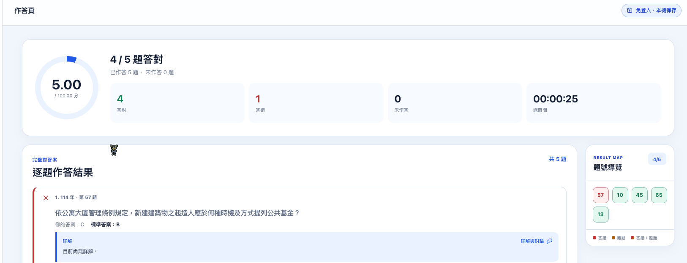 隨機出題不用顯示分數，應該顯示答對題數（依據使用這選擇的題數比例）
- [x]  對應考古題單題寫完對答案一樣意思不用顯示分數直接在當頁是否正確即可（不用跳頁面）；再把 113 年題目完整匯入網站，並測試跨年度統計結果
- [x] 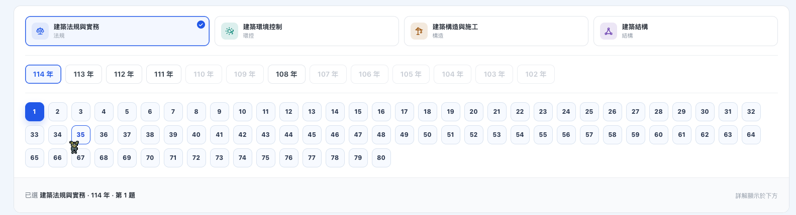 詳解與討論把已經有詳解或討論的題號做特別標記，同時也顯示使用者的難題標記
- [x] 隨機出題新增一個功能：從相同類別的題目隨機出題（比如從歷屆建築技術規則的題目中隨機出五題）
- [x] 作答時新增刪去法功能，可以讓使用者確定錯誤的選項暗去，方便使用者判斷答案
- [x] 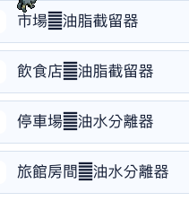 中間出現的符號應該是「-」；已對該題目資料做修正，找到相似錯誤一起修正
- [x] 歷屆試題計時器每到下一題不應該重新計時

## 1.7 - 2026-07-28

- [x]  隨機出題作答紀錄不用紀錄
- [x]  使用者筆記支援刪除
- [x]  第 74 題沒有明確法規分類，應分類為「其他」
- [x]  題目分類新增作者可編輯的管理功能，可手動檢核程式判斷與處理未分類題目
- [x]  新增「作答全部題目」，可以作答所有相同分類的題目
- [x]  考題分類可以有複數（如果該題有兩種以上法規在內）

## 1.8 - 2026-07-28

- [x] 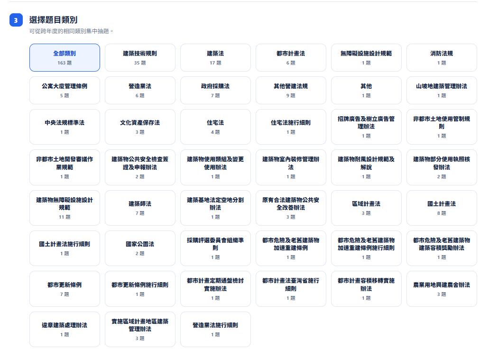 題目類別改為下拉式選擇
- [x] 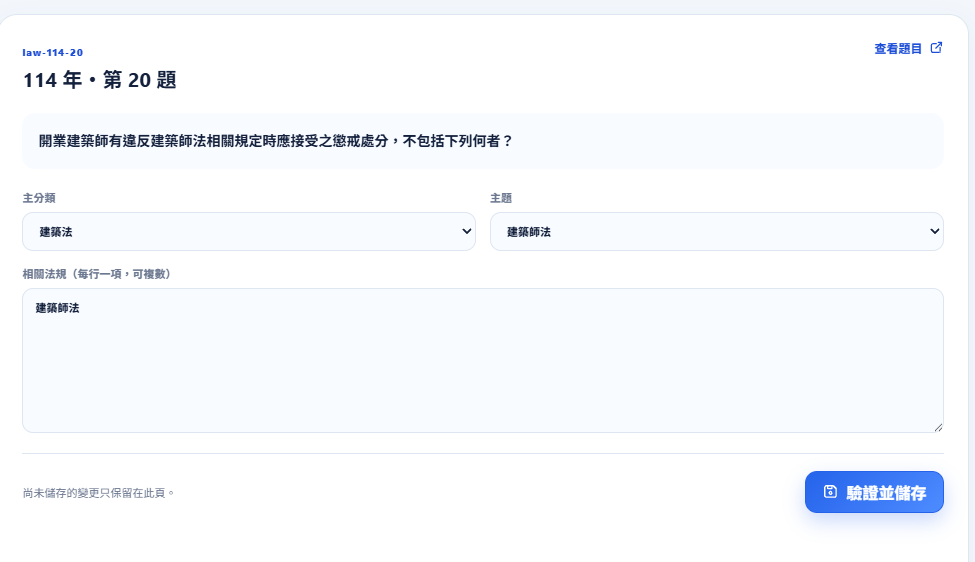 作者分類管理員直接分類即可，不必分別操作主分類、主題及相關法規

## 1.9 - 2026-07-28

- [x] 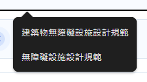 將「建築物無障礙設施設計規範」與「無障礙設施設計規範」整合為「建築物無障礙設施設計規範」
- [x]  左側功能欄新增「法規資料庫」，把題目曾出現的所有法規建立超連結連到全國法規資料庫

## 1.10 - 2026-07-28

- [x] 跨年度可選年份區間
- [x] 修復使用者筆記題庫載入失敗
- [x] 法規資料庫放在最下面，「???」及「廢止」不用連結，排序按照出題頻率排列

## 1.11 - 2026-07-28

- [x] 修復「詳解與討論」及「使用者筆記」題庫載入失敗
- [x] 法規改為條列式，右側顯示條狀圖比例，方便一目了然

## 1.12 - 2026-07-28

- [x] 左側導覽列改為 App Store 風格的淺灰背景、藍色圖示、緊湊間距與中性灰色選取狀態；保留原有導覽項目、順序、路由及手機抽屜行為。
- [x] 導覽列改版僅調整既有功能的 styling，不新增搜尋欄、搜尋功能、分組或其他互動。
- [x] 作答頁移除線性答題進度條、底部已作答比值及題號導覽中的重複進度；題幹上方只保留一組目前題號進度。
- [x] 題號導覽移除 `STATIC PATHS`，保留目前題、已作答、難題及答錯狀態的既有語意。
- [x] 作答卡改為自然內容高度、白底、14px 圓角、細框與無陰影，避免短題目下方留下大片空白。
- [x] 題幹與選項統一使用 `clamp(16px, 1.1vw, 18px)`、一般字重及相同行高；選項固定一個選項一列。
- [x] 圖片題的題幹欄設定合理最小寬度；空間不足時改為題幹與圖片上下排列，避免題目文字被壓得過窄。
- [x] 資料來源移到作答進度題號上方，作答區最終順序為「資料來源、題號進度、題目、選項」。
- [x] 作答時間移到底部導覽列左側；上一題與下一題／對答案按鈕成組靠右，手機保留 safe-area 與換列處理。
- [x] 標記為難題按鈕改為與題號導覽按鈕一致的扁平細框樣式，並保留難題的黃色狀態。
- [x] 詳解與討論、使用者筆記、難題標記及作答紀錄／結果檢討頁面的題幹與選項統一套用相同的 Apple 風格閱讀字級、單欄選項、白底細框及圓角。
- [x] 跨頁統一後仍保留正確答案、錯誤答案、使用者選取、刪去選項、計時、上下題與題號導覽等既有狀態及功能。
- [x] 詳解與討論及使用者筆記頁的資料來源統一移到題目上方；使用者筆記頁移除可見的「題目選項」標題，並保留無障礙區域名稱。
- [x] 將「標記為難題」抽成全站共用元件，作答頁、詳解與討論及難題清單統一使用作答頁的完整文字、扁平灰底、藍色 hover 與黃色已標記狀態，移除各頁重複樣式及精簡版變體。

## 1.13 - 2026-07-29

- [x] 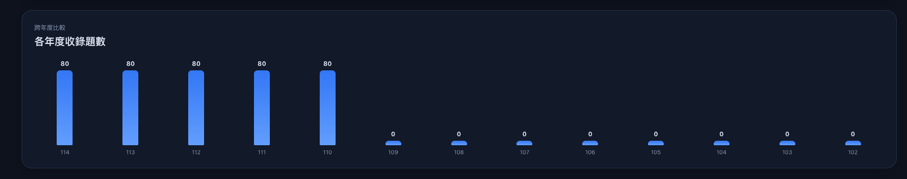 刪除無意義的各年度收錄題數圖
- [x] 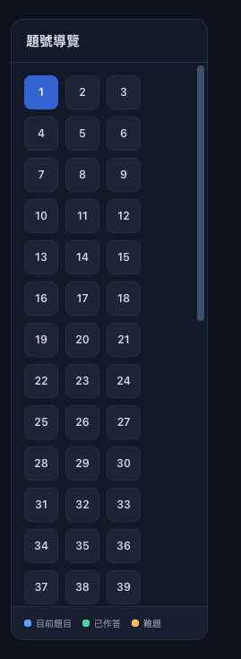 重新調整題號導覽排版，移除右側多餘空間
- [x] 詳解與討論新增管理者可刪除留言與回覆的後台
- [x]   法規資料庫直接移除「廢止」與「???」
- [x] 加入閱讀設定，可分別調整題目與選項字體大小
- [x] 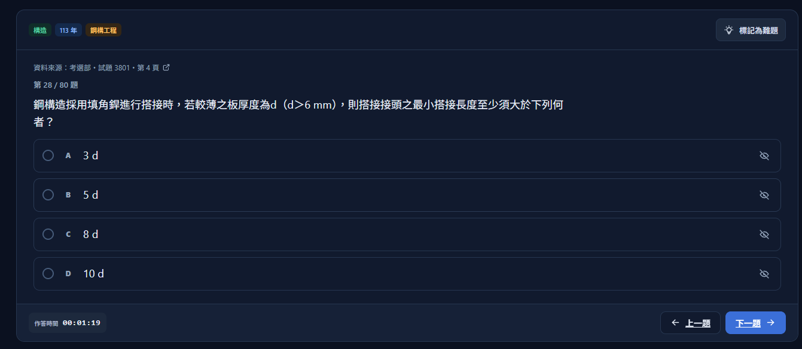 改善題幹換行，避免下一行只剩一、兩個字
- [x] 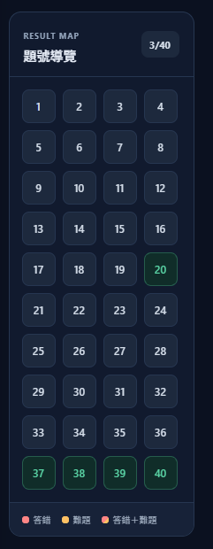 作答結果中的錯題題號顯示紅色
- [x] 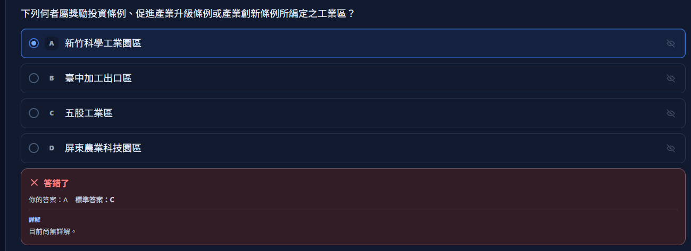 放大並強調標準答案
- [x] 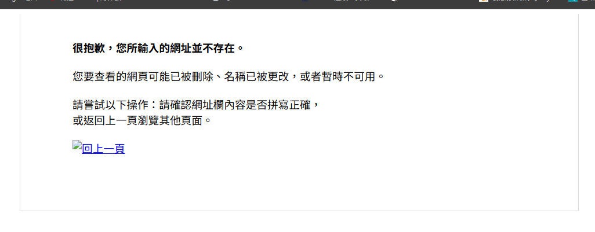 修正 103 年環境控制原始題目連結

## 1.14 - 2026-07-29

- [x] 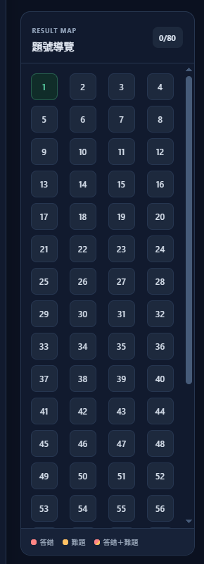 修正作答結果中錯誤題目仍未顯示紅色
- [x] 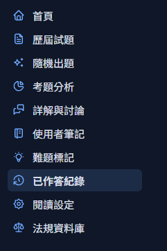 閱讀設定移到側欄最下方，並與主要功能區隔

## 1.15 - 2026-07-29

- [x] 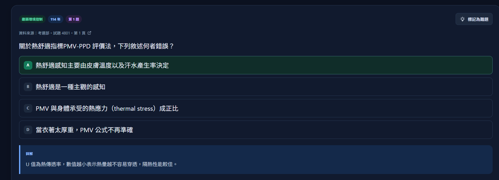 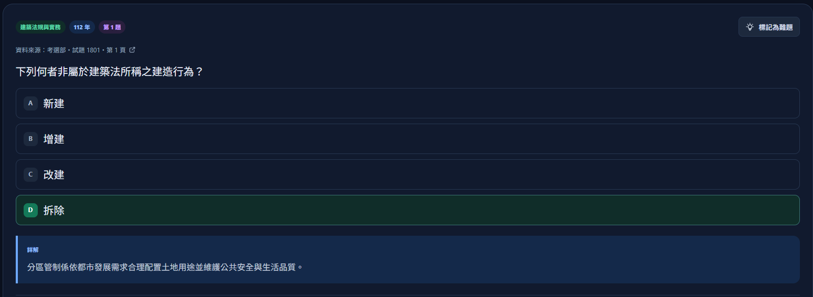 移除所有測試用的題目詳解內容
- [x] 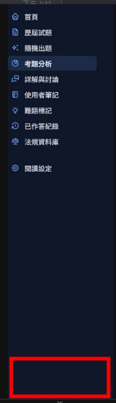 新增問題回報頁面，與閱讀設定固定在側欄底部（閱讀設定在上）
- [x] 確認官方題目詳解會隨網站公開；匿名投稿目前僅儲存在使用者的本機瀏覽器，不會同步給其他使用者
- [x] 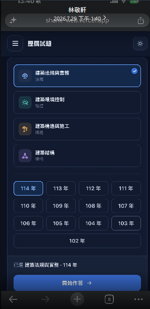 手機版 102 年按鈕維持與其他年度相同大小

## 1.16 - 2026-07-30

- [x]  刪除單題對答案結果中沒有內容的詳解欄
- [x] 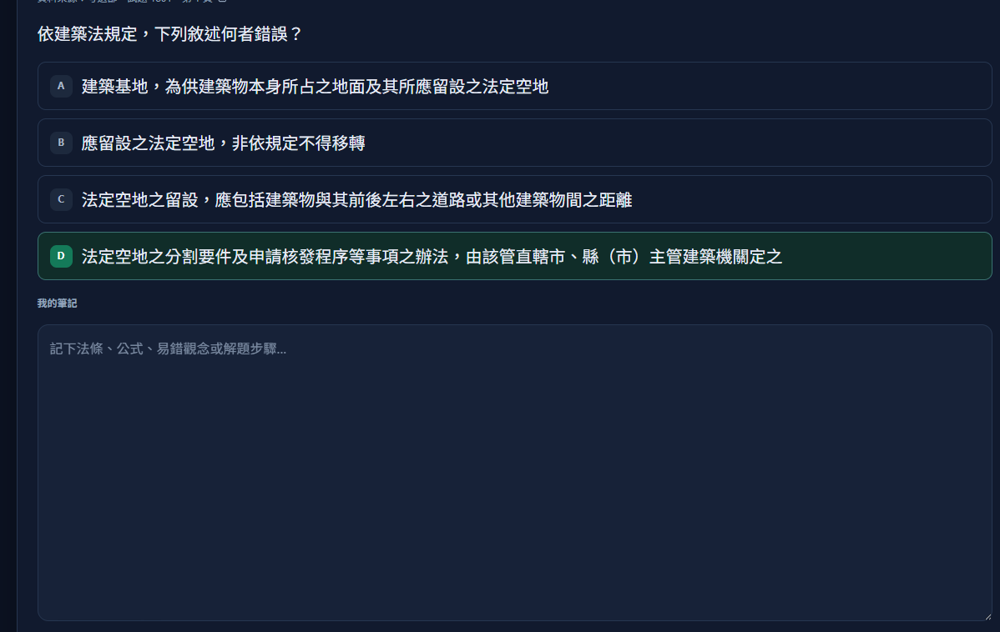 筆記支援直接從剪貼簿貼上圖片，方便加入截圖

## 1.17 - 2026-07-30

- [x] 使用者完成作答後新增錯題類型統計，顯示各分類的答錯題數與題號

## 1.19 - 2026-07-30

- [x] 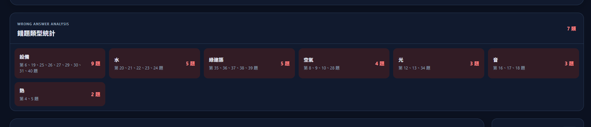 錯題統計設計成分類分頁，選取分類後可以查看該類型的錯題題目、選項、使用者答案與正確答案

## 1.20 - 2026-07-30

1. [x] 錯題統計也要呈現在已作答紀錄裡，每次作答的紀錄內，並且支援跨年度錯題分析
2. [x] 目前錯題分析版面太雜，在上方 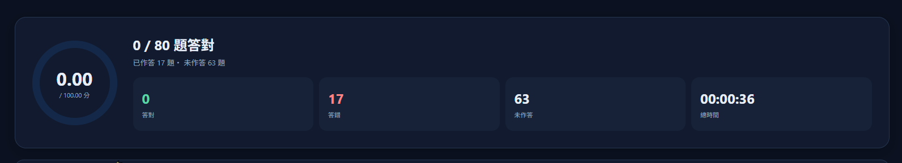 答錯處下面新增「錯題統計結果」，跳至另一個分頁查看，一樣在作答紀錄也這樣呈現

## 1.21 - 2026-08-05

- [x] 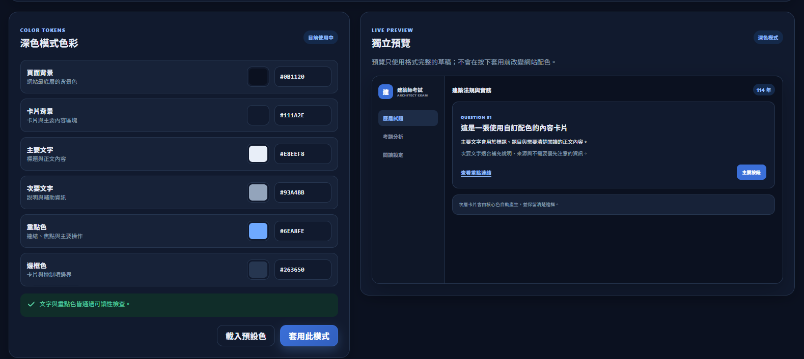  「套用此模式」按鈕固定在上方，模式色彩收合至「進階設定」，並刪除配色設定標題列
- [x]  「獨立預覽」改為「頁面預覽」
- [x]  刪除閱讀設定標題列
- [x] 將配色設定與閱讀設定整合成「設定」，內部分為可收合的「閱讀設定」與「介面配色設定」
- [x] 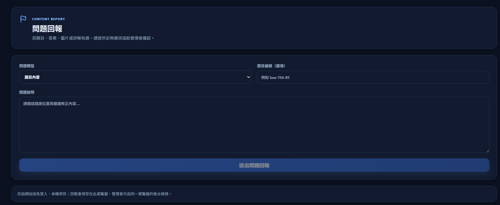 刪除問題回報標題列

## 1.22 - 2026-08-05

- [x] 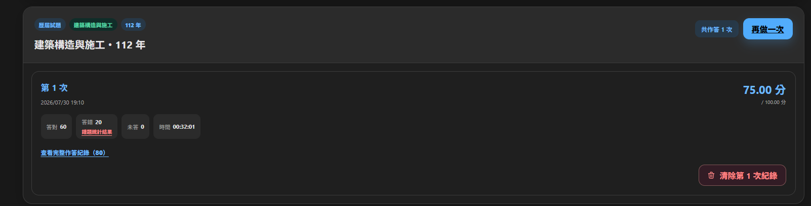 答題記錄裡面，答對答錯未答不用顯示，只留查看完整作答紀錄跟錯題統計結果，版面精簡化
- [x] 詳解與討論投稿改用 Firestore 即時共享，所有使用者可查看，登入後可投稿、回覆、按讚、檢舉及刪除自己的內容（第一階段僅支援文字）

## 1.23 - 2026-08-05

- [x] 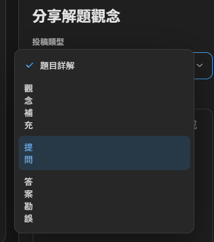 投稿類型選單文字改為水平排列
- [x] 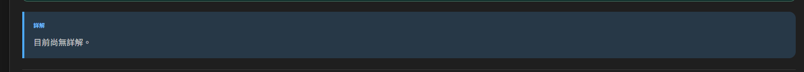 刪除題庫內建詳解區塊，以共享內容為主
- [x] 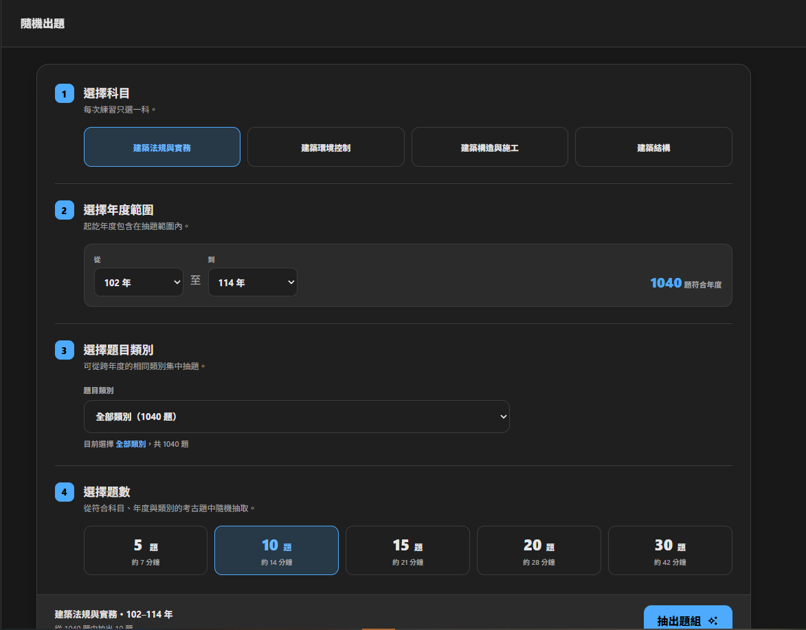 隨機出題設定整合為桌面版單頁可完整瀏覽的緊湊版面
- [x]  刪除考題分析的選擇摘要列
- [x]  刪除使用者筆記的選擇摘要列
- [x] 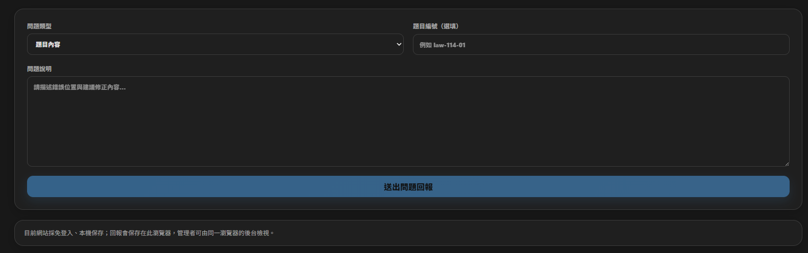 問題回報改為登入後寫入 Firestore，供後端工程師集中查看

## 1.24 - 2026-08-06

- [x] 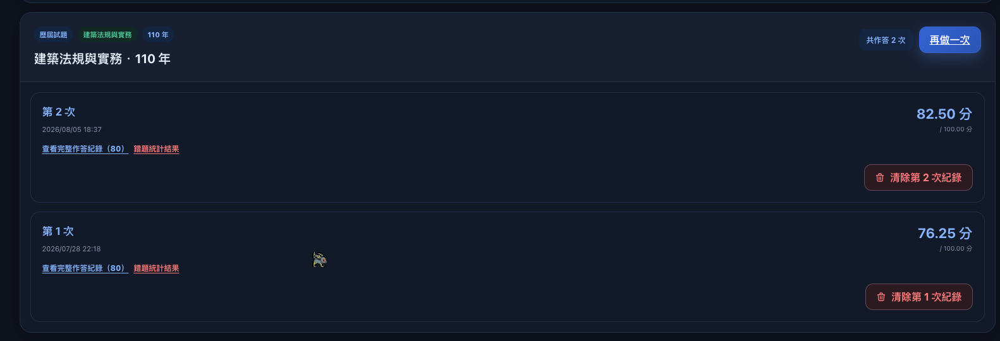 作答紀錄依年份排列，詳細資訊預設收合，只顯示年份與作答次數，展開後才顯示分數與操作
- [x] 使用者文字筆記跟隨登入帳號同步，並修正從對答案與筆記頁分享詳解後未出現在詳解與討論的問題
- [x]  刪除「返回作答頁」連結
- [x]  隨機出題的科目文字維持單行，並修正年度範圍題目數超出框外的排版

## 1.25 - 2026-08-07

- [x]  難題標記跟隨登入帳號同步
- [x] 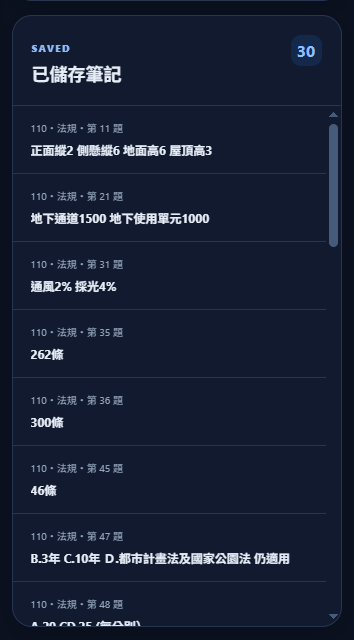 已儲存筆記依目前選擇的科目與年度篩選
- [x] 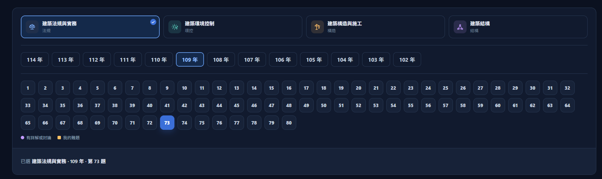 共享投稿成功後確實刊登，所有已有詳解討論的題目皆在題號標記

## 1.26 - 2026-08-09

- [x] 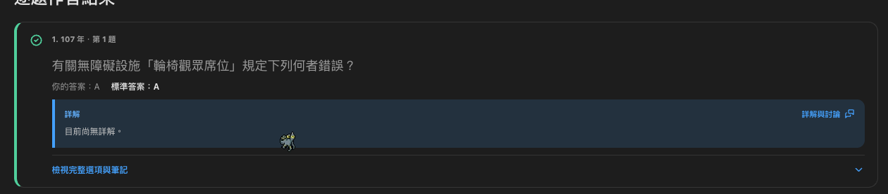 作答檢討移除內建詳解欄位，改為僅顯示前往詳解與討論的連結
- [x] 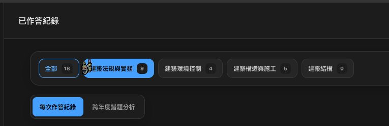 已作答紀錄移除「全部」分類，直接顯示較大的科目篩選按鈕
- [x] 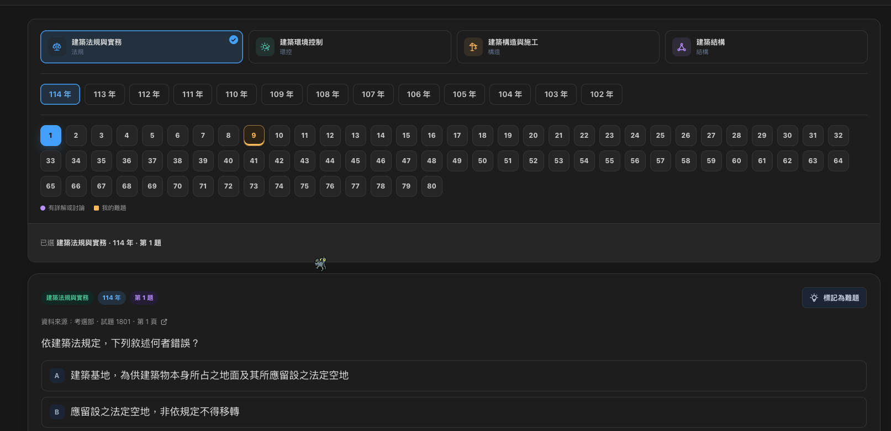 詳解與討論改為題號導覽置右，年份與科目維持於題目上方
- [x] 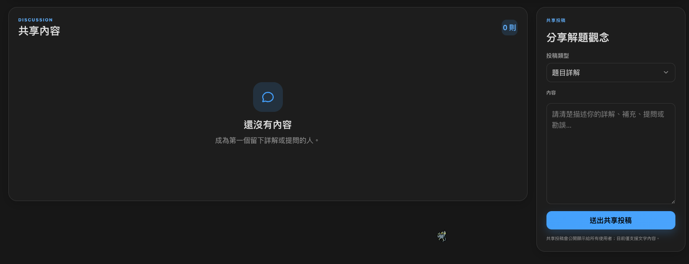 分享解題觀念移至題目下方，並與共享詳解並排
- [x] 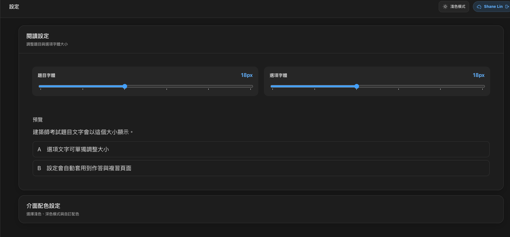 設定改用浮動視窗，關閉後保留原頁面與操作狀態
- [x] 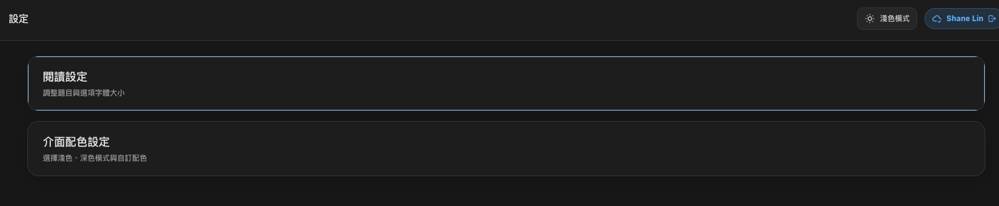 閱讀設定預設收合

## 1.27 - 2026-08-09

- [x] 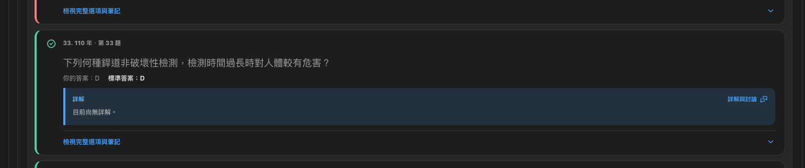 已作答紀錄的逐題結果新增標記與取消難題選項

## 1.28 - 2026-08-09

- [x] 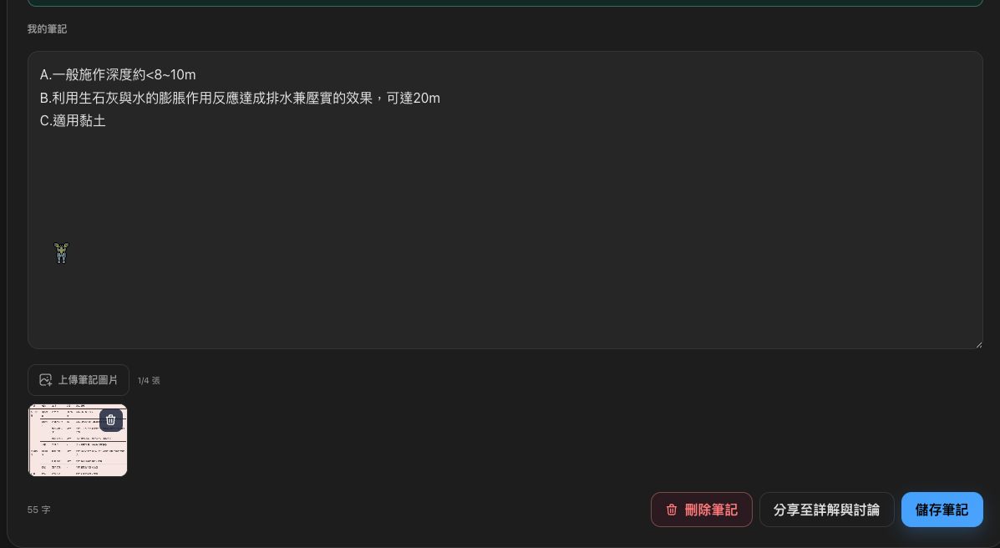 使用者筆記與詳解討論中的圖片可點擊開啟放大檢視
- [x] 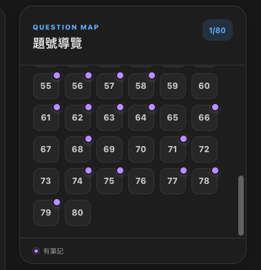 使用者筆記的題號導覽同步顯示難題標記

## 1.29 - 2026-08-11

- [x] 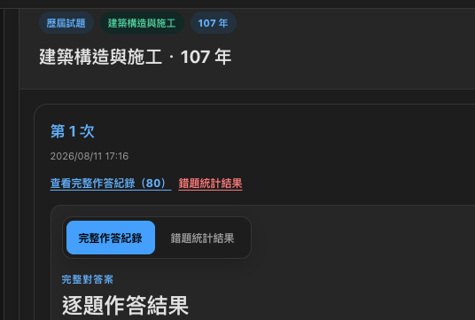 完整作答結果新增明確的收起操作
- [x] 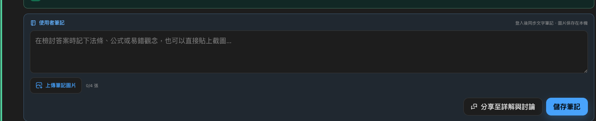 放大使用者筆記輸入區，並加入粗體格式功能
- [x] 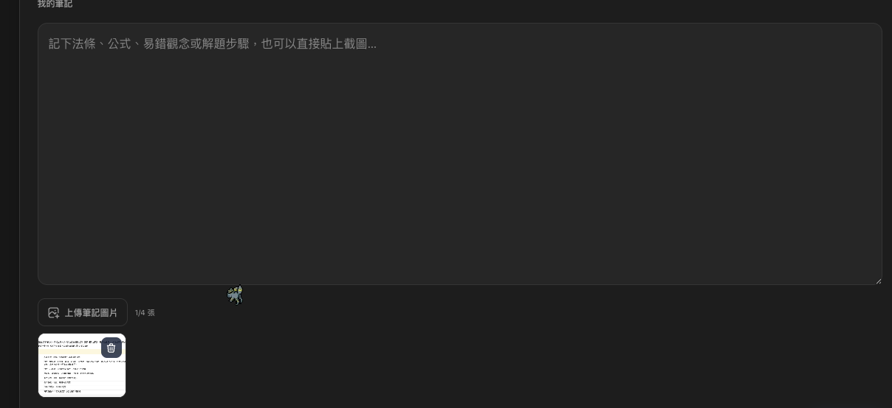 詳解圖片支援放大檢視，圖片可正確共享至詳解討論，網址自動轉為超連結
- [x] 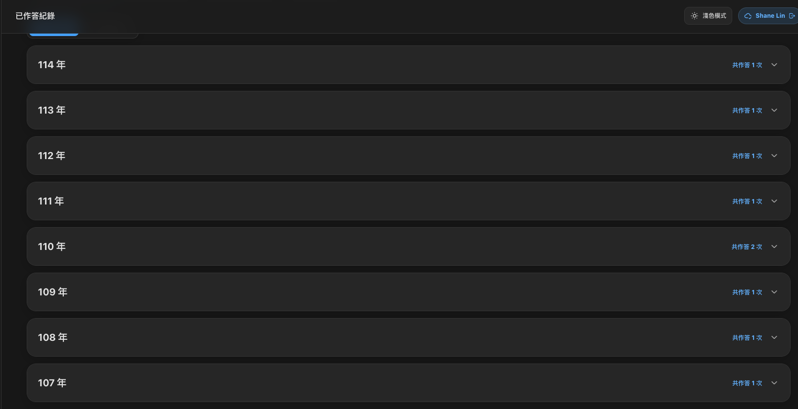 作答紀錄底部新增下一個未作答年度入口；完成所有年度後可再練習一個年度

## 1.30 - 2026-08-12

- [x] 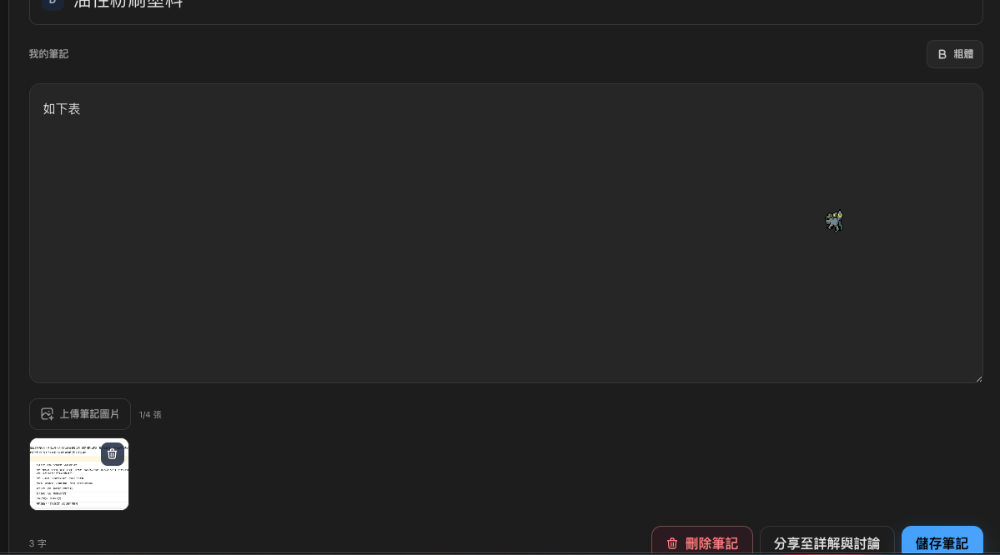 修正儲存筆記後分享至詳解與討論沒有反應且未成功刊登的問題

## 1.31 - 2026-08-12

- [x] 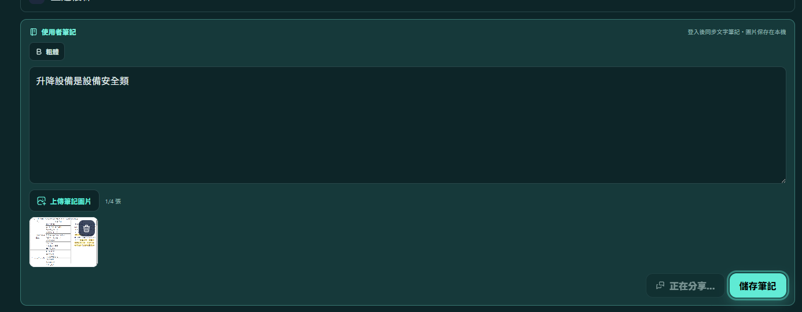 上傳共享圖片加入逾時處理，避免介面持續停留在「正在分享」
- [x] 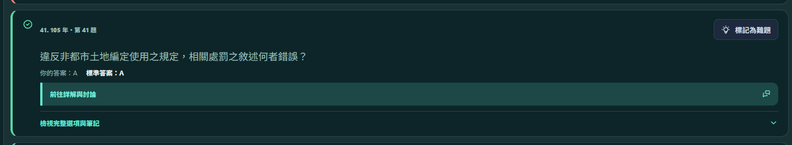 作答檢討改為原頁展開該題詳解與討論，不再使用跳頁連結；尚無內容時顯示提示

## 1.32 - 2026-08-12

- [x] 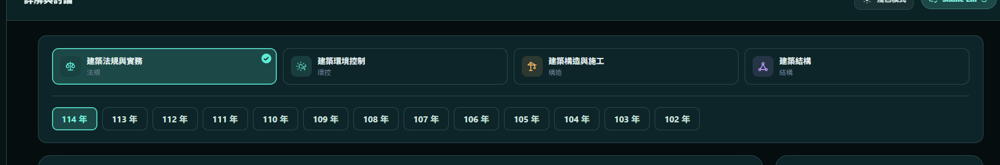 修正題庫背景載入期間點擊科目沒有反應的問題

## 1.33 - 2026-08-13

- [x] 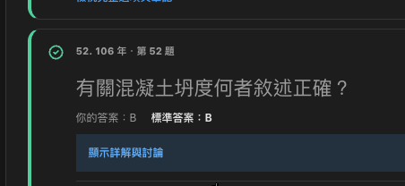 放大逐題作答結果中的題號資訊
- [x] 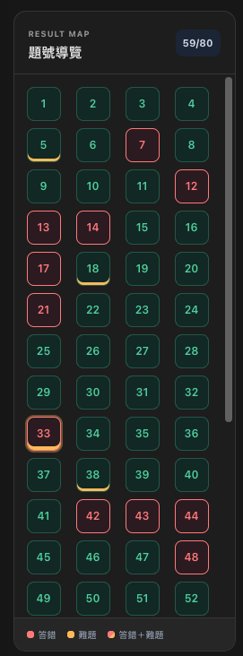 右側題號索引跟隨目前檢視的題目並自動捲動

## 1.34 - 2026-08-13

- [x]  使用者討論移除多餘標題文字，直接顯示內容
- [x]  刪除第 16 題重複顯示的題號
- [x]  詳解與討論的題目前顯示題號
- [x]  解題觀念分享欄位移到共享內容下方、加大輸入區並支援粗體
- [x]  自己發布的詳解支援編輯內容

## 1.35 - 2026-08-14

- [x]  修正顯示詳解時文字被擠成直向排列的問題
- [x]  使用者筆記管理頁與逐題作答結果皆加入格式預覽，正確顯示粗體效果

## 1.36 - 2026-08-16

- [x]  改善手機版完整作答紀錄的閱讀排版，並避免題號跟隨功能將頁面持續拉回上方

## 1.37 - 2026-08-17

- [x] 歷屆試題作答新增保留功能，使用者做到一半離開後，下次回到網頁可以繼續完成未完成的題目。
- [x] 檢討題目時如果進入詳解與討論，按上一頁要回到檢討題目頁面，而非一般作答題目。

## 1.38 - 2026-08-17

- [x]  使用者筆記與詳解討論皆顯示該題分類，呈現方式與作答頁一致。

## 1.39 - 2026-08-17

- [x]  移除獨立的格式預覽，文字輸入新增斜體、上標、下標與紅字格式。

## 1.40 - 2026-08-18

- [x]  使用粗體等格式功能時保留輸入區捲動位置，不再跳至最頂。
- [x]  同一使用者分享的詳解不重複刊登，新的修正直接取代原內容。

## 1.41 - 2026-08-23

- [x] 作答紀錄比較同年度每次作答錯題，同題重複答錯時標記累計答錯次數。
- [x] 法規題依題幹與選項語意判斷細分考點，在使用者筆記、詳解與討論底部顯示同考點的類似題目。

## 1.42 - 2026-08-24

- [x]   題庫部分年度載入失敗時，使用者筆記與詳解討論仍可使用已成功載入的題目。

## 1.43 - 2026-08-24

- [x]  修復已作答紀錄題庫載入失敗，縮短單年度題庫在正式環境的讀取時間。
- [x]   使用者筆記與難題標記只載入實際需要的年度，避免其他年度失敗阻斷內容顯示。

### 追加修正

- [x]  作答檢討顯示時即預先讀取各題詳解與討論，展開後直接呈現相關投稿。
- [x]  難題標記分類移除「全部」，預設顯示第一個有標記題目的科目。

## 1.44 - 2026-08-24

- [x]  修正作答紀錄誤判已完成所有年度；做到 105 年後，依題庫收錄順序繼續顯示 104、103、102 年。

## 1.45 - 2026-08-25

- [x]  題號導覽完整顯示不要滾動，並壓縮下方使用者筆記輸入區。
- [x]  修正難題標記裡面分享詳解失敗。

### 追加修正

- [x] 使用者筆記頁的題號導覽移除高度限制與內部捲動，完整呈現該年度所有題號。
- [x] 修正既有詳解更新遭 Firestore 權限拒絕時分享失敗，改以新版替代投稿相容線上舊規則。
- [x] 隨機出題新增「打亂選項」勾選功能；同一題組的選項順序保持穩定，答案仍依原始選項正確計分與保存。

## 1.46 - 2026-09-03

- [x]  難題標記展開後不重複顯示題目，只呈現選項、作答與詳解。
- [x] 難題標記新增重新作答功能，使用者可以直接驗證自己是否已學會。
- [x] 歷屆試題完成後的檢討頁面加入標記與取消難題功能。

## 1.47 - 2026-09-04

狀態：歷史紀錄

- [x] 作者分類管理新增獨立的「類似題目細分考點」，可人工校正類似題目的配對準確性，且不影響原本的大分類。
- [x] 相同細分考點的法規題互相配對；人工分類優先，尚未分類時保留關鍵字自動判斷。
- [x] 新增「類似題目尚未人工分類」篩選，方便逐題完成細項分類。

## 1.48 - 2026-09-08

狀態：歷史紀錄

- [x] 考題分析新增可收合的詳細趨勢分析，使用折線圖跨年度比較各科目分類的出題數量。
- [x] 使用者可自行勾選最多六個法規或分類進行比較，並可查看各年度精確題數表。
- [x] 法規科目可切換比較「法規分類」或「人工細分考點」。
- [x] 整合選取項目總標註數、最高單年出題量及首末年度變化最大項目等統計摘要。

## 1.49 - 2026-09-08

狀態：歷史紀錄

- [x] 考題分析新增「115 年複習優先度」，依近期加權頻率、近五年覆蓋率、升降趨勢與長期平均排列考點。
- [x] 提供 0～100 優先指數、近三年加權題數、近期動能、最近出題年度與可解釋的趨勢標籤。
- [x] 顯示人工細分考點資料覆蓋率，並註明結果是複習資源排序而非命題機率。

## 1.50 - 2026-09-09

狀態：歷史紀錄

- [x] 折線圖在未勾選分類時保留空白圖表與固定位置，勾選後即時呈現，避免頁面跳動。
- [x] 折線圖標示縱軸「出題數（題）」與橫軸「年份」。
- [x] 縱軸題數以 1 題為間隔顯示刻度及格線。
- [x] 詳細趨勢分析提供獨立的起訖年度選擇，折線圖、統計摘要與預測排名同步套用所選區間。

## 1.51 - 2026-09-09

狀態：歷史紀錄

- [x] 使用者筆記加入難題標記按鈕，並與題號導覽及既有難題清單同步狀態。
- [x] 新增「常錯題目」頁面，依歷屆試題交卷紀錄統整錯題與累計答錯次數，並提供科目、年度、重作、詳解、筆記及難題標記功能。
- [x] 登入後同步題目／選項字體大小、淺深模式與自訂介面配色，讓設定跟隨 Firebase 帳號套用至不同裝置。

## 1.52 - 2026-09-09

狀態：歷史紀錄

- [x] 閱讀截圖列出的建築相關法規及設計規範，建立後續內容校正所需的法規架構。
- [x] 整理 19 份文件的官方來源、核心範圍及版本注意事項至 `ref/building-law-reading-index.md`。
- [x] 標註國土計畫轉軌、太陽光電新制、無障礙歷史版本及臺灣省施行細則等易誤用處。

## 1.53 - 2026-09-21

狀態：歷史紀錄

- [x] 常錯題目與難題標記改用和歷屆試題一致的科目卡片及年度按鈕，並只顯示目前選取年度的題目。
- [x] 類似題目區塊的「細分考點」標籤改為「類似考題」。

## 1.54 - 2026-10-07

狀態：歷史紀錄

- [x] 新增獨立的「每日練習」功能，可複選科目，並由各科題庫分別隨機抽出 50 題。
- [x] 每科分為十層、每層五題，以關卡地圖、即時進度與答題統計呈現遊戲化流程。
- [x] 每層結束強制檢討該層錯題；單輪累積三題錯誤時立即暫停作答，完成逐題檢討後才能繼續。
- [x] 保存當日題組、作答與檢討進度，重新整理後可繼續，且不修改既有作答功能。

## 1.55 - 2026-10-07

狀態：歷史紀錄

- [x]  壓縮作答頁高度，避免主要操作區在一般桌面尺寸被切到。
- [x]  移除重複的每日練習資訊卡，將目前科目的十層關卡、作答統計及重新選科整合為單列。
- [x]  答對或答錯後以整張題目卡框線顯示狀態，放大下一題按鈕並靠右排列。
- [x] 每日練習加入刪除／恢復選項功能及難題標記。
- [x]  單科完成頁新增錯題清單，集中顯示作答選項、正確答案及詳解。
- [x] 單科完成後鎖定至隔日，並可返回選擇其他尚未完成的科目；複選科目時每完成一科皆先顯示成果。

## 1.56 - 2026-10-08

狀態：歷史紀錄

- [x]  每次只選擇一個科目，各科分別建立獨立的 50 題每日練習，不使用複選合併出題。
- [x]  移除答對後重複顯示的提示列，保留整張題目卡的答對狀態。
- [x] 錯題檢討時可直接新增、編輯及儲存使用者筆記。
- [x] 累積答錯達三題時，立即結束該科當日練習並鎖定至隔日。
- [x] 每日練習不顯示題目年份，且每場題目的選項順序隨機打亂並隨進度保存。
- [x] 題目與完成狀態於台北時間每日零點換日刷新，不以開始後 24 小時計算。

#1.56
 每日練習裡的詳解好像不會正常顯示
 選項框跟外寬黏再一起，適度脫開

## 1.57 - 2026-10-08

狀態：歷史紀錄

- [x]  每日練習主頁顯示今日已完成的科目、答對題數與實際作答題數。
- [x] 取消每層答錯三題即結束；每五題仍須完成該層錯題檢討，再繼續下一層。
- [x]  檢討頁恢復顯示題目年份與分類；作答頁只隱藏年份並保留題目分類。
- [x]  每日練習的檢討與完成頁同步載入「詳解與討論」投稿，不再只讀取題庫內嵌詳解。
- [x] 加入血量連擊、關卡脈動、答對獎勵及答錯回饋動畫，並支援減少動態效果設定，提升闖關遊戲感。
- [x] 每次每日挑戰有十點共用血量；答錯扣一點，連續答對三題回復一點，最多回到十點，血量歸零才結束。
- [x] 測試階段取消每科每日一次限制，保留今日上次成果但允許立即重複挑戰。

## 1.58 - 2026-10-09

狀態：歷史紀錄

- [x] 每題加入六十秒倒數，逾時視為答錯並扣除一點血量。
- [x] 滿血時連續答對三題改為獲得寶具；每題最多使用一個寶具。
- [x] 寶具包含自動刪除一個錯誤選項、增加十秒、凍結倒數八秒，以及本題答錯免扣血的護盾。
- [x] 每五題固定進入關卡結算，依錯題數給予 S／A／B 評級；無傷通關額外獎勵一個寶具，第五與第十層標示為 BOSS 關。
- [x] 將血量改為置頂的十顆愛心血條，加入像素遊戲風格的計時器、寶具列、關卡名稱與結算獎勵介面。

## 1.59 - 2026-10-10

狀態：歷史紀錄

實作說明：已加入六層建築戰場、原創建築師與六隻魔王像素素材、攻擊／受擊／連擊及十秒結界動畫。六層題數為 5／6／7／8／9／15，耐久為 3／3／4／4／3／3；每層恢復耐久，連對三題回復一格，滿血改得寶具。每題作答後顯示詳解，時間歸零立即戰敗並保存。答對造成魔王傷害，錯題於關卡檢討後補上傷害；防護罩在有效時間內擋傷並延長倒數十秒。素材使用內建 imagegen 產生，存於 `public/daily-game/`；參考 Eastward 的城市光影與 Sea of Stars 的戰鬥回饋。

原始需求：每日挑戰大更新

後續補齊：#1.62 已加入週期蓄力／投射物攻擊、連續倒數血條、時機格擋及狂暴階段；容錯耐久與本題倒數壓力分開標示，保留六十秒歸零立即戰敗。
1.讓每題作答完都會顯示詳解不管對錯
2.我想加入一些遊戲風格的動畫，用平面2D的捲軸式遊戲呈現，目前分成十層，每一層剛好一打一隻怪，整體機制跟隨這個做變更如下：
(1)每層都是設定成答對五題可以擊敗該層怪物，差別在於前面的怪物打完家教輕微，怪物會攻擊玩家的機制是玩家作答失敗，越後面的層數怪物打玩家越痛（意即越後面層數越不能錯）
(2)基於前項遊戲規則，更改本來十層變成只有六層，每層題目數量改成：5/6/7/8/9/15 最後一層是大魔王龍王，最難打
(3)每層錯題數量導致遊戲結束的門檻如下：3/3/4/4/3/3
(4)連續答對有連擊動畫，寶具設定不變
(5)設定成每層怪物都會一直攻擊玩家，直到時間結束會直接被打死遊戲結束，錯題則會加快血量消耗
(6)遊戲動畫風格利用可愛的像素風格，玩家是建築師形象，手拿捲尺當作武器
(7)各層魔王可以以建築元素去呈現，共六個魔王，越後面層數的看起來威脅性要越大，這部分由你幫我設計
(8)整個遊戲的風格都由你幫我設計，原則以平面捲軸是像素風格，背景就用各種建築物
(9)寶具目前的延秒跟凍結時間就改成發起防護罩，可以抵擋該層魔王攻擊，持續10秒，刪除選項不變

## 1.60 - 2026-10-10

狀態：歷史紀錄

- [x]  縮小戰鬥區並固定於頁首下方，捲動到選項與確認答案時仍可看見遊戲畫面；手機版再縮減高度。
- [x]  建築師改為襯衫、背心、眼鏡與圖紙造型，保留捲尺武器。
- [x]  魔王血量歸零時加入擊落、縮小與消失動畫；全關完成顯示勝利、獎盃及星光畫面，龍王血量確實歸零。
- [x] 六隻魔王改為短身、大眼的原創可愛像素造型，保留各自建築材料特色與龍王的威脅感。
- [x] 六張背景拆成獨立 WebP，以等比例裁切呈現，避免寬幅拉伸；角色也採用獨立透明 WebP。

## 1.61 - 2026-10-10

狀態：歷史紀錄

- [x]  魔王面向左側建築師；朝向與攻擊、受傷、擊破動畫分離，動畫不會翻轉角色方向。
- [x]  桌面版將關卡、統計與重新選科整合至右側欄，主要區域保留給題目；手機版改為題目下方的緊湊資訊區。
- [x] 魔王與玩家受擊加入閃光、後退、撞擊星光與傷害數字；結界擋下攻擊時顯示防禦，不誤播扣血受傷效果。
- [x]  玩家戰敗時閃光、傾倒並淡出，顯示 DEFEAT 與失敗原因；玩家血量歸零，關卡標示失敗，結果圖示不再使用勝利獎盃。
- [x] 六個背景重新設計為圓潤、暖色與童話建築的可愛像素場景，搭配現有角色及魔王；保留原始圖集並輸出獨立 WebP。
- [x] 修正關卡最後一題戰敗後重新載入時，誤用下一關滿血而恢復練習的問題；支援減少動態效果偏好並保留戰敗狀態。

## 1.62 - 2026-10-11

狀態：歷史紀錄

- [x] 確認六張新版可愛背景已套用；修正過度寬幅裁切，桌面改為左側大戰場、右側作答，較完整呈現背景、角色與魔王。
- [x] 作答與確認／下一題按鈕同屏顯示；長題、附圖及詳解只在題目區內捲動，確認鍵不跟著消失。手機依螢幕高度平衡戰場與題目，修正標籤擠成直排，完整保留題目內容與圖片放大功能。
- [x] 魔王週期蓄力、招式預告、投射物攻擊與玩家受擊；後段魔王蓄力更快，魔王低血量進入狂暴，以較快攻擊與紅色提示增加緊張感。
- [x] 本題血條與實際倒數連動，時間持續消耗血條；答錯另扣一格耐久，作答後停止本題攻防，下一題重新蓄力。原本各關 3／3／4／4／3／3 格容錯、連對三題回血／寶具及六十秒歸零戰敗規則保留。
- [x] 每關一次「架設防禦」：蓄力亮紅時完美格擋，延長五秒並擋傷三秒；提前使用延長兩秒但不擋錯題傷害。使用次數與防護期限保存，重新整理不可重用，跨關恢復機會。
- [x] 答對新增捲尺伸展打擊、命中閃光與魔王後退；答錯新增魔王投射物與玩家受傷，防護時投射物彈開；第三次連續答對以多重捲尺與必殺星光呈現既有回血／寶具獎勵，不減少必要作答題數。
- [x] 保留減少動態效果設定；驗證倒數扣血、格擋時機／期限、保存還原、連擊、手機及長題附圖排版。

設計參考：[Super Mario RPG](https://www.nintendo.com/us/store/products/super-mario-rpg-switch/) 的時機防禦與連擊回饋、[Sea of Stars](https://www.nintendo.com/us/store/products/sea-of-stars-switch/) 的連招與戰鬥節奏。此處轉化為作答中斷敵人攻勢、限次格擋、容錯耐久與倒數血條，不要求玩家另外操作角色移動或犧牲題目閱讀。

## 1.63 - 2026-10-11

狀態：歷史紀錄

原始需求：
1.我覺得遊戲機制錯了，應該是每層的王有固定血量（以目前每層題數），玩家要把王打死就要打完那些血量（即答對該層題數），然後每層錯題限制達成時如果王還沒死就判定失敗，演出被王打死的動畫
2.手機介面題目要滾動會變很難用，盡量讓題目一目瞭然不用滾動，排版需要重新設計
3.我想要新增“以闖關模式進行”或正常模式進行兩種選項，後者就讓使用者回到一開始的練習排版版本，只有選擇遊戲模式才會進到現在的模式（考量不同年齡層的使用者）
4.目前的怪物都是以建築物的材料為主，我想把這些王定義為“建築構造與施工”的王，
有關法規的要重新設計六隻：
第一層：用建築法作為形象
第二層：用公寓大夏管理條例作為形象
第三層：用國普計劃法區域計畫法國家公園法等作為形象
第四層：用營造業法、採購法作為形象
第五層：用都市計畫法、都市更新條例作為形象
第六層：用建築技術規則作為形象
有關環控的也要重新設計六隻：
第一層：風
第二層：光
第三層：水
第四層：音
第五層：設備（如空調等等）
第六層：綠建築

5.然後怪物被攻擊時要有受到攻擊的模樣動畫，同理答錯時使用者也是
6.時間扣點應該不會每層都重置血量，是累積式的，答對就會回復一些血量，另外答對題目回覆錯題的機制配合第一點取消
7.根據我上面的規則，幫我設想周到，並找到可能衝突的地方，並幫我擬定相對應的規則

補充需求：錯題上限改為 **7／6／5／4／4／3**。

實作與規則決議：

- [x] 開始前可選「正常模式」或「以闖關模式進行」，預設正常模式。正常模式抽選本科 50 題、不限時、無血量／錯題上限，逐題顯示詳解，最後整理錯題；每日一次限制仍維持測試停用。
- [x] 闖關魔王血量固定 5／6／7／8／9／15，只有正確作答造成 1 點傷害，答錯與檢討都不扣魔王血量。魔王歸零後才進入關卡檢討；檢討不再是補傷害途徑。
- [x] 每層答錯次數上限 7／6／5／4／4／3；到達上限且魔王存活即戰敗，演出反擊、建築師傾倒與 DEFEAT，並保存失敗關卡。答對只補玩家 HP，不抵銷錯題次數；跨關重設的是該關錯題計數，不是玩家 HP。
- [x] 玩家總 HP 100，作答時每秒扣 0.5、答錯額外扣 10、答對回復 15（不超過 100），跨關保留血量。HP 歸零即戰敗；每題仍保留 60 秒上限，到時也立即戰敗。詳解／關卡檢討／題庫載入時暫停，重新載入不補滿 HP 或倒數；離開時未作答的有效倒數照常結算。
- [x] 連對三題改為寶具 +1，不回復錯題機會；無錯擊破魔王再得寶具 +1。保留每題一寶具、刪除錯誤選項、防護結界 10 秒及每關一次時機格擋；防護暫停耗血、擋反擊，但不免除答錯計數。結界延時 10 秒，完美格擋延時 5 秒且防護 3 秒，提前使用只延時 2 秒。
- [x] 預抽同科 74 題不重複題目作為補題儲備：通關需答對 50 題，加上各關最多 6／5／4／3／3／2 次可存活錯誤，共最多 73 題；第 74 題留作終止錯誤。畫面分別顯示已作答與答對進度，不再把 50 次作答誤判為通關。題庫不足 74 題時提示改用正常模式；意外耗盡題庫不會假通關。
- [x] 手機縮小戰場、精簡標籤與選項控制，題目／選項完整展開，取消限高與巢狀捲動；圖片保持比例並可放大。短題盡量同屏，長題／長選項採整頁自然捲動，避免縮字或截斷內容。桌面保留左右同屏與固定確認區。
- [x] 建築材料魔王沿用為構造與施工系列；新增法規與環控各六隻原創魔王，依所選科目切換名稱、招式、透明像素角色。結構科暫沿用建築系列；魔王形象是科目主題，不限制每層只出該分類題目，避免題庫分布不足。
- [x] 法規：建照印章獸／公寓管家獸／國土山林靈／契約工務獸／都市更新獅／技規法典龍，對應原始需求的六組法律主題；環控：旋風精靈／日光稜晶獸／水滴管管獸／回聲音波獸／空調機械獸／綠建築森龍。
- [x] 保留捲尺命中、魔王閃光後退、錯答投射物、玩家受傷、防護彈開、連擊及減少動態效果。新版保存格式保留 HP／模式／題目儲備／防禦次數，舊版不相容的作答次數闖關進度轉為正常模式保留答案，不自動刪除或虛構新制勝利。
- [x] 驗證固定魔王 HP、六關錯題上限、跨關血量、73 題通關、載入暫停、超時與歸零優先判定、防護仍計錯題、存檔還原、正常模式、手機長題與受擊／戰敗動畫。

素材：使用內建 imagegen 分別產生 12 隻角色，原圖存於 [`public/daily-game/source-1.63/`](../../public/daily-game/source-1.63/)，正式素材為 `law-boss-1-v3.webp`～`law-boss-6-v3.webp`、`env-boss-1-v3.webp`～`env-boss-6-v3.webp`；完整提示詞與輸出說明見 [`asset-prompts-1.63.txt`](../../public/daily-game/asset-prompts-1.63.txt)。

## 1.64 - 2026-10-11

狀態：歷史紀錄

- [x]  題目／選項可分別調整為 14～24px，統一由「設定 → 閱讀設定」操作，移除每日練習額外的字體設定區塊；沿用既有設定保存及登入後跨裝置同步，正常／闖關模式、關卡檢討、完成頁與手機皆套用。
- [x] 移除每日練習寫死的選項與手機題目字級；大字完整換行、不截斷，手機保留整頁自然捲動，桌面闖關確認鍵仍留在題目區外。
- [x]  刪除選科頁的規則數值及長篇說明區塊，保留模式選項內的簡短提示，不改變闖關規則。
- [x]  刪除「DAILY CHALLENGE／建築師的六層試煉」標題、圖示與副標，直接顯示模式與科目選擇。
- [x] 驗證正常／闖關模式字級分開調整、重新載入保存、不重設答案／倒數、檢討及完成頁套用、手機大字無橫向溢出，以及既有闖關流程。
- [x] 補充修正：正常／闖關模式的桌面及手機版一律取消題目卡內部捲軸與限高，題幹、大圖、選項及詳解完整展開；手機附圖取消固定 240px 高度上限、按可用寬度保留比例。超出螢幕時只捲動整個頁面，不縮字或截斷題目。

## 1.65 - 2026-10-11

狀態：歷史紀錄

原始需求：

1.每個王都做得太複雜了，可以再簡化，只要表現出特徵就好了，而且目前風格過度免洗（很像中國廉價手遊），重新想一下
2.法規環控的每層名稱不要這樣取，畢竟不一定該層就是該類題目
3.換層要有過場動畫
4.就算答對該題下面也讓使用者可以打詳解或紀錄

補充回饋（2026-10-12）：過場只在左側動畫框播放；魔王細節取原版與過度簡化版之間的平衡，改用日式風格，全部畫風一致。

實作與設計決議：

- [x] 十八隻魔王統一重製為柔和日式像素 JRPG 角色：以建築師、既有背景及同一隻日式印章獸為共同風格參考，統一琥珀眼睛、深色階梯描邊、暖色左上光源與像素陰影。保留表情、短肢體、少量材質接縫及立體感，細節量介於繁複舊版與 32×32 圖示版之間；移除誇張怒眉、繁複裝甲及裝飾。構造保留磚塊／鋼梁／鷹架／玻璃／混凝土／屋頂龍，法規保留印章／公寓鑰匙／山林／契約／街屋獅／法典龍，環控保留風／光／水／音／空調／葉翼龍。結構科沿用構造系列；舊版素材保留，不覆蓋或刪除。
- [x] 法規與環控層名統一為「入口／迴廊／階梯／露臺／高臺／塔頂」，不再以法律名稱或風光水音等分類命名；魔王形象只代表科目風格，不限制該層出題分類，題目抽選及既有規則不變。
- [x] 第一至第五層檢討完成後，在左側原戰鬥框播放 1.8 秒換層過場：沿用同一框架尺寸、血量條及角色比例，建築師前進、下一層背景與魔王登場；右側檢討保留，繼續按鈕暫停，手機則在上方同一戰鬥框播放，不另外佔用題目區。可略過；期間不扣血、不啟動下題倒數，不重設 HP／作答／寶具；過場中重新整理安全回到已保存的檢討，再次繼續即可。減少動態效果時改為 0.3 秒靜態提示，最後一層直接進入勝利結果，不出現第七層。
- [x] 正常／闖關模式在每題送出答案後，不分答對答錯，詳解下方都提供使用者筆記、格式工具、貼圖、儲存與「分享至詳解與討論」。沿用既有文字同步及本機圖片保存；未送出答案前不顯示編輯器，換題不沿用上一題未儲存內容，閱讀及記錄期間維持暫停。
- [x] 驗證十八隻透明 WebP 的共同 384×384 畫布、透明留白、原稿保留及科目切換；目視檢查共同畫風與實際戰鬥框。驗證中性層名、既有關卡與戰鬥、過場左側定位／框架不跳動／暫停／自動完成／略過／重新整理／減少動態效果、答對後儲存及分享、換題隔離、重新載入保存，以及電腦／手機完整展開與無橫向溢出。

正式素材：[`public/daily-game/`](../../public/daily-game/) 的 `{construction,law,env}-boss-{1..6}-v5.webp`。使用內建 imagegen 分別重製 18 隻日式角色，原稿存於 [`source-1.65-jp/`](../../public/daily-game/source-1.65-jp/)，完整提示詞及處理方式見 [`asset-prompts-1.65-jp.txt`](../../public/daily-game/asset-prompts-1.65-jp.txt)；正式檔只做透明裁邊、等比例 nearest-neighbor 縮放與 WebP 轉存，不套濾鏡。

## 1.66 - 2026-10-12

狀態：歷史紀錄

原始需求：
新增一項測驗內容:法規克漏字
希望這邊可以把常考的法規改成填空題給使用者填空，主要以數字題目為主
初步先閱讀"建築技術規則"施工編的內容，做成填空題進行測試，你要先閱讀完這份法規，並且依據目前考古題的資料幫我找出常考題型製作，每次填空都是一題，每題可以是複數空格。使用者填完答案後提交可以直接比對答案及完整條文
依照上述要求先行施做看看

補充要求：填入數字維持法條表示方式，不接受小數、分數、百分比或單位之間的等值換算。

- [x] 研究《建築技術規則建築設計施工編》官方 389 條文字及現行生效狀態，對照 100～114 年本站技術規則相關考古題；研究紀錄與可重現證據保存在 `ref/law-cloze/`。
- [x] 新增獨立「法規克漏字」頁面與導覽入口，以常見數字題型製作 34 題、83 空；每次一題，可有多個空格並可依考點練習。
- [x] 提交後逐空比對答案與原文數字、展開完整條文，提供官方法源及相關考古題連結；第 167 條之 6 官方 PDF 的兩類無障礙停車附表已核對補齊。
- [x] 判分保留原文數值表示方式；八分之一／1/8 不接受 0.125，比例不約分換算，比值／小數／半分別核對。全形、中文與阿拉伯字號可對照，單位固定不換算。
- [x] 保存本輪順序、草稿與已提交成績於目前瀏覽器；切換題目隔離答案、題庫版本不符則建立新練習，不改動既有選擇題或雲端資料。
- [x] 驗證官方原文一致性、多空格判分、未填不得提交、法條表示法、重新載入保存，以及桌面／手機版面。

## 1.67 - 2026-10-12

狀態：歷史紀錄

原始需求：

1.目前做法還不錯，但我希望可以直接田在文字敘述裡面
另外下面法條的答案部分請以紅字呈現
2.讓使用者選擇每次測驗題數(5/10/15/20/25/30)，也可以選擇法規及考點(或考點隨機出))
3.以依樣的方式研究最新版"建築物無障礙設施設計規範"並加入，因為這科目也是常考

補充回饋：填空不應誤挖標題／款次，例如「三、」須保留，應挖後面的「三公尺」。

- [x] 改成在條文敘述中直接輸入，重複空號同步；提交後逐空比對，完整原文以紅字標出本題答案數值。
- [x] 提供5／10／15／20／25／30題、法規及考點設定，也可隨機考點；每輪不重複，小題庫明示實際題數並以上限出題。設定按「開始新測驗」才套用，完成後顯示題數／空格成績。
- [x] 研究國土署最新版《建築物無障礙設施設計規範》105頁全文及12頁勘誤，核對表格、樓梯錯圖與既有考題；新增39題175空，兩部法規合計73題258空，附官方原文／圖表連結。
- [x] 修正款次誤挖、數字局部匹配、非數量「之一」、單位不符的誤挖及同題重複門檻答案洩漏；法條表示方式及不等值換算原則保持不變。
- [x] 保存本輪設定、順序、草稿、提交結果及完成狀態；驗證所有原文與答案位置、題數篩選、小題庫、重載、逐空判分及電腦／手機整輪流程。未改動既有作答紀錄或雲端規則。

補充回饋（2026-10-12）：建築技術規則題目太少，重新整理並增加題型。

- [x] 再核對現行設計施工編與歷屆資料，新增128題434空，建築技術規則由34題擴充為162題517空，涵蓋17個考點；保留39題無障礙規範，總計201題692空。
- [x] 補齊用語、基地與容積、一般設計、停車設備、防火避難、特定建築、防空、施工安全、地下／高層／山坡地／工廠、開放空間、老人住宅與綠建築。保留用途、例外、但書及原文表示法，不納入未施行第301條、刪除或移編條文。
- [x] 支援原文小數比值及小數分子分數，不接受等值轉換；保護條號款次而允許填真正樓層門檻，並核對括號內單位。
- [x] 原73題內容不變；舊測驗順序、草稿、成績及完成狀態保持不變，按「開始新測驗」才使用擴充題庫。核對全題庫原文與答案位置並驗證桌面／手機整輪及舊輪次還原。

## 1.68 - 2026-10-14

狀態：歷史紀錄

原始需求：

1.法規克漏字加入"建築法"、"建築師法"、"都市計畫法"、"國土計畫法"，填空著重在相關"期限"、"罰緩"等數字，依樣先參考歷屆考古題常出現的題目及法條進行
2.法規克漏字新增直接看答案功能
3.目前的詳解不會有空格換行等排版，修正成可以依據使用者筆記的排版呈現

- [x] 核對四部法規現行官方全文與100～114年法規考古題線索；新增建築法23題52空、建築師法15題25空、都市計畫法21題35空、國土計畫法14題33空，合計新增73題145空；六部法規總計274題837空。
- [x] 以執照／開工／公告／展覽／復議等期限、罰鍰／罰金／懲戒、相關法定比例與門檻為重點；保留單位、比較用語、起算點與但書。國土計畫法採114.01.20版本，第45條地方計畫公告後十年內公告功能分區圖；舊考題不改答案。延伸題型明示非直接命題證據。
- [x] 新增「直接看答案」，不需填完；條文內紅字呈現原文答案並展開完整條文。本題標記閱讀練習、不列入答對率，可換題、整輪閱讀及重載還原；草稿保留、不虛構提交答案或100%成績。
- [x] 原201題逐題內容不變；相容兩版1.67題庫的既有順序、草稿、成績及小題庫輪次，不自動加入新法規或重設進度。
- [x] 詳解與討論、回覆、每日練習及作答檢討沿用筆記安全格式渲染，保留換行、空白行、連續空格和縮排；難題／錯題內建詳解也支援格式。投稿、編輯、從筆記分享及加入筆記不再截掉原始首尾排版，空白內容仍會攔截。
- [x] 驗證全題庫法源、答案位置／判分／單位、數字表示法、款次保護、舊進度相容、直接閱讀不計分、重載及桌面／手機版面。研究與可重現來源存於 `ref/law-cloze/`，不修改Firebase權限規則或歷屆作答紀錄。

## 1.69 - 2026-10-14

狀態：歷史紀錄

原始需求：

 每題都要列出所有條文內容，否則使用者無法只憑一條項目得知考點
繼續加入"公寓大廈管理條例"、"非都市土地使用管制規則"、"政府採購法"、"營造業法"

- [x] 作答區改以完整條文組成填空，從第一項到所有款項、後續段落、前提及但書一開始就展開；只挖原有考點數字，不再孤立顯示單一款，亦不必交卷後才看法條脈絡。無障礙規範顯示本題所涉編號的完整文字，附表與官方法源保留核對途徑。
- [x] 核對四部現行官方全文352條及100～114年相關考古題；新增公寓大廈19題41空、非都市土地24題67空、政府採購21題46空、營造業20題55空，合計新增84題209空；十部法規總計358題1046空。
- [x] 保留規約例外、雙重人數／權利門檻、土地核定計畫及地方調降、付款實際工作日、異議與申訴起算點、營造業資格及罰則義務人。非都市土地採115.05.27版本；不把授權子法金額規模或錯誤選項當母法數字，延伸題型明示非直接命題證據。
- [x] 原274題及三種舊版輪次可繼續還原，包含答錯結果、草稿與直接看答案狀態。補齊億／萬元中文整數的精確判分及數字邊界，不變更分數、小數、比值、半及固定單位原則。
- [x] 驗證全題庫完整原文、空格還原、標紅位置、款次保護、判分與舊版相容，並檢查桌面／手機全文作答、換題、重載、選法規及無橫向溢出；研究來源與可重現腳本存於 `ref/law-cloze/` 及 `scripts/`。

## 1.70 - 2026-10-15

狀態：歷史紀錄

原始需求：

1.每日練習生成的題目新增"列印功能"，使用者也可以選擇把每日派發的題目列印出來手寫，題目排版及字型請比照國家考試的題目格式，上方標題改為"專門職業及技術人員高等考試建築師每日練習試題"，請看下方參考圖，下載下來的格式是PDF

2.每日練習新增當日考題預覽，讓使用者做完後可以完整檢視今日題目

補充需求：另附一份參考答案頁供使用者對答案，一樣參考建築師考試格式。

- [x] 每日練習建立後即可「列印／下載 PDF」；A4 黑白楷體風格、指定標題、科目日期、座號／姓名、注意事項、題前作答括號及頁碼。嵌入開源字型，保留題圖比例、原文段落與單位，自動分頁；不依賴使用者電腦字型或付費 PDF 服務。
- [x] PDF 末頁另附國考式參考答案表，以本次每日題號編排，精確對應已打亂的選項；支援多個可接受答案與一律給分，不在題目頁標出答案，不包含筆記、投稿或詳解。
- [x] 新增可展開／收合的「當日考題預覽」，正常模式顯示完整 50 題（小題庫依實際派發數量），闖關模式含全部備用題並標示題數；完成後或重載仍可查看。題目與選項順序和本次練習一致，不重新抽題、不提交答案、不改變成績；闖關計時照常進行。
- [x] 題目尚未載齊時禁止部分下載／預覽；字型或題圖下載失敗可重試，既有作答、難題、筆記與進度保留。PDF 程式與約 2 MB 字型僅在下載時載入，字型來源、授權、裁切腳本及視覺核對腳本一併保留。
- [x] 驗證 386 項單元測試、60 項每日練習／PDF 桌面與手機測試、TypeScript、ESLint 及正式建置；四科各 50 題下載的 PDF 共 200 筆答案逐筆比對，核對題圖數量、中文字型、分頁及頁面邊界並實際渲染檢視。

使用方式：進入「每日練習」→選科及模式→「建立今日挑戰」→上方「列印／下載 PDF」。完成練習後點「當日考題預覽」可完整檢視本次派發題目；PDF 的最後一頁為獨立參考答案。

## 1.71 - 2026-10-16

狀態：歷史紀錄

原始需求：

應該是正常模式下面多一個"製作每日練習紙本檔案"跟"線上作答"給使用者選擇，而不用直接點進去
紙本列印格式修正：
1.原題出處放到該題右下角，以(年,題)顯示就好，例如(110-30)代表110年第30題
2.中文字體改成新細明體，遇到數字就用time new romans，請完全比照國家考試題目卷的形式(直接照抄)
3.所以頁次會在右上角
4.有一律給分的題目不要抓取為每日練習題

補充確認：使用者同意缺少新細明體或 Times New Roman 時，改用開源明體及 Times 風格字型，並明確提示。

- [x] 正常模式下直接提供「製作每日練習紙本檔案」及「線上作答」兩個入口；紙本直接下載，不進入作答畫面、不啟動計時、不提交答案或成績。紙本快照獨立保存，重試、重載及之後線上作答沿用同一題序與選項順序。
- [x] 依參考國考試卷調整標題、等別、類科、科目、日期與座號、注意事項、題號縮排及選項配置；短選項四欄／兩欄橫排，長選項保留懸掛縮排。原題出處移至每題末右下角，採 `(110-30)`；頁次移至右上角，以「總頁數-本頁」呈現，答案維持獨立頁。
- [x] 中文優先使用新細明體，數字及英文字母使用 Times New Roman；僅在下載點擊時請求讀取這兩個本機字型，確認文件嵌入權限，不上傳或將系統字型散布到網站。無法取得時採開源 Noto Serif TC 明體及 Tinos（Times 風格），下載介面明示實際字型，依後續要求不在 PDF 內印出字型資訊；保留完整授權及可重現字型轉換腳本。
- [x] 新建正常模式、闖關模式及紙本統一排除一律給分、全部選項皆接受與非選擇題；可用題數同步重算。舊版作答順序、已答內容、成績與錯題狀態保持不變，不為套用新篩選而覆蓋既有進度。
- [x] 驗證 396 項單元測試、62 項桌面／手機每日練習與 PDF 測試、TypeScript、ESLint 及正式建置；逐筆核對四科 200 筆答案、題圖數量、出處與頁次位置、數字字型及嵌入字型可渲染性，並實際檢視試卷分頁、本機指定字型／開源備援輸出與兩入口畫面。

- [x] 補充調整：將「製作每日練習紙本檔案」與「線上作答」移至設定區最底部，在模式、科目及說明之後顯示；手機改為直向排列。
- [x] 補充調整：輸出的試卷與參考答案頁不再印出「字型：…」資訊；保留原字型、題目、答案、頁碼與下載介面的備援字型提示。
- [x] 補充調整：線上作答與中途檢討移除「當日試題」工具列，不提供完整考題預覽或 PDF 按鈕；在正常練習完成、闖關成功或失敗後，於成績與錯題整理下方提供當日考題預覽。紙本製作僅保留在開始前的設定區。
- [x] 補充調整：正常模式每天每科固定一份題組，紙本與線上共用題目及選項順序；線上先開始也會保存題組，切換科目、重複挑戰、重新整理後均沿用。依臺灣日期隔日更新，闖關模式每次重新抽題，不受此限制。相容舊紙本快照及既有線上進度，不重置已存答案。
- [x] 固定題組調整驗證：422 項單元測試、76 項桌面／手機每日練習流程、TypeScript 與 ESLint 均通過；涵蓋四科獨立保存、紙本／線上共用、完成後重玩、重載、臺灣日期換日、舊資料相容及闖關重新抽題。

使用方式：先選今日科目，再點設定區最底部的「製作每日練習紙本檔案」或「線上作答」。若瀏覽器詢問本機字型權限，可允許使用已安裝字型；拒絕或不支援仍可用明示的開源備援完成下載。

## 1.72 - 2026-10-20

狀態：歷史紀錄

原始需求：

新增一個"速記圖庫"，我會把一些整理圖片放上去，裡面分類成法規、構造、環控，看可不可以做成圖片可以由我(管理者)上傳

補充確認：採用本機管理，上傳後隨網站部署公開，不另設雲端圖片儲存服務。

- [x] 新增 `/memory-gallery` 及側欄「速記圖庫」入口，支援法規、構造、環控分類、標題／說明搜尋、縮圖與放大檢視；一般使用者只能瀏覽。
- [x] 新增 `/admin/memory-gallery` 本機管理頁，輸入 `AUTHOR_EDIT_KEY` 後可上傳圖片、修改標題／說明／分類及確認下架。每次修改均由伺服器重新驗證金鑰，不以單純的前端解鎖作為權限依據。
- [x] 管理 API 僅限本機 development 環境，正式網站與 Vercel 拒絕檔案修改；金鑰不存入 localStorage、圖庫索引或公開環境變數，`.env.example` 僅提供空白設定欄位。
- [x] 接受靜態 PNG／JPEG／WebP，每張最多 8 MB、2,400 萬像素；檢查真實檔案簽章及解碼結果、校正方向、轉 WebP、建立縮圖，長邊上限 12,000 像素。以隨機 UUID 命名，不接受使用者指定儲存路徑。
- [x] 圖片存於 `public/memory-gallery/assets/`，索引存於 `data/memory-gallery.json`；串行及原子寫入避免上傳互相覆蓋，損壞的索引不會被清空。下架只加上 `archivedAt` 並從清單移除，完整圖片檔案仍保留，可透過 Git 或移除該索引的 `archivedAt` 還原；已知圖片網址不會因此撤銷。
- [x] 驗證 448 項單元測試、10 項桌面／手機圖庫流程、TypeScript、ESLint 與正式建置；另以真實本機 API 完成上傳，確認公開頁面、完整圖片及縮圖均可讀取。測試圖片已移至測試輸出，正式圖庫不放入示範內容。

使用方式：

1. 在專案 `.env.local` 設定 `AUTHOR_EDIT_KEY=你的長隨機金鑰`；已有設定可沿用，請勿加上 `NEXT_PUBLIC_` 或提交實際金鑰。修改後重新啟動 `npm.cmd run dev`。
2. 本機開啟 `http://localhost:3000/admin/memory-gallery`，輸入同一組金鑰。
3. 選擇分類、標題、說明與圖片，點「上傳並儲存圖片」。只上傳有權公開分享、且不含私人個資的圖片。
4. 在 `http://localhost:3000/memory-gallery` 檢查呈現；圖片及 `data/memory-gallery.json` 一起 commit／push，正式網站才會更新。
5. 下架後同樣需要 commit／push；此功能不是永久刪除，若要撤除已知圖片網址，需另外移除完整圖片檔案並重新部署。

## 1.73 - 2026-10-22

狀態：歷史紀錄

原始需求：

把這邊分類成幾個大項，然後依據大項再細分：

1. 首頁刪除（按最上方建築師考試圖示就是首頁了有點多餘），每日練習改成第一列。
2. 歷屆試題、隨機出題、法規克漏字都歸類為「歷屆試題題練習」。
3. 考題分析、速記圖庫、法規資料庫歸類為「歷屆試題資料集成」。
4. 詳解與討論獨立一個。
5. 使用者筆記、難題標記、常錯題目、已作答紀錄歸類為「我的作答存摺」。

以上做成觸碰或點擊會跳出子項目的形式。

保留的首頁入口參考：

- [x] 側欄移除重複的「首頁」項目，依序顯示每日練習、歷屆試題題練習、歷屆試題資料集成、詳解與討論、我的作答存摺；設定與問題回報仍獨立保留於底部。
- [x] 三個大項各自收納需求指定的子頁，桌面可滑鼠移入或點擊開啟浮出子選單，手機以點擊開啟；支援再次點擊收合、關閉按鈕、Escape、鍵盤選取與同時只開一個大項。
- [x] 保留頂端建築師考試標誌返回首頁，手機按標誌或子項目後自動關閉抽屜；子頁及所屬大項同步標示目前位置，作答頁歸於試題練習。保留既有頁首標題與設定彈窗，不更動作答紀錄、筆記或資料儲存方式。
- [x] 驗證 485 項單元測試、30 項桌面／手機導覽與圖庫流程、TypeScript 與 ESLint；涵蓋所有子頁連結、滑鼠移入、點擊／觸控收合、鍵盤焦點、首頁入口、目前頁面標示及視窗邊界，另回歸原手機抽屜與設定彈窗流程。

使用方式：桌面將滑鼠移到大項或按一下，從浮出選單選擇功能；手機先開啟左上選單，再點大項與子項目。若要改選其他大項，可再按目前大項或子選單右上關閉鍵收合。

## 1.74 - 2026-10-23

狀態：歷史紀錄

本次改動：

- [x] 新增「每日練習（新版）」`/practice`，融合每日練習（正常模式）與隨機出題，放在側欄第一個；原本的每日練習 `/daily` 與隨機出題 `/random` 保留不變以便比較。

### 出題設定

- [x] 以每日練習正常模式的畫面為基底重新設計，移除闖關模式。
- [x] 外層只選科目，其餘設定都收在預設收合的「進階選項」；收合時顯示目前設定摘要，並可「恢復預設」。
- [x] 進階選項包含年度範圍、題目類別、題數（5／10／15／20／30／50，題庫不足 50 題時多一個「全部 N 題」）、打亂選項順序，以及改為選項的「包含一律給分題目」。
- [x] 預設與原本每日練習相同：50 題、全部年度與類別、打亂選項、不含一律給分；進階設定不會在重新整理後保留。
- [x] 每按一次就重新抽題，不提供保留題組的選項。
- [x] 設定頁保留「製作紙本檔案」與「線上作答」，兩者各自重新抽題，紙本與線上是不同題組；紙本沿用每日練習的 PDF 格式，未打亂選項時參考答案頁註明選項維持原試卷順序。
- [x] 題目類別只在此頁整理：「???」與「廢止」改用原本的主題分類，重複的「臨時建築使用辦法」合併為一個；題庫資料與隨機出題不受影響。

### 作答過程

- [x] 每題一個網址（例如 `/practice?q=3`），重新整理會停在同一題，瀏覽器上一頁／下一頁在題目之間移動。
- [x] 每題按「確認答案」後立刻顯示對錯並鎖定該題答案，同時顯示詳解、討論區投稿與筆記編輯器。
- [x] 可回上一題、用題號導覽跳題，也可以跳過留空。
- [x] 記錄作答時間但不限時；只計算尚未確認答案的題目，頁面在背景時暫停。
- [x] 保留刪去選項與難題標記。
- [x] 手機版作答按鈕列不固定在畫面底部，與每日練習相同，避免擋住剛顯示的對錯。

### 結束後與紀錄

- [x] 隨時可以交卷，還有未作答的題目時先確認；正確率＝答對／已作答，未作答不計入。
- [x] 結果頁顯示正確率、本次錯題整理（只列答錯的題目，含詳解與筆記；未作答只顯示題數）及本次考題預覽。
- [x] 作答中重新整理會保留進度；交卷後重新整理結果就消失，回到空白題組。交卷後按上一頁回到空白題組，再按下一頁可回到結果。
- [x] 不寫入已作答紀錄或常錯題目，其他也不另外保存。
- [x] 同一時間只能有一組題目進行中：中途換科會先確認並清掉作答進度，開兩個分頁會同步成同一組。

## 1.75 - 2026-10-23

狀態：歷史紀錄

原始需求：

nav bar 歷屆試題資料集成底下有三個頁面，想重新設計，把三個 nav button 合併成一個通往同一頁面，集中頁面可以再通往子頁面。

新增統計分析頁面用來放歷屆試題資料集成底下三個頁面。

補充需求：總覽頁也不需要子頁面的按鈕；有預覽很好，但不需要可以點擊；移除法規資料庫的站外超連結。

- [x] 側欄在「歷屆試題（新版）」下方新增「統計分析（新版）」，點了進入新的總覽頁。原本的「歷屆試題資料集成」選單保留不變，方便比較新舊版。
- [x] 總覽頁把考題分析、速記圖庫、法規資料庫做成三張卡片，點卡片就進入該頁。
- [x] 補充調整：卡片上不放子頁的按鈕，只留文字說明與預覽；預覽不能單獨點，點卡片任何地方（包括預覽）都是進入該頁：
  - 考題分析：拿掉各科的按鈕，改成一句文字說明（選科目與年度，查看命題分布、歷年趨勢與對應考古題）。
  - 速記圖庫：保留最新上架的 3 張圖當預覽，點圖不再跳到那一張；拿掉選科目的按鈕。
  - 法規資料庫：保留最常考的 5 項法規與題數當預覽，不再連到全國法規資料庫。
- [x] 三個頁面上方都有切換列（總覽｜考題分析｜速記圖庫｜法規資料庫），可以直接換頁或回總覽。
- [x] 速記圖庫選好的科目，重新整理或分享連結後仍會停在同一科；科目順序改為法規、環控、構造、結構，和其他頁面一致；一般使用者不再看到用不到的「管理者上傳」按鈕。
- [x] 修正法規資料庫在平板寬度時畫面會左右滑動的問題。
- [x] 電腦版與手機版都已測試。

使用方式：側欄點「統計分析（新版）」進入總覽頁，看完卡片上的說明與預覽，點卡片進入想看的頁面。各頁上方的切換列可以換頁或回總覽。

## 1.76 - 2026-10-23

狀態：歷史紀錄

原始需求：

法規克漏字搬到新版每日練習底下
每日練習學習新版統計分析導向兩個子頁面 但不需要上方的tab切換列，子頁面顯示返回每日練習按鈕

討論結果：克漏字是練習，不是自己的作答紀錄，所以放在每日練習（新版）底下，不放「我的作答存摺」。

補充需求：總覽頁不需要子頁面的按鈕選項，單純文字敘述就好，三個連結放在同一欄上下排列。

- [x] 「每日練習（新版）」改成總覽頁，放「選擇題練習」和「法規克漏字」兩張卡片，點卡片進入子頁。側欄仍只有「每日練習（新版）」一個入口，總覽頁與子頁都標示為目前位置；原本「歷屆試題題練習」裡的法規克漏字保留不變，方便比較新舊版。
- [x] 補充調整：總覽頁不放子頁的按鈕，原本卡片上跟著進度變化的捷徑（選科目、繼續第 N 題、看結果、繼續本輪、再練一輪）全部拿掉。練習改成同一欄上下排列的連結，每個只有名稱、一句文字說明和題數，點了進入子頁；進行中的練習不受影響，進入子頁就接著上次的進度。
- [x] 子頁不放切換列，最上方改為「返回每日練習」按鈕，頁首標題顯示子頁名稱。
- [x] 選擇題練習沿用原本每日練習（新版）的設定、作答與結果，每題網址改為 `/practice/quiz?q=3`。交卷後離開，結果可以到「已作答紀錄」再看（1.78）。
- [x] 法規克漏字沿用原本的頁面，和舊頁面共用同一輪進度；「題型相關考古題」改連到歷屆試題（新版）。
- [x] 電腦版與手機版都已測試。

使用方式：側欄點「每日練習（新版）」進入總覽頁，點「選擇題練習」或「法規克漏字」進入子頁。在子頁按最上方的「返回每日練習」回總覽；之後再點同一個練習，會接著上次的進度。

## 1.77 - 2026-10-23

狀態：歷史紀錄

原始需求：

舊「歷屆試題」的流程是：

選好科目和年度後，照原題號作答整份試卷；
交卷後按各科配分算分數；
中途離開，下次可以「繼續作答」。

把這個搬到新版每日練習第三部分 名稱叫做`歷屆試題模擬考`

- [x] 每日練習（新版）總覽頁新增第三個練習「歷屆試題模擬考」，點了進入子頁；子頁最上方一樣有「返回每日練習」。
- [x] 選卷：先選科目，再選年度（100～114 年），畫面會顯示這份試卷的題數、每題配分與滿分。有申論題的試卷會說明申論題不計分，並連到歷屆試題（新版）閱讀。
- [x] 作答：照原題號一題一題作答，作答時不顯示對錯。可以上一題、下一題、用題號導覽跳題，也能刪去選項與標記難題。記錄作答時間但不限時，頁面在背景時暫停。
- [x] 交卷：隨時可以交卷，還有未作答的題目時先確認。交卷後按各科配分算分（法規、構造每題 1.25 分，滿分 100 分；環控、結構每題 1.5 分，滿分 60 分），顯示答對、答錯、未作答與作答時間，並可逐題對答案、看詳解、寫筆記與看錯題統計。
- [x] 交卷結果寫入「已作答紀錄」，答錯的題目計入「常錯題目」，和原本的歷屆試題相同。重新整理後結果仍在，選卷畫面也可以「查看結果」。
- [x] 中途離開：每份試卷各自保留作答進度，可以同時有好幾份試卷作答中。選卷畫面會顯示「繼續作答（第 N 題）」與「重新開始」，年度按鈕標示作答中的進度或上次分數。
- [x] 補充調整：總覽頁不列出作答中的試卷、科目和最近一次交卷的分數，只留名稱、文字說明和試卷數（同 1.76 補充調整）。作答中的試卷在選卷畫面接著作答；交卷結果從選卷畫面的「查看結果」或「已作答紀錄」再看。
- [x] 原本的歷屆試題暫時保留，和模擬考共用作答進度與紀錄，1.78 移除舊版時一起刪除。
- [x] 電腦版與手機版都已測試。

使用方式：側欄點「每日練習（新版）」，再點「歷屆試題模擬考」，選好科目和年度後按「開始作答」。中途可以按「先離開，保留進度」，之後在選卷畫面選同一份試卷接著作答。

### 實作時的決定

- 模擬考只作答選擇題。申論題沒辦法自動計分，選卷時說明題數，並連到歷屆試題（新版）閱讀。
- 和原本的歷屆試題一樣，作答時不對答案，交卷後才一起看結果；選項維持原試卷順序，不打亂。
- 一律給分的題目沒作答也照樣給分，和原本的計分相同；交卷前的確認與結果頁都會說明。
- 每份試卷各自保留進度，不像選擇題練習同時只能有一組題目。只打開過、沒有選過任何答案的試卷不算作答中，按「開始作答」會從頭開始。
- 作答中換題不會增加瀏覽器的上一頁紀錄：作答中按上一頁，會回到進入作答前的畫面，進度保留；交卷後結果會取代作答畫面，按上一頁同樣回到進入前的畫面。
- 結果頁讀的是「已作答紀錄」裡的那一筆，所以之後隨時能再看；如果那筆紀錄被清除，結果頁會說明找不到。

## 1.78 - 2026-10-23

狀態：歷史紀錄

原始需求：

我的作答存摺 「已作答紀錄」和「常錯題目」要能連結新版的隨機出題和歷屆試題模擬考
目標是讓新版取代舊版 舊版之後可以刪除

補充確認：舊版直接刪除，不另外保留；以前存下的舊頁面連結，打開會顯示找不到頁面，不會自動帶到新版。闖關模式與每日固定題組是新版刻意拿掉的，不保留；歷屆試題（新版）只供閱讀，不加作答；整份試卷作答依 1.77 搬到每日練習（新版）的「歷屆試題模擬考」。

補充需求：側欄移除「（新版）」這兩個字。

以下的「選擇題練習」就是新版的隨機出題，名稱沿用 1.76。

### 作答紀錄接上新版

我的作答存摺裡，使用者筆記與難題標記在新版已經會記下來，這次要接上的是已作答紀錄與常錯題目。

- [x] 選擇題練習交卷後，結果記到「已作答紀錄」，答錯的題目計入「常錯題目」，沒作答的題目不算錯。取代 1.74「不寫入已作答紀錄或常錯題目」的做法。
- [x] 歷屆試題模擬考交卷後同樣會記到已作答紀錄（1.77 已做到，這次確認）。
- [x] 紀錄上的成績與交卷結果頁一致：模擬考顯示分數，選擇題練習顯示正確率與答對題數。
- [x] 以前在舊頁面留下的作答紀錄全部保留，照常顯示。
- [x] 已作答紀錄的按鈕改開新版：
  - 「再做一次」：模擬考紀錄開同一科同一年的模擬考；選擇題練習紀錄用同一組題目再練一次。
  - 「繼續作答 N 年」與沒有紀錄時的「開始第一份試卷」：開歷屆試題模擬考，帶入科目與年度。

### 移除舊版

- [x] 側欄移除舊的「每日練習」、「歷屆試題題練習」（歷屆試題、隨機出題、法規克漏字）、「歷屆試題資料集成」（考題分析、速記圖庫、法規資料庫）與「詳解與討論」。移除後側欄依序為每日練習、歷屆試題、統計分析、我的作答存摺，底部仍是設定與問題回報。
- [x] 補充調整：側欄的三個名稱拿掉「（新版）」。頁首標題、瀏覽器分頁上的名稱，以及其他畫面提到這三頁的文字也一起改，例如筆記與逐題結果的「分享到歷屆試題」、模擬考選卷的「到歷屆試題閱讀」。需求紀錄裡其他地方的舊名稱不另外修改。
- [x] 刪除上述舊頁面；闖關模式與每日固定題組隨舊每日練習一起刪除。

### 其他頁面改連新版

- [x] 首頁四張科目卡：改開歷屆試題模擬考，帶入該科。
- [x] 難題標記、常錯題目卡片上的「查看詳解」：改開歷屆試題（新版）的同一題。
- [x] 速記圖庫管理頁的「查看速記圖庫」：改開統計分析（新版）裡的速記圖庫。
- [x] 其他還連到舊頁面的按鈕也一樣：看詳解的改開歷屆試題（新版），作答的改開歷屆試題模擬考。
- [x] 電腦版與手機版都已測試。

使用方式：交卷後到「我的作答存摺 → 已作答紀錄」看紀錄；模擬考依年度分組，選擇題練習放在「選擇題練習」分組。按「再做一次」會直接開始同一組題目或打開同一份試卷。

### ai agent 實作時的決定

- 已作答紀錄把兩種紀錄分開標示：「歷屆試題模擬考」照年度分組並顯示分數；「選擇題練習」放在「選擇題練習」分組，顯示正確率（答對／已作答），和交卷結果頁相同。同一組題目重做會算在同一張卡片。
- 選擇題練習一題都沒作答就交卷，不會留下紀錄。
- 選擇題練習紀錄的逐題結果依原試卷的選項順序顯示，畫面上會註明可能和作答時的順序不同。
- 選擇題練習紀錄的「再做一次」：直接開始同一組題目，題目順序相同、選項重新打亂；如果目前有還沒交卷的選擇題練習，會先詢問。題目還沒載入完成時（例如離線）按鈕暫時不能按，旁邊會說明原因。模擬考紀錄的「再做一次」：打開模擬考，選好同一科同一年。
- 常錯題目與逐題結果裡的「已答錯 N 次」，模擬考和選擇題練習的答錯會一起累計。
- 已作答紀錄沒有紀錄時，「開始第一份試卷」改開歷屆試題模擬考，旁邊多一個「選擇題練習」；常錯題目沒有紀錄時，多了「選擇題練習」和「歷屆試題模擬考」兩個按鈕。
- 考題分析（統計分析（新版）裡）：每題的連結改開歷屆試題（新版）看題目與詳解；「作答全部 N 題」改成「到選擇題練習抽題」，帶入科目、年度與類別（每次最多 50 題，和選擇題練習相同）。這裡沒有改開模擬考，因為模擬考只能整份試卷作答；若有還沒交卷的選擇題練習，會先詢問。
- 以前隨機出題的作答紀錄從 7 月起就不再保存，這次不會恢復；以前歷屆試題的紀錄照常顯示，標示改為「歷屆試題模擬考」。
- 舊頁面（例如舊的每日練習、歷屆試題、詳解與討論，以及舊的作答頁）的連結或書籤，打開會顯示找不到頁面，不會自動帶到新版。
- 筆記的「分享至詳解與討論」改名為「分享到歷屆試題（新版）」，因為詳解與討論頁已刪除，分享的內容在歷屆試題（新版）看得到。
- 選擇題練習的「製作紙本檔案」保留；闖關模式的角色圖片一起刪除。

## 1.79 - 2026-10-23

狀態：歷史紀錄

原始需求：

做 Storybook 時發現的網站 UI 問題：

- 好幾則通知疊在一起時，舊的蓋在新的上面；通知不管成功或失敗都是綠色勾勾。
- 做成連結的按鈕會有底線，例如「開始第一份試卷」「查看詳解」。
- 文字格式工具列的「上標」「下標」兩顆按鈕看起來一樣（都是「X 2」）。
- 使用者筆記的「已儲存筆記」清單、留言管理，會直接顯示 `**…**` 這類格式符號。
- 手機寬度下有些按鈕被擠成一字一行：歷屆試題投稿的按鈕列、筆記頁底部按鈕、作答紀錄的題目標題。
- 複選題的正確答案順序沒排好，會出現「正確答案：B、A」。
- 模擬考找不到題目時，提示說可以「直接交卷」，但交卷按鈕是不能按的。
- 投稿按過「讚」之後，按鈕看起來跟沒按過一樣。

- [x] 好幾則通知疊在一起時，最新的一則在最上面。
- [x] 通知分成三種樣子：完成的動作是綠色勾勾；失敗（分享失敗、投稿失敗、回覆失敗、編輯失敗、回報失敗、無法貼上圖片、無法開始練習等）是紅色驚嘆號；只做了一部分或沒有做任何事的提醒（尚無可分享的筆記、部分圖片沒貼上、圖片沒有一起分享）是藍色 i。
- [x] 做成連結的按鈕不再有底線，例如「開始第一份試卷」「查看詳解」「繼續作答」「再做一次」。
- [x] 文字格式工具列：「上標」按鈕顯示 X²、「下標」顯示 X₂；「紅字」按鈕改成紅色的「A 紅字」，不再出現「紅字 紅字」。
- [x] 使用者筆記的「已儲存筆記」清單只顯示筆記的文字，不顯示格式符號。
- [x] 留言管理的留言與回覆照格式顯示（粗體、紅字等），跟歷屆試題上看到的一樣。
- [x] 手機寬度：歷屆試題投稿下方的按鈕（讚、加入我的筆記、檢舉、編輯、刪除）放不下時換到下一行；使用者筆記頁底部的按鈕兩個一排；題目下方「使用者筆記」的「分享到歷屆試題」「儲存筆記」放不下時上下排列；作答紀錄的「○○ 年・第 N 題」保持在同一行，難題按鈕放不下時換到下一行。
- [x] 複選題的正確答案依選項順序列出，例如「正確答案：A、B」。紙本檔案的解答頁也一樣。
- [x] 模擬考找不到某一題時，提示改為「請重新整理頁面再試。可以先作答其他題目，整份試卷的題目都能顯示後才能交卷。」
- [x] 投稿按過讚之後，愛心變成實心紅色，「讚」也變成紅色；再按一次取消後恢復原樣。
- [x] 電腦版與手機版都已測試。

使用方式：在「歷屆試題」打開有投稿的題目，按「讚」看愛心變化；手機寬度下看投稿下方的按鈕。在「我的作答存摺 → 使用者筆記」看右側的「已儲存筆記」清單與底部按鈕。分享、貼上圖片失敗時會看到紅色的通知。也可以執行 `npm run storybook`，在「Components/基礎 UI/ToastProvider」「Components/文字/TextFormattingToolbar」等故事直接看。

### ai agent 實作時的決定

- 通知分成綠色勾勾（完成）、紅色驚嘆號（失敗）、藍色 i（提醒）三種。只完成一部分的情況，例如貼上的圖片有幾張太大沒貼上、文字分享了但圖片沒有一起分享，用藍色 i，說明文字照舊。
- 「已儲存筆記」清單是一行的預覽，所以只留文字、拿掉格式，不顯示粗體或紅字；點進去看筆記時照格式顯示，和原本一樣。
- 留言管理顯示完整的留言，所以照格式顯示，和使用者在歷屆試題看到的一樣。問題回報的說明沒有格式工具，照原樣顯示。
- 模擬考交卷還是要整份試卷的題目都能顯示才行，少了題目就沒辦法正確計分，所以這次只修正提示文字，沒有開放缺題的試卷交卷。選擇題練習的同一句提示是對的（隨時可以交卷），不改。
- 按過讚的樣子用實心紅色愛心，因為讚的圖示本來就是愛心。
- 「紅字」按鈕的範例字改成紅色的「A」，和「B 粗體」「I 斜體」一樣用一個字母示範。
- 手機上放不下的按鈕改成換到下一行，不縮小文字，也不讓字一個一個斷開。

## 1.80 - 2026-10-23

狀態：歷史紀錄

原始需求：

全站 UI 改成新的風格（靜態 styling，不加動畫）

參考網站
- 風格以 https://illoca.com/legal 和 https://illoca.com/changelog 為準，不要首頁那種動畫與花俏的區塊。
- 區塊分隔方式參考 https://illoca.com/community：有時用虛線分隔 sections（Frequently asked questions 那段）；有時用外框分隔（Explore the benefits 那段）；https://illoca.com/changelog 則是實線分隔每一筆。
- 請自己去看這幾頁，研究它的配色、字型、線條與外框的用法。

我的要求
1. 背景要用和參考網站一樣的格子（方格紙）背景。
2. 目前 UI nested 太多層圓角外框，要降低 nested 程度：裡面需要外框，外面就不要外框，用線條區分 sections；外面需要外框，裡面就不要，直接純文字就好。
3. 不需要動畫，只要靜態 styling。
4. 淺色與深色模式都要處理。
5. 直接開始實作；有待決定的事項你先幫我決定，最後把決定整理放在 todo.md 裡（新一筆需求，決定放在「### ai agent 實作時的決定」小節）。

補充需求：這種大的可點擊方塊（每日練習總覽的三個方塊）不要虛線外框，改成實線。

補充需求：abcd 選項之間移除分隔線。選擇題練習確認答案後選項就不能點擊了，這個狀態下移除 hover 背景效果。

補充需求：閱讀設定這裡沒有改到，重新檢查所有用到選項的地方。這裡預覽可以直接用歷屆試題同一個 component 共用，改一個地方另一個地方就會自動改，避免漏掉。

補充需求：abcd 選項上下移除分隔線。

- [x] 全站背景改成和參考網站一樣的米色方格紙，內容放在奶油色面板上；面板只有一圈細線外框，轉角接近直角。
- [x] 區塊改用線條分隔：同一個面板裡的小節用實線分隔，不同區塊之間用虛線分隔。
- [x] 補充調整：可以點進去的大方塊（首頁的科目、每日練習與統計分析的總覽）改用實線外框，滑過時外框變藍色。
- [x] 補充調整：A、B、C、D 選項之間與上下都不再畫分隔線，選項直接接在題目下面（選擇題練習、模擬考、常錯題目、難題標記、歷屆試題、已作答紀錄的完整選項、設定裡閱讀設定的預覽都一樣）；歷屆試題的上一題／下一題按鈕上方也不再有線。確認答案後選項鎖住，滑過去不再有底色。
- [x] 外框只留一層：外面有外框的，裡面只放文字與按鈕；裡面需要外框的，外面就改用線條分隔。每一頁都照這個原則重排。
- [x] 拿掉陰影、漸層、滑過時浮起或放大等效果；按鈕、輸入框、標籤改成一致的細框樣式，主要按鈕是深藍色。
- [x] 淺色與深色模式都重新配色；設定裡的官方配色預設改為「米紙方格」與「墨紙方格」，原本的「藍圖晨光」「藍圖深夜」仍可選。
- [x] 標題改為中等粗細；日期、年度、題號、數量等小標籤改用等寬字。
- [x] 電腦版與手機版都已測試。

使用方式：打開任何頁面就會看到新的樣式；頂部列可切換深色模式。「設定 → 介面配色」可以換官方配色或自訂顏色，自訂的頁面背景色也會變成方格紙的底色。也可以執行 `npm run storybook`，在 Layouts 底下逐頁檢視。

### ai agent 實作時的決定

- 配色直接取自參考網站；連結的藍色比參考網站稍深一點，讓文字直接放在方格紙上也看得清楚。
- 參考網站沒有深色模式，深色模式是自行設計的暖黑色方格紙。
- 字型不另外下載，沿用系統字型；小標籤用系統的等寬字型。
- 動態效果只保留通知出現與手機選單滑出，其餘全部拿掉。
- 外框只留一層的判斷：可以點進去的大方塊與內容面板都用實線細框，只有空白佔位的地方用虛線；按鈕、輸入框、選項列這類操作元件不算外框，所以可以放在面板裡。
- 官方配色預設改為「米紙方格」「墨紙方格」；移除和新預設太接近的「暖砂紙」「琥珀暮夜」，其他配色保留。自訂配色時，方格線會跟著背景色與文字色自動調整。
- 手機版沿用原本的排法（含 1.79 的換行調整），只換樣式。

## 1.81 - 2026-10-24

狀態：歷史紀錄

原始需求：

-  已作答紀錄的年度還是要有獨立外框。
- 目前背景格線的水平格線不明顯，導致整體看起來只有垂直格線，格線可以再放大。
-  歷屆試題模擬考作答頁面右側大量空白，把整個作答區塊填滿版面，如同歷屆試題那邊的排列方式。
-  改成選了選項再點一次可以取消選擇。
-  各個選項中間再加一條分隔線，可以是較淺線條以分隔選項。

- [x] 每個年度及「選擇題練習」分組改成獨立實線外框，收合與展開都保留；框內的試卷與作答紀錄只用線條分隔，避免再多一層外框。手機也有左右內距。
- [x] 方格由 16px 放大至 24px，水平與垂直使用同一線色；淺色、深色、官方配色及自訂配色都沿用同一組背景設定。
- [x] 模擬考作答頁解除 1180px 限寬，題目區與右側導覽填滿網站可用寬度；手機維持單欄與整頁捲動，選卷與結果頁不改寬度。
- [x] 共用選項支援再點已選答案取消，滑鼠、觸控及鍵盤空白鍵都可操作。模擬考同步回復未作答數量與題號狀態，取消後重新整理仍未作答；保留計時與刪去選項，其他題答案不變。選擇題練習、難題及常錯題已確認的答案仍鎖定。
- [x] 互動選項與答案閱讀面板共用較淺的選項間分隔線，第一項上方與最後一項下方不加線；歷屆試題、練習、模擬考、筆記、作答紀錄及閱讀設定預覽同步套用。
- [x] 驗證桌機寬版／手機、淺色／深色、快速重複點選、鍵盤、保存及重載；更新並實際開啟相關 Storybook 故事。全站單元測試、型別、lint、瀏覽器回歸及正式建置完成。

### ai agent 實作時的決定

- 年度框採面板底色及實線細框，內部不再保留試卷外框，延續 1.80 的單層框原則。
- 方格放大為 24px，兩個方向都使用會隨配色變動的 `--grid-line`，不額外加粗，避免水平線再次過淡。
- 滿版僅套用模擬考作答頁；仍保留網站整體的最大寬度與左右留白，並非讓文字貼齊螢幕邊緣。
- 取消選取會移除未確認的答案欄位，不寫入假答案或重設時間；已確認答案不能取消。導覽與交卷仍保留防止連點誤操作的保護，只有已選答案的再次點選例外。
- 分隔線統一用 `--line`，不影響正確／錯誤的底色與左側標記。舊筆記瀏覽器測試改成先確認儲存後的格式化閱讀畫面，再按「編輯筆記」確認內容，沒有更改筆記功能。
